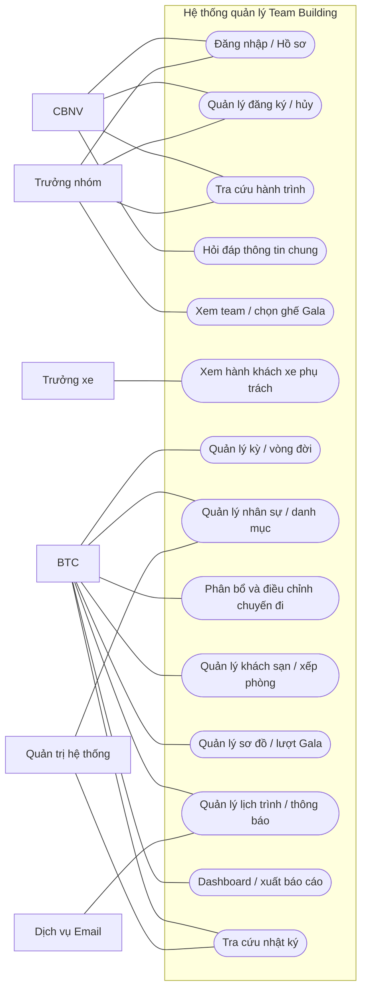
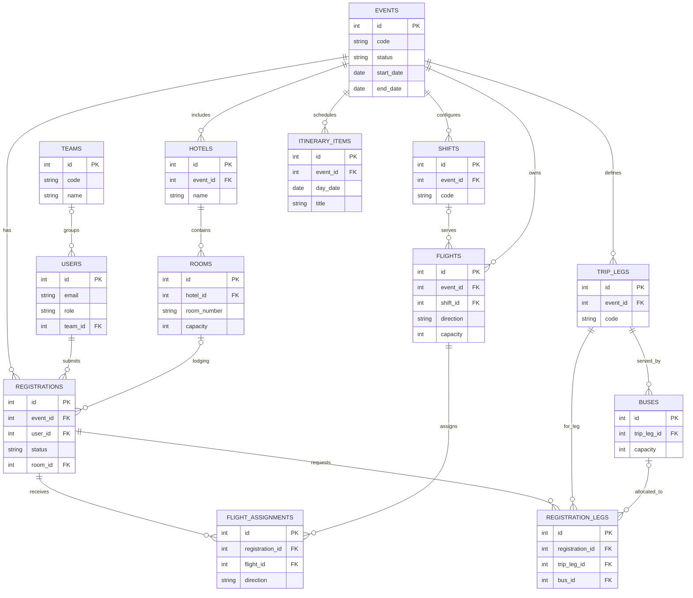
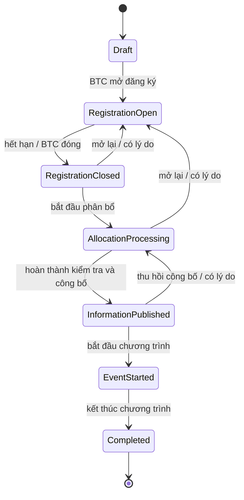

# ĐỀ CƯƠNG BÁO CÁO BÀI TẬP LỚN
> **Cập nhật:** Trong lượt viết báo cáo sau, đã trích xuất được văn bản hai PDF mẫu và bài giảng bằng PDF.js. Báo cáo chi tiết theo **7 chương** nằm tại `D:/QLDuLich/Báo cáo BTL/README.md`; sử dụng bộ tài liệu đó làm bản hiện hành. Các ghi chú chưa đọc được PDF và khung 5 chương ở đề cương bên dưới phản ánh phiên biên soạn trước, không còn là căn cứ bố cục cuối cùng.

## Phân tích và thiết kế hệ thống quản lý Team Building

> **Mục đích tài liệu:** Đề cương tổng quát để nhóm lập báo cáo môn Phân tích & Thiết kế hệ thống. Đây là hướng dẫn tổ chức nội dung, phạm vi sơ đồ, tập bảng dữ liệu đại diện và danh sách Use Case; không phải nội dung báo cáo cuối cùng để nộp nguyên văn.
>
> **Phạm vi tham khảo:** Project trong workspace là cổng quản lý một hay nhiều kỳ Team Building nội bộ (đăng ký, phân bổ đi lại/lưu trú, Gala, lịch trình), không phải hệ thống thương mại đặt tour. Có thể trình bày dưới góc nhìn hệ thống quản lý hoạt động du lịch/sự kiện; không nên tự thêm đặt vé công khai, thanh toán trực tuyến, hãng lữ hành hay quản lý khách hàng nếu không nằm trong phạm vi đã chọn.

---

## 1. Cách dùng đề cương và nguyên tắc học thuật

1. Dùng khung chương ở mục 2 làm mục lục dự kiến, rồi điều chỉnh theo yêu cầu giảng viên và nội dung thật trong các PDF mẫu.
2. Bám quy trình **khảo sát → xác định vấn đề/phạm vi → mô hình hóa yêu cầu → phân tích nghiệp vụ → mô hình hóa dữ liệu/hành vi → thiết kế kiến trúc, giao diện và dữ liệu → kiểm thử/đánh giá**. Tách rõ **hiện trạng (As-Is)**, **mục tiêu (To-Be)**, yêu cầu và quyết định thiết kế.
3. Chọn một cách ghi tên xuyên suốt: “kỳ Team Building” (thực thể `Event`), “đăng ký tham gia” (`Registration`), “Ban tổ chức” (BTC). Tránh khi thì gọi chuyến đi, tour, event nếu chúng không đồng nghĩa trong phạm vi bài.
4. Mọi sơ đồ phải có tên, số hiệu, chú giải, nguồn/tác nhân và được giải thích trong nội dung. Không đưa hình vào chỉ để đủ số lượng.
5. Phân biệt **mô hình khái niệm** (dễ hiểu, ưu tiên nghiệp vụ) với **thiết kế logic/hiện thực** (tên bảng/cột và ràng buộc thực tế). Chỉ gắn nhãn PK/FK, cardinality và constraint khi đã đối chiếu schema.
6. Các phần đánh dấu “nên chọn” là mức hợp lý cho báo cáo môn học; phần tùy chọn chỉ đưa vào nếu có đủ phân tích và có thời gian.

### Hạn chế đối chiếu tài liệu đính kèm

Trong workspace có `NoiDungBaoCaoBTL.pdf`, `Báocáo.pdf` và các slide `l02`–`l08`, `l10`. Tại phiên tạo đề cương, công cụ đọc file trả các PDF dưới dạng nhị phân và môi trường không có tiện ích trích văn bản PDF. Có DOCX nguồn `NoiDungBaoCaoBTL.docx`, nhưng không có công cụ đọc DOCX khả dụng. Vì vậy **chưa xác minh được nguyên văn mục lục/định dạng của hai báo cáo mẫu hay nội dung chi tiết từng slide**; đề cương sau đây không tuyên bố sao chép chính xác các tài liệu đó. Cần mở các tệp PDF trên máy, bổ sung yêu cầu riêng của giảng viên và kiểm tra lại thứ tự/format trước khi viết bản nộp.

---

## 2. Mục lục báo cáo đề xuất

### Phần đầu

- Trang bìa theo mẫu trường/khoa; tên học phần; đề tài; giảng viên; nhóm/sinh viên; lớp; địa điểm và năm học.
- Nhận xét của giảng viên (nếu mẫu yêu cầu).
- Lời cam đoan/lời cảm ơn (nếu cần).
- Tóm tắt đề tài (khoảng 150–300 từ): vấn đề, mục tiêu, phương pháp, giải pháp, kết quả chính.
- Mục lục; danh mục hình, bảng, từ viết tắt.

### Chương 1. Tổng quan đề tài và khảo sát hiện trạng

1. Bối cảnh nghiệp vụ tổ chức kỳ Team Building/du lịch nội bộ.
2. Vấn đề hiện trạng (As-Is): thông tin nằm ở nhiều biểu mẫu/bảng tính/email; dữ liệu thay đổi không đồng bộ; phân bổ thủ công tốn thời gian; người tham dự khó tra cứu hành trình; khó kiểm soát thay đổi và quyền xem dữ liệu.
3. Mục tiêu và lợi ích kỳ vọng của hệ thống.
4. Đối tượng liên quan và phạm vi tổ chức khảo sát.
5. Phạm vi hệ thống, giả định, giới hạn và nội dung **ngoài phạm vi**.
6. Phương pháp khảo sát thực tế: phỏng vấn, quan sát, xem biểu mẫu/tài liệu. Nêu rõ nguồn thật; không dựng kết quả khảo sát hay số liệu phỏng vấn.

**Kết quả chương:** mô tả được vấn đề, ai gặp vấn đề, tại sao cần hệ thống và đâu là ranh giới giải quyết.

### Chương 2. Mô hình hóa nghiệp vụ và yêu cầu

1. Từ điển thuật ngữ: kỳ sự kiện, đăng ký, ca, chặng, phân bổ, Team, người tham dự, BTC.
2. Quy trình nghiệp vụ tổng thể As-Is và To-Be.
3. Tác nhân (actor), vai trò và mục tiêu.
4. Phạm vi hệ thống và biểu đồ Use Case tổng quan.
5. Danh mục Use Case; đặc tả chi tiết một số luồng quan trọng.
6. Yêu cầu chức năng theo nhóm nghiệp vụ.
7. Yêu cầu phi chức năng và các quy tắc nghiệp vụ.
8. Ma trận truy vết yêu cầu → Use Case → mô hình/kiểm thử (khuyến nghị).

**Kết quả chương:** yêu cầu có thể kiểm tra được và có phạm vi rõ, không nhảy thẳng từ vấn đề sang thiết kế bảng.

### Chương 3. Phân tích và mô hình hóa hệ thống

1. Phân rã chức năng (Functional Decomposition) theo miền nghiệp vụ.
2. Mô hình tiến trình/DFD: Context Diagram (mức ngữ cảnh) và DFD mức 0; chỉ phân rã mức 1 cho một tiến trình phức tạp.
3. Mô hình dữ liệu khái niệm: ERD miền cốt lõi.
4. Mô hình cấu trúc: sơ đồ lớp phân tích (boundary/control/entity) hoặc mô hình lớp nghiệp vụ ở mức phù hợp học phần.
5. Mô hình hành vi: Activity Diagram cho quy trình đăng ký, phân bổ, Gala; State Machine cho vòng đời kỳ.
6. Sequence Diagram cho 1–2 tương tác có nhiều đối tượng/tầng.
7. Từ điển dữ liệu và mô tả các thực thể/trạng thái/ràng buộc.

**Ghi chú:** DFD và UML Use Case/Activity/Sequence không thay thế nhau; dùng đúng ký pháp và mục đích. Chỉ đưa DFD nếu học phần yêu cầu/phần kiến thức có dạy.

### Chương 4. Thiết kế hệ thống

1. Kiến trúc tổng thể và trách nhiệm các thành phần.
2. Sơ đồ triển khai/môi trường (nếu có trong yêu cầu môn).
3. Thiết kế dữ liệu logic và vật lý: lược đồ quan hệ, khóa, kiểu dữ liệu/ràng buộc quan trọng, chuẩn hóa ở mức giải thích được.
4. Thiết kế API/giao tiếp giữa giao diện và backend (mức tổng quan, không cần chép toàn bộ endpoint).
5. Thiết kế giao diện: luồng màn hình, wireframe/prototype những màn tiêu biểu.
6. Thiết kế phân quyền, bảo vệ dữ liệu cá nhân, ghi nhận lịch sử thay đổi.
7. Mô tả thuật toán phân bổ ở mức yêu cầu/thiết kế và giới hạn; phân biệt kết quả tối ưu với phương án heuristic.

### Chương 5. Cài đặt, kiểm thử và đánh giá

1. Môi trường/công nghệ triển khai (ghi đúng hiện thực, phiên bản nếu có căn cứ).
2. Những chức năng đã hoàn thành và minh họa màn hình.
3. Kế hoạch kiểm thử: chức năng, xác thực/phân quyền, ràng buộc sức chứa/không trùng, trạng thái kỳ, lỗi nhập liệu, kiểm thử giao diện.
4. Bảng test case: mã, tiền điều kiện, bước thực hiện, kết quả mong đợi, kết quả thực tế, Pass/Fail.
5. Kết quả demo, số liệu hiệu năng nếu thực sự đo được.
6. Đánh giá đạt/chưa đạt mục tiêu, hạn chế và hướng phát triển.

### Kết luận và phụ lục

- Kết luận theo mục tiêu; bài học/rủi ro còn lại.
- Tài liệu tham khảo theo một chuẩn trích dẫn thống nhất.
- Phụ lục: đặc tả Use Case bổ sung, danh mục trường dữ liệu, test case đầy đủ, ảnh giao diện, sơ đồ khổ lớn. Không đưa toàn bộ mã nguồn/schema 27 bảng vào thân báo cáo.

---

## 3. Phạm vi và tác nhân nghiệp vụ

### 3.1. Mục tiêu hệ thống To-Be

Một cổng tập trung cho mỗi kỳ Team Building: người lao động khai báo tham gia và nhu cầu; BTC quản lý dữ liệu tổ chức, bố trí phương tiện/chỗ ở, kiểm tra ràng buộc, công bố thông tin; người dùng tra cứu hành trình theo quyền được cấp; các thay đổi quan trọng có thể truy vết.

### 3.2. Tác nhân

| Tác nhân | Mục tiêu và phạm vi truy cập |
|---|---|
| **Khách (Visitor)** — tùy chọn theo phạm vi môn | Xem thông tin công khai; nếu hệ thống không cho truy cập công khai thì bỏ khỏi sơ đồ. |
| **CBNV / Người tham dự** (`employee`) | Đăng nhập, cập nhật hồ sơ của mình, đăng ký/sửa/hủy theo thời hạn, xem thông báo và hành trình của chính mình. |
| **Trưởng nhóm** (`team_leader`) | Các quyền CBNV và xem thông tin cần thiết của team mình; đại diện team chọn/xếp ghế Gala khi đúng lượt. Không mặc định được xem hồ sơ nhạy cảm của mọi thành viên. |
| **Trưởng xe** | Xem danh sách hành khách/điểm đón của xe được giao để điều phối. Trong code đây là chức năng/quyền gắn với user được chỉ định, không nhất thiết là một giá trị `role` độc lập. Có thể vẽ như actor phụ kế thừa CBNV. |
| **Ban tổ chức (BTC)** (`admin`) | Tạo/cấu hình kỳ, quản lý dữ liệu, theo dõi đăng ký, phân bổ và điều chỉnh, xếp phòng, công bố, gửi thông báo, xuất danh sách, xử lý ngoại lệ. |
| **Quản trị hệ thống** (`super_admin`) | Quản lý người dùng/vai trò, thiết lập quyền, hỗ trợ vận hành và xem audit log. Có thể kế thừa các quyền BTC trong sơ đồ tổng quát. |
| **Dịch vụ email** (hệ thống ngoài) | Nhận yêu cầu gửi email và trả trạng thái gửi/thất bại. |
| **Dịch vụ AI/tri thức** (hệ thống ngoài, nếu chatbot nằm trong phạm vi) | Hỗ trợ truy hồi tài liệu công khai và sinh câu trả lời; không được mặc định cấp quyền đọc hồ sơ cá nhân. |

**Nguyên tắc:** actor là vai trò bên ngoài ranh giới phần mềm tương tác với hệ thống, không phải tên bảng, màn hình hay chức năng. Các vai trò có thể tổng quát hóa trong UML để tránh nối cùng một Use Case cho quá nhiều actor.

### 3.3. Ranh giới phạm vi cần chốt

- Cốt lõi: quản lý kỳ, tài khoản/phân quyền, đăng ký, vận tải/chỗ ở, Gala, lịch trình, tra cứu, báo cáo và nhật ký.
- Tùy phạm vi: chatbot hỏi đáp, email tự động, import/export bảng tính, dashboard.
- Không tự nhận hệ thống thực hiện thanh toán, bán tour cho khách lẻ, đặt vé trực tiếp với hãng, đặt phòng trực tiếp với khách sạn hay tích hợp SSO thật, trừ khi có hiện thực và bằng chứng.

---

## 4. Danh mục Use Case đầy đủ để chọn vào báo cáo

Danh sách dưới đây bao phủ các miền liên quan và cả trường hợp mở rộng trong project. **Không cần chép 100+ Use Case vào sơ đồ.** Sơ đồ tổng quan gom theo gói chức năng; phần 4.1 là bộ UC cốt lõi đề nghị đưa vào nội dung chính; các UC chi tiết/ít quan trọng chuyển phụ lục hoặc nêu gộp. Các mã UC là mã đề xuất cho báo cáo, không phải ID chính thức của phần mềm.

### 4.1. Bộ Use Case cốt lõi nên đặc tả

| Mã | Use Case | Tác nhân chính | Tóm tắt kết quả |
|---|---|---|---|
| UC-01 | Đăng nhập | Mọi vai trò đã có tài khoản | Xác thực và vào phạm vi chức năng phù hợp với vai trò. |
| UC-02 | Quản lý phiên và đăng xuất | Mọi vai trò | Kết thúc/duy trì phiên an toàn. |
| UC-03 | Xem và cập nhật hồ sơ cá nhân | CBNV, Trưởng nhóm | Xem/chỉnh sửa thông tin được phép của chính mình. |
| UC-04 | Xem danh sách kỳ Team Building | Người dùng | Chọn kỳ được phép truy cập và xem trạng thái. |
| UC-05 | Cấu hình kỳ và vòng đời kỳ | BTC, Quản trị hệ thống | Tạo/cập nhật kỳ, mở/đóng đăng ký, bắt đầu phân bổ, công bố, kết thúc; kiểm tra chuyển trạng thái hợp lệ. |
| UC-06 | Khai báo/sửa đăng ký tham gia | CBNV, Trưởng nhóm | Chọn tham gia, khai nhu cầu/ca và thông tin cần thiết; lưu xác nhận quy định. |
| UC-07 | Gửi yêu cầu hủy / hủy đăng ký | CBNV, Trưởng nhóm | Tự hủy theo giai đoạn hoặc gửi yêu cầu BTC duyệt. |
| UC-08 | Theo dõi và xử lý đăng ký/hủy | BTC | Tra cứu người tham gia, duyệt/từ chối yêu cầu hủy, ghi nhận lý do và cập nhật chỗ đã phân bổ. |
| UC-09 | Quản lý người dùng, nhóm và danh mục tổ chức | BTC, Quản trị hệ thống | Quản lý CBNV, team, phòng ban, địa điểm và dữ liệu nền. |
| UC-10 | Quản lý chuyến bay và phân bổ hành khách | BTC | Khai báo chuyến/slot; chạy xem trước phân bổ; xác nhận kết quả; chỉnh tay ngoại lệ; tránh vượt sức chứa. |
| UC-11 | Quản lý xe và phân bổ theo chặng | BTC | Cấu hình chặng, điểm đón, xe/sức chứa, chạy phân bổ hoặc gán tay và xử lý chênh lệch giờ. |
| UC-12 | Quản lý khách sạn, phòng và xếp phòng | BTC | Khai báo khách sạn/phòng; phân phòng hoặc nhập danh sách; kiểm tra sức chứa/chính sách phòng. |
| UC-13 | Quản lý sơ đồ và chọn ghế Gala | BTC, Trưởng nhóm | BTC cấu hình sơ đồ/bốc thăm; trưởng nhóm chọn ghế theo lượt; giữ ghế tạm và xác nhận không trùng. |
| UC-14 | Quản lý lịch trình và thông báo | BTC | Cập nhật, công bố lịch trình/thông báo theo đối tượng. |
| UC-15 | Xem hành trình cá nhân | CBNV, Trưởng nhóm | Xem chuyến bay, xe, chỗ ở, Gala, lịch trình và thông báo của chính mình. |
| UC-16 | Gửi email và xem trạng thái gửi | Hệ thống email, BTC | Hệ thống gửi email nghiệp vụ; BTC kiểm tra trạng thái, lỗi, thử gửi lại khi được hỗ trợ. |
| UC-17 | Tra cứu dashboard, xuất báo cáo và danh sách | BTC, Quản trị hệ thống | Xem tiến độ, người cần xử lý; xuất dữ liệu được phép. |
| UC-18 | Tra cứu nhật ký thay đổi | BTC, Quản trị hệ thống | Xem ai thay đổi đối tượng nào, lúc nào, lý do và dữ liệu trước/sau theo quyền. |
| UC-19 | Hỏi đáp chatbot | CBNV, Trưởng nhóm; BTC (quản trị tri thức) | Hỏi tài liệu/lịch trình công khai; chatbot từ chối yêu cầu ngoài phạm vi và không tiết lộ dữ liệu cá nhân. |

### 4.2. Danh sách mở rộng theo miền

#### A. Truy cập và tài khoản

- AUTH-01 Đăng nhập bằng thông tin tài khoản.
- AUTH-02 Đăng xuất.
- AUTH-03 Làm mới phiên (token/session nếu mô tả thiết kế hiện thực).
- AUTH-04 Đổi mật khẩu; bắt đổi mật khẩu khởi tạo nếu có.
- AUTH-05 Xem hồ sơ cá nhân.
- AUTH-06 Cập nhật hồ sơ cá nhân.
- AUTH-07 Xem/đổi ảnh đại diện nếu thuộc phạm vi.
- AUTH-08 Quản lý người dùng: tạo, xem, sửa, khóa/mở, đặt lại mật khẩu.
- AUTH-09 Gán/đổi vai trò và quyền; chỉ Quản trị hệ thống.
- AUTH-10 Nhập danh sách nhân viên từ tệp và kiểm tra lỗi (nếu đưa import vào phạm vi).
- AUTH-11 Xem danh sách thành viên của team theo quyền.
- AUTH-12 Xem danh sách hành khách xe mình phụ trách (actor Trưởng xe).

#### B. Kỳ sự kiện và danh mục dùng chung

- EVT-01 Xem kỳ/sự kiện đang hoạt động.
- EVT-02 Tạo kỳ mới.
- EVT-03 Cập nhật thông tin, thời hạn, quy định và cấu hình kỳ.
- EVT-04 Mở/đóng đăng ký.
- EVT-05 Bắt đầu giai đoạn phân bổ.
- EVT-06 Công bố thông tin phân bổ.
- EVT-07 Bắt đầu/đánh dấu hoàn tất sự kiện.
- EVT-08 Mở lại giai đoạn đã công bố/đổi trạng thái có lý do (ngoại lệ có ghi audit).
- EVT-09 Quản lý team, phân công trưởng nhóm, phòng ban và địa điểm làm việc.
- EVT-10 Quản lý ca, chặng xe, điểm đón và tham số cấu hình.
- EVT-11 Xem dashboard và checklist mức sẵn sàng công bố.

#### C. Đăng ký và hủy

- REG-01 Xem quy định/thời hạn và điều kiện tham gia.
- REG-02 Tạo đăng ký hoặc lưu bản nháp (nếu quy trình cho phép).
- REG-03 Khai báo tham gia/không tham gia và lý do.
- REG-04 Khai nguyện vọng ca, điểm đi và nhu cầu xe theo chặng.
- REG-05 Xác nhận đồng ý phiên bản quy định.
- REG-06 Sửa đăng ký trước khi đóng đăng ký.
- REG-07 Xem lại đăng ký của mình.
- REG-08 Tự hủy trước hạn theo quy tắc.
- REG-09 Gửi yêu cầu hủy sau hạn/sau công bố.
- REG-10 BTC duyệt hoặc từ chối yêu cầu, ghi chú và quyết định phí phạt theo chính sách.
- REG-11 BTC hủy thay trong tình huống ngoại lệ có lý do.
- REG-12 Xem lịch sử yêu cầu/hủy.

#### D. Chuyến bay

- FLT-01 Thêm/xem/sửa/ngừng sử dụng chuyến bay.
- FLT-02 Xem sức chứa khả dụng theo chiều bay/ca.
- FLT-03 Nhập/import danh sách chuyến bay hoặc dữ liệu hành khách (nếu phạm vi có hỗ trợ).
- FLT-04 Tạo bản xem trước phân bổ tự động.
- FLT-05 Xác nhận ghi kết quả phân bổ.
- FLT-06 Gán/chuyển hành khách thủ công sang chuyến khác.
- FLT-07 Xem cảnh báo thiếu chỗ, vượt giới hạn, sai nguyện vọng ca hoặc tách team.
- FLT-08 Xóa/đặt lại phân bổ và chạy phân bổ lại theo quy tắc.
- FLT-09 Xem danh sách hành khách theo chuyến/chiều.
- FLT-10 Ghi nhận mã vé/số ghế nếu bài làm có quản lý các trường này.

#### E. Xe và di chuyển

- BUS-01 Khai báo/cập nhật các chặng di chuyển.
- BUS-02 Quản lý điểm đón/trả.
- BUS-03 Thêm/xem/sửa xe và sức chứa theo chặng.
- BUS-04 Gắn xe với chuyến bay liên quan khi cần điều phối sân bay.
- BUS-05 Chạy xem trước phân bổ xe.
- BUS-06 Xác nhận phân bổ xe.
- BUS-07 Gán/chuyển hành khách thủ công.
- BUS-08 Chỉ định/bỏ chỉ định trưởng xe.
- BUS-09 Xem danh sách hành khách, điểm đón và liên hệ theo phạm vi quyền.
- BUS-10 Kiểm tra sức chứa, xe thiếu người/không xếp được, lệch giờ chuyến bay.
- BUS-11 Xuất danh sách xe/hành khách.

#### F. Khách sạn và phòng

- HTL-01 Quản lý khách sạn.
- HTL-02 Quản lý loại/số phòng/sức chứa/chính sách phòng.
- HTL-03 Xem thống kê nhu cầu và giường/phòng còn thiếu.
- HTL-04 Import danh sách phân phòng hoặc xếp thủ công.
- HTL-05 Chạy xem trước/xác nhận phân phòng tự động (chỉ ghi vào báo cáo nếu chức năng này nằm trong bản hiện hành được kiểm chứng).
- HTL-06 Sửa/chuyển một người sang phòng khác.
- HTL-07 Kiểm tra sức chứa và chính sách giới tính/phòng.
- HTL-08 Xem danh sách người ở phòng theo quyền.
- HTL-09 Xuất danh sách phòng.

#### G. Gala Dinner

- GALA-01 Tạo/cập nhật sơ đồ Gala.
- GALA-02 Thêm/sửa/xóa bàn và ghế; đánh dấu ghế khóa/không sử dụng.
- GALA-03 Bốc thăm thứ tự chọn ghế của các team.
- GALA-04 Mở, chuyển, tạm dừng, tiếp tục, gia hạn lượt chọn ghế.
- GALA-05 Xem sơ đồ và trạng thái ghế.
- GALA-06 Team Leader giữ ghế còn trống trong thời gian giới hạn.
- GALA-07 Team Leader xác nhận ghế trong thời gian giữ.
- GALA-08 Gán thành viên vào ghế của team / xếp thành viên theo phân quyền.
- GALA-09 BTC gán, đổi, khóa hoặc mở ghế trong trường hợp quản trị.
- GALA-10 Mở lại lượt cho team thiếu chỗ và kết thúc lựa chọn.
- GALA-11 Ngăn giữ trùng/đặt vượt hạn mức và giải phóng ghế giữ hết hạn.
- GALA-12 Xem sơ đồ được cập nhật theo thời gian gần thực (nếu trình bày cơ chế này).

#### H. Nội dung, hành trình và liên lạc

- CNT-01 Quản lý mục lịch trình.
- CNT-02 Quản lý tài liệu quy định/FAQ công khai.
- CNT-03 Soạn, xem trước đối tượng nhận, sửa, đăng/gỡ thông báo.
- CNT-04 Gửi thông báo qua email cho nhóm được chọn.
- CNT-05 Xem/tra cứu hành trình cá nhân sau khi thông tin được công bố.
- CNT-06 Xem chuyến bay, các chặng xe, phòng, ghế Gala, lịch trình và chỉ dẫn liên quan.
- CNT-07 Xem/hủy/đăng ký lại email gửi lỗi nếu quyền cho phép.
- CNT-08 Thêm lịch vào ứng dụng lịch/bản đồ nếu phần mềm thực sự có các liên kết này.
- CNT-09 Hỏi chatbot về lịch trình, quy định, FAQ và thông tin chung.
- CNT-10 Quản lý hội thoại/lịch sử chatbot của chính tài khoản nếu phạm vi có hỗ trợ.
- CNT-11 Quản trị/nạp lại kho tri thức chatbot (BTC).
- CNT-12 Từ chối câu hỏi về dữ liệu cá nhân, người khác hoặc ngoài nguồn tri thức.

#### I. Báo cáo, quản trị và bảo vệ dữ liệu

- ADM-01 Xem dashboard đăng ký và tiến độ phân bổ.
- ADM-02 Tra cứu một người/đăng ký theo tiêu chí.
- ADM-03 Export danh sách theo quyền, ghi log tải dữ liệu nhạy cảm nếu có.
- ADM-04 Tra cứu nhật ký thay đổi theo thời gian/người/đối tượng.
- ADM-05 Xem lịch sử và quyết định trước/sau của điều chỉnh phân bổ.
- ADM-06 Kiểm tra trạng thái email và thử gửi lại thư lỗi.
- ADM-07 Theo dõi lỗi đăng nhập/khóa tài khoản (chỉ quản trị nếu nghiệp vụ thuộc phạm vi).
- ADM-08 Sao lưu/khôi phục dữ liệu (nếu đề tài bao gồm vận hành).
- ADM-09 Xem trạng thái sẵn sàng dịch vụ/phiên bản (mô tả hệ thống, không nhất thiết là nghiệp vụ người dùng).

---

## 5. Quan hệ giữa các Use Case và đặc tả đề xuất

### 5.1. Quan hệ UML hợp lý

- `Đăng nhập` có thể là **tiền điều kiện chung**, không nhất thiết vẽ `<<include>>` từ mọi UC đến Đăng nhập vì đăng nhập không phải hành vi bắt buộc diễn ra lại mỗi lần thao tác.
- `Phân bổ tự động` có bước **xem trước** và **xác nhận kết quả**; có thể tách thành Use Case riêng hoặc ghi như luồng trong một UC, tùy mức chi tiết sơ đồ.
- `Gửi thông báo email` là hành vi tùy chọn sau khi công bố/đổi kết quả: dùng `<<extend>>` nếu mô hình đúng ý nghĩa tùy chọn; không dùng quan hệ chỉ để giảm số đường nối.
- `Duyệt yêu cầu hủy` và `Từ chối yêu cầu hủy` có thể là các luồng thay thế trong một Use Case “Xử lý yêu cầu hủy”, hoặc hai UC con. Chọn một cách nhất quán.
- `Trưởng nhóm` và `Trưởng xe` có thể tổng quát hóa từ `CBNV` khi có quan hệ thừa kế vai trò; `Quản trị hệ thống` có thể tổng quát hóa từ `BTC` khi thật sự có quyền kế thừa.
- Không nối dịch vụ email/AI tới Use Case nội bộ nếu nó không tương tác trực tiếp trong ranh giới đã mô hình hóa.

### 5.2. Năm Use Case nên viết đặc tả đầy đủ

Đề xuất chọn UC-06 (đăng ký), UC-10 (phân bổ chuyến bay), UC-11 (phân xe), UC-13 (chọn ghế Gala), UC-15 (tra cứu hành trình). Có thể thay UC-11 bằng UC-05 nếu môn tập trung quản lý quy trình. Mỗi đặc tả tối thiểu có:

1. Mã/tên, mục tiêu, mức ưu tiên.
2. Tác nhân chính và tác nhân phụ.
3. Tiền điều kiện và bảo đảm sau khi hoàn tất.
4. Kích hoạt.
5. Luồng chính đánh số bước (actor ↔ hệ thống).
6. Luồng thay thế/ngoại lệ (thiếu dữ liệu, kỳ đóng, hết chỗ, hết thời gian, mất kết nối, không đủ quyền).
7. Quy tắc nghiệp vụ, dữ liệu vào/ra.
8. Hậu điều kiện và liên kết tới yêu cầu/test case.

### 5.3. Mẫu đặc tả tham khảo — UC-06 Đăng ký tham gia

| Thuộc tính | Nội dung mẫu để điều chỉnh theo nghiệp vụ đã xác minh |
|---|---|
| Mục tiêu | Người dùng khai báo có/không tham gia một kỳ và gửi nhu cầu cần thiết cho BTC. |
| Tác nhân chính | CBNV; Trưởng nhóm thao tác cho chính mình. |
| Tiền điều kiện | Người dùng đã đăng nhập; kỳ đang mở đăng ký; chưa có đăng ký trùng cho cùng người/kỳ. |
| Kích hoạt | Người dùng chọn chức năng Đăng ký. |
| Luồng chính | 1) Hệ thống hiển thị kỳ, quy định và hạn. 2) Người dùng khai thông tin/ca/điểm đi/nhu cầu theo chặng. 3) Hệ thống kiểm tra dữ liệu bắt buộc và logic. 4) Người dùng xác nhận phiên bản quy định. 5) Người dùng gửi đăng ký. 6) Hệ thống lưu và xác nhận kết quả; nếu thiết kế có email thì gửi xác nhận. |
| Luồng thay thế | Không tham gia: ghi nhận lựa chọn và lý do nếu quy định yêu cầu. Có bản đăng ký: cho phép sửa theo quy tắc, không sinh bản ghi trùng. Thiếu thông tin: chỉ rõ trường cần sửa. |
| Ngoại lệ | Kỳ đã đóng/chưa mở; phiên hết hạn; yêu cầu trùng đồng thời; dữ liệu không hợp lệ. Không ghi dữ liệu dở dang nếu giao dịch thất bại. |
| Hậu điều kiện | Đăng ký được lưu ở trạng thái hợp lệ; bằng chứng chấp thuận quy định được lưu cùng version/thời điểm; audit/email chỉ ghi nếu hành động thực tế yêu cầu. |

### 5.4. Mẫu đặc tả tham khảo — UC-10 Phân bổ chuyến bay

| Thuộc tính | Nội dung mẫu để điều chỉnh theo nghiệp vụ đã xác minh |
|---|---|
| Mục tiêu | BTC bố trí người tham gia lên chuyến theo chiều bay mà không vượt slot và cố gắng giữ team/nguyện vọng phù hợp. |
| Tác nhân chính | BTC. |
| Tiền điều kiện | BTC đã đăng nhập; kỳ phù hợp ở giai đoạn cho phép; có danh sách đăng ký, chuyến bay và sức chứa. |
| Luồng chính | 1) BTC chọn kỳ/chiều. 2) Hệ thống tổng hợp nhu cầu và slot. 3) BTC chạy thử (dry-run). 4) Hệ thống trả phương án, người chưa xếp và cảnh báo. 5) BTC xem/điều chỉnh. 6) BTC xác nhận ghi kết quả. 7) Hệ thống kiểm tra lại ràng buộc, lưu phân bổ/audit và thông báo nếu được chọn. |
| Luồng thay thế | Dữ liệu không đổi và BTC xác nhận được thì ghi; có thay đổi cạnh tranh thì yêu cầu tải lại/xem trước lại. Manual assignment được giữ theo chính sách hiện hành. |
| Ngoại lệ | Không có chuyến; tổng slot không đủ; vượt sức chứa; chiều bay không phù hợp; phân bổ thiếu dữ liệu. Hệ thống không âm thầm ghi kết quả vi phạm ràng buộc cứng. |
| Hậu điều kiện | Bản phân bổ được lưu hoặc hệ thống chỉ trả preview; có thể truy vết người thao tác, thời điểm, trước/sau và lý do. |

---

## 6. Yêu cầu chức năng, phi chức năng và quy tắc nghiệp vụ

### 6.1. Nhóm yêu cầu chức năng

1. **Tài khoản và quyền:** xác thực; quản lý hồ sơ; phân quyền theo vai trò và phạm vi dữ liệu.
2. **Kỳ sự kiện:** cấu hình nhiều kỳ; quản lý trạng thái/vòng đời; không cho ghi nghiệp vụ ngoài giai đoạn cho phép.
3. **Đăng ký:** ghi nhận tham gia, ca/nguyện vọng/nhu cầu; lưu bằng chứng đã chấp thuận chính sách; sửa/hủy theo giai đoạn.
4. **Vận hành chuyến đi:** cấu hình ca, chuyến bay, chặng, xe, khách sạn/phòng; phân bổ tự động hoặc thủ công; kiểm tra sức chứa và hiển thị cảnh báo.
5. **Gala:** cấu hình bàn/ghế; phân lượt; giữ và xác nhận ghế tránh hai team chọn trùng.
6. **Thông tin sau công bố:** hành trình cá nhân, lịch trình, thông báo và các thông tin được cấp quyền.
7. **Điều hành:** dashboard, tìm kiếm, import/export có kiểm soát, email, audit log.
8. **Hỏi đáp:** chatbot chỉ trả nội dung thuộc nguồn và phạm vi chính sách đã công bố.

### 6.2. Yêu cầu phi chức năng cần cân nhắc

- **Bảo mật/phân quyền:** xác thực, vai trò, kiểm tra quyền ở server, nguyên tắc least privilege, chống IDOR, bảo vệ dữ liệu cá nhân và audit các thao tác nhạy cảm.
- **Toàn vẹn:** FK/unique/check constraint phù hợp; giao dịch cho thao tác cạnh tranh; kiểm soát double-submit.
- **Tính đúng nghiệp vụ:** không vượt sức chứa; không xếp phòng sai chính sách; không cấp một ghế/chỗ cho nhiều người khi quy tắc cấm.
- **Hiệu năng:** đặt mục tiêu đo được và kiểm tra theo dữ liệu test; không ghi “nhanh”, “thời gian thực” nếu không đo hoặc chưa cài.
- **Dễ sử dụng:** giao diện tiếng Việt, thao tác di động cho CBNV và màn hình điều hành rõ cho BTC.
- **Khả dụng/khôi phục:** backup, migration, khôi phục và xử lý lỗi; chỉ mô tả năng lực đã xác nhận.
- **Khả năng mở rộng/bảo trì:** ca/chặng/sự kiện là dữ liệu cấu hình thay vì cột đánh số cứng; tách lớp nghiệp vụ, API và lưu trữ.
- **Riêng tư:** thu thập tối thiểu, hiển thị/export theo quyền, xác định thời hạn lưu và cách xóa/ẩn dữ liệu theo chính sách.

### 6.3. Quy tắc nghiệp vụ cốt lõi

- Một nhân viên có tối đa một đăng ký cho một kỳ.
- Mỗi đăng ký thuộc một kỳ và một người; dữ liệu các kỳ không được nhập nhằng.
- Chỉ cho tạo/sửa/hủy trong trạng thái/thời hạn được quy định; ngoại lệ phải có quy trình và lý do.
- Phân bổ tự động chỉ là phương án hỗ trợ quyết định; mọi ràng buộc cứng như slot/sức chứa phải được kiểm tra lại khi lưu.
- Tách ràng buộc **cứng** (bắt buộc đúng) và **mềm** (ưu tiên/xếp hạng) khi giải thích thuật toán.
- Một đăng ký chỉ có một chuyến theo mỗi chiều bay và một xe theo mỗi chặng nếu nghiệp vụ áp dụng.
- Phân phòng không vượt sức chứa và tuân thủ chính sách phòng đã chọn.
- Một ghế Gala không đồng thời bị chiếm/giữ bởi nhiều người; hết hạn giữ chỗ phải được giải phóng theo cơ chế rõ ràng.
- Thay đổi quan trọng ghi lại người thực hiện, thời điểm, đối tượng, dữ liệu trước/sau và lý do nếu nghiệp vụ yêu cầu.
- Người dùng phổ thông chỉ xem dữ liệu của mình; Trưởng nhóm chỉ xem dữ liệu team phục vụ nghiệp vụ; BTC/Quản trị được cấp quyền rộng hơn.
- Chatbot không được suy diễn quyền truy cập từ nội dung câu hỏi; không cho phép truy vấn tùy ý dữ liệu riêng tư.

---

## 7. Danh mục sơ đồ nên có

### 7.1. Nên vẽ (tập gọn, đủ giải thích thiết kế)

| Mã gợi ý | Sơ đồ | Mục đích/vị trí |
|---|---|---|
| Hình 1 | Sơ đồ bối cảnh (Context Diagram) | Chương 2/3: hệ thống và các actor/dịch vụ bên ngoài; một tiến trình duy nhất ở giữa. |
| Hình 2 | Use Case tổng quan | Chương 2: boundary, actor, nhóm chức năng chính; giữ ít kết nối để đọc được. |
| Hình 3 | DFD mức 0 **hoặc** sơ đồ phân rã chức năng | Chương phân tích; chọn theo kiến thức bắt buộc. Không nhồi cả DFD chi tiết lẫn Use Case chi tiết vào cùng hình. |
| Hình 4 | ERD khái niệm cốt lõi | Chương phân tích dữ liệu: khoảng 9–12 thực thể nghiệp vụ, đủ cho luồng đăng ký → phân bổ → hành trình. |
| Hình 5 | Activity Diagram quy trình đăng ký | Luồng người dùng, xác thực kỳ/thời hạn, hợp lệ/không hợp lệ. |
| Hình 6 | Activity Diagram phân bổ → kiểm tra → điều chỉnh → công bố | Thể hiện BTC, preview, rule cứng và bước phê duyệt. |
| Hình 7 | State Machine vòng đời kỳ | Thể hiện các trạng thái và guard/điều kiện chuyển trạng thái. |
| Hình 8 | Sequence Diagram chọn ghế Gala | Một ví dụ tương tác có tranh chấp/giữ tạm/xác nhận. |
| Hình 9 | Kiến trúc tổng thể/phân tầng | Chương thiết kế: Browser/UI, API, dịch vụ nghiệp vụ, DB và dịch vụ ngoài (nếu dùng). |
| Hình 10 | Wireframe 3–4 màn hình tiêu biểu | Đăng ký; màn BTC phân bổ; hành trình cá nhân; sơ đồ Gala. Chọn theo thời lượng. |

### 7.2. Tùy chọn

- Class Diagram chi tiết nếu kiến thức môn yêu cầu hướng đối tượng; giữ khoảng 8–12 lớp phân tích, tránh chép cả class ORM/code.
- DFD mức 1 cho một tiến trình lớn (ví dụ điều phối phân bổ), chỉ khi DFD là nội dung học tập/yêu cầu nộp.
- Deployment Diagram nếu đề tài yêu cầu thiết kế triển khai.
- Component Diagram nếu cần làm rõ phụ thuộc frontend/backend/dịch vụ.
- Sequence Diagram đăng ký hoặc đổi chuyến nếu còn chỗ; không cần một sequence cho từng UC.
- ERD chi tiết theo miền (đăng ký, chuyến đi, Gala) thay vì phóng to một ERD toàn bộ.

### 7.3. Không nên làm

- Không dùng một sơ đồ ERD có toàn bộ 27 bảng làm sơ đồ duy nhất trong thân báo cáo: quá dày và có các bảng hạ tầng ít giúp người đọc hiểu nghiệp vụ.
- Không đưa toàn bộ biểu đồ tuần tự/activity cho mọi Use Case.
- Không vẽ đồng thời DFD/UML như thể chúng là cùng một loại ký pháp.
- Không vẽ bảng `consents`, `room_assignments`, `bus_assignments`, `gala_seat_holds` theo schema cũ rồi mô tả đó là schema hiện tại. Một số chức năng/bản ghi đã được gộp hoặc biểu diễn khác.
- Không dùng Excalidraw để vẽ sơ đồ có liên kết/cardi­nality phức tạp nếu Mermaid/PlantUML phù hợp và cần kiểm tra logic; Excalidraw tốt cho sơ đồ trình bày/wireframe. Luôn kiểm tra lại ký pháp và đường nối sau khi tạo.

---

## 8. Phạm vi CSDL: bảng nên trình bày và cách giản lược

### 8.1. Quy mô và lưu ý về schema

ERD hiện hành `ERD.MD` mô tả **27 bảng** theo SQLAlchemy models; tài liệu `docs/03-data-model.md` có ghi chú lịch sử/khác revision và không nên lấy mọi DDL phía dưới đó làm schema đang chạy một cách máy móc. Để báo cáo, chỉ chọn các bảng quyết định luồng nghiệp vụ. Các tên dưới đây đối chiếu models hiện tại.

**Khác biệt quan trọng so với những phiên bản thiết kế cũ:**

- `registrations` mang dữ liệu phòng (`room_id`, trạng thái gán liên quan) thay vì cần mặc định có bảng `room_assignments`.
- `registration_legs` biểu diễn nhu cầu và phân xe theo từng chặng; không giả định một bảng xe gắn cứng 4 cột chặng.
- `gala_seats` giữ trạng thái free/held/taken và thông tin người/team giữ/xác nhận; không bắt buộc có bảng `gala_seat_holds` hay `gala_seat_assignments` riêng trong schema hiện hành.
- `contents` dùng `kind` để phân loại announcement/document; thông báo và tài liệu không nhất thiết là hai bảng.
- `chat_messages` lưu lịch sử; không nên vẽ `chat_sessions` trong ERD hiện hành nếu model không có bảng ấy.
- `flight_assignments` vẫn là bảng riêng, mô tả phân bổ chuyến bay theo đăng ký và chiều.

Luôn dùng models/ERD hiện hành trước khi ghi DDL. Đề cương không giả định schema archive/legacy là schema triển khai hiện tại.

### 8.2. Tập lõi (nên đưa vào ERD chính: khoảng 12 bảng)

| Bảng | Vai trò trong nghiệp vụ | Cột/quan hệ cần tập trung khi giải thích |
|---|---|---|
| `events` | Một kỳ Team Building, cấu hình và vòng đời | PK; mã/tên; ngày; `status`; cấu hình theo kỳ. Là cha của đăng ký/chuyến/chặng. |
| `users` | Tài khoản và hồ sơ nhân sự | PK; email; tên; role; liên kết team. Dữ liệu nhạy cảm không cần liệt kê hết trên ERD báo cáo. |
| `teams` | Đơn vị nhóm để xem team/phân bổ/Gala | PK; mã/tên; phòng ban; trưởng nhóm (lưu ý leader ID là tham chiếu mềm trong models hiện hành). |
| `registrations` | Trung tâm hồ sơ một người trong một kỳ | PK; FK `event_id`, `user_id`; trạng thái/tham gia; ca/đồng ý; **phòng**. Unique `(event_id,user_id)`. |
| `shifts` | Ca/nguyện vọng theo kỳ | PK; `event_id`; mã/tên. Số ca do dữ liệu quyết định, không phải cột cứng. |
| `flights` | Chuyến bay và sức chứa | PK; `event_id`; chiều; ca; mã chuyến; sức chứa/slot giữ lại. |
| `flight_assignments` | Kết quả ghép đăng ký với chuyến | FK `registration_id`, `flight_id`; chiều; kiểu phân bổ; người/thời điểm gán. Unique đăng ký + chiều. |
| `trip_legs` | Danh mục chặng di chuyển trong kỳ | PK; `event_id`; mã/tên; chiều/ngày; có liên kết sân bay hay không. |
| `buses` | Xe chạy theo chặng | PK; `event_id`; FK chặng; sức chứa; điểm/giờ; chuyến bay liên quan nếu có. |
| `registration_legs` | Nhu cầu và xe được gán cho một đăng ký trên một chặng | FK đăng ký/chặng; nhu cầu/điểm đón; `bus_id` có thể null khi chưa xếp. Đây là cấu trúc v2, thay cho bảng nhu cầu xe + phân xe tách ở mô hình trước. |
| `hotels` / `rooms` | Cơ sở lưu trú và phòng | `hotels` 1–N `rooms`; phòng có sức chứa/chính sách. Đăng ký tham chiếu phòng. Có thể tính đây là 2 bảng trong tập lõi. |
| `itinerary_items` | Các mục lịch trình theo kỳ/ngày | `event_id`; thời gian; địa điểm; audience; có thể gắn chặng. |

Tập trên có 14 bảng nếu tách cả `hotels`/`rooms`; để ERD chính gọn hơn, có thể bỏ `shifts` hoặc `itinerary_items` tùy trọng tâm và chuyển sang sơ đồ miền/phụ lục.

> **Hiệu chỉnh so với schema hiện hành:** không có `bus_assignments` riêng trong models đang dùng; dòng `registration_legs` vừa mô tả nhu cầu xe vừa chứa liên kết `bus_id`/trạng thái phân xe. Các tài liệu ADR/kiến trúc cũ có thể còn nêu bảng gán xe hoặc nhiều cấu trúc cũ. Khi mô tả hiện thực, lấy SQLAlchemy models/`ERD.MD` hiện tại làm chuẩn và nêu rõ khác biệt thiết kế lịch sử nếu cần.

### 8.3. Bảng mở rộng đưa vào sơ đồ miền khi cần

| Miền | Bảng hiện hành đáng cân nhắc | Lý do |
|---|---|---|
| Hủy đăng ký | `registration_cancellations` | Lịch sử xin hủy/duyệt/từ chối và quyết định BTC. |
| Gala | `gala_layouts`, `gala_tables`, `gala_seats`, `gala_draw_orders` | Sơ đồ bàn/ghế, trạng thái ghế, lượt và quota team. Đây là nhóm nên vẽ riêng nếu Gala là trọng tâm. |
| Điểm đón | `pickup_points` | Chỉ thêm khi mô tả rõ địa điểm/điều phối xe. |
| Nội dung | `contents` | Thông báo và tài liệu công khai dùng chung bảng có phân loại. |
| Thông báo email | `email_logs` | Bằng chứng gửi/trạng thái nếu email là nghiệp vụ báo cáo. |
| Lịch sử | `audit_logs` | Ai thay đổi, trước/sau, lý do. Nên hiện như bảng hệ thống quan trọng nhưng có thể để ERD phụ. |
| Chatbot | `chat_messages` | Lịch sử hỏi đáp; không cần vẽ vector store như bảng SQL. |
| Tổ chức | `departments`, `work_locations` | Bổ sung nếu bài mô tả sâu nhập liệu/danh mục tổ chức. |

### 8.4. Bảng có thể lược khỏi ERD nghiệp vụ chính

`refresh_tokens`, `login_attempts` (hạ tầng xác thực/chống dò tài khoản), `email_logs`, `audit_logs`, `chat_messages`, các danh mục ít liên quan. Không có nghĩa là bỏ chúng khỏi thiết kế thực tế; chỉ giữ ngoài **sơ đồ trọng tâm**, rồi nhắc trong phần bảo mật/kiến trúc/phụ lục khi phù hợp.

### 8.5. Mô tả quan hệ chủ yếu

- `Event` 1 — 0..N `Registration`.
- `User` 1 — 0..N `Registration`; mỗi `Registration` gắn 1 user và 1 event; unique theo cặp kỳ/người.
- `Team` 1 — 0..N `User` theo quan hệ thành viên; một user có thể chưa gắn team.
- `Event` 1 — 0..N `Flight`; `Shift` 1 — 0..N `Flight`.
- `Registration` 1 — 0..N `FlightAssignment`; mỗi chiều có tối đa một phân bổ theo unique constraint.
- `Event` 1 — 0..N `TripLeg`; mỗi `TripLeg` 1 — 0..N `Bus`.
- `Registration` 1 — 0..N `RegistrationLeg`, mỗi dòng gắn một chặng; dòng này có thể chưa có `Bus`.
- `Hotel` 1 — 0..N `Room`; một `Room` được nhiều `Registration` tham chiếu theo sức chứa/nghiệp vụ (không nhầm cardinality tối đa với ràng buộc vật lý FK).
- `Registration` có thể gắn một `Room`; mô hình nullable/unique phải xác nhận trước khi ghi chính xác bội số.
- `Event` 1 — 0..N `ItineraryItem`.
- Gala: `GalaLayout` 1 — N `GalaTable` 1 — N `GalaSeat`; team có thứ tự chọn qua `GalaDrawOrder`; ghế có thể trống, đang giữ hoặc đã xác nhận.
- Không diễn giải `leader_user_id`, `target_id`, `entity_id` là FK thật nếu models chỉ lưu tham chiếu mềm.

### 8.6. Danh sách trường đề xuất cho lược đồ quan hệ

Trong thân báo cáo, có thể trình bày bảng theo ký pháp `PK`, `FK`, `NN`, `UQ`; chỉ chọn trường phục vụ nghiệp vụ. Ví dụ:

```text
EVENT(event_id PK, event_code UQ, name, start_date, end_date, status)
USER(user_id PK, email UQ, full_name, role, team_id FK)
TEAM(team_id PK, team_code UQ, name, department_id FK)
REGISTRATION(registration_id PK, event_id FK, user_id FK,
             participation_status, shift_id FK, room_id FK, consent_version,
             UQ(event_id, user_id))
FLIGHT(flight_id PK, event_id FK, shift_id FK, code, direction, capacity,
       reserved_slots)
FLIGHT_ASSIGNMENT(assignment_id PK, registration_id FK, flight_id FK,
                  direction, assignment_mode, assigned_by FK, assigned_at,
                  UQ(registration_id, direction))
TRIP_LEG(trip_leg_id PK, event_id FK, code, name, direction)
BUS(bus_id PK, event_id FK, trip_leg_id FK, bus_code, capacity)
REGISTRATION_LEG(registration_leg_id PK, registration_id FK, trip_leg_id FK,
                 bus_id FK NULL, needs_bus, pickup_point_id FK NULL)
HOTEL(hotel_id PK, event_id FK, name)
ROOM(room_id PK, hotel_id FK, room_number, capacity, gender_policy)
ITINERARY_ITEM(item_id PK, event_id FK, day_date, title, start_time, location)
```

Đây là **ký pháp khái quát minh họa**, không phải DDL để triển khai. Trước khi nộp, cần đối chiếu tên trường, unique, nullability và cả ràng buộc FK với models hiện hành; không tự đổi tên vật lý rồi gọi đó là tên bảng thực tế.

### 8.7. Chuẩn hóa và toàn vẹn dữ liệu cần giải thích

- Giải thích ngắn vì sao dữ liệu người, kỳ, team, chuyến và phân bổ không nhét tất cả vào một bảng.
- Ca/chặng lưu thành danh mục có khóa tham chiếu, không tạo `bus_1`, `bus_2`, … cố định; giúp mở rộng số chặng và tránh cột lặp.
- Phân bổ chuyến bay tách ra vì một đăng ký có hai chiều đi/về và cần theo dõi ai/khi nào/cách nào gán.
- Mỗi phòng/bàn/ghế/chuyến xe có sức chứa/trạng thái; mô tả rõ constraint DB và validation service là hai lớp khác nhau.
- `events.settings` là dữ liệu cấu hình theo kỳ; không coi mọi cấu hình logic là bảng riêng.
- Nêu các constraint tiêu biểu: unique email; unique `(event_id,user_id)`; unique `(registration_id,direction)`; sức chứa dương; trạng thái thuộc tập cho phép; FK đúng chiều/chặng khi có ràng buộc ghép.
- Không khẳng định “đã chuẩn hóa đến 3NF” chỉ dựa tên bảng. Nêu từng phụ thuộc hàm/ví dụ nếu cần kết luận chuẩn hóa.

---

## 9. Sơ đồ Mermaid mẫu để tạo hình

> Các khối Mermaid là bản nháp logic có thể render để soát nội dung, không thay thế việc xác nhận cardinality cuối cùng hay làm sơ đồ đồ họa. Có thể mở khối trong VS Code Markdown Preview/diagrams.net, hoặc lấy ý tưởng để dựng thủ công trong Excalidraw. Excalidraw không được gọi ở lượt tạo file này.

### 9.1. Context Diagram (dạng luồng khái niệm)

```mermaid
flowchart LR
    CBNV[CBNV / Người tham dự]
    TL[Trưởng nhóm]
    BTC[Ban tổ chức]
    SA[Quản trị hệ thống]
    MAIL[Dịch vụ Email]
    AI[Dịch vụ tri thức / AI<br/>(nếu bật chatbot)]
    SYS((Hệ thống quản lý Team Building))

    CBNV -->|Hồ sơ, đăng ký, nhu cầu, yêu cầu hủy| SYS
    SYS -->|Trạng thái, thông báo, hành trình của mình| CBNV
    TL -->|Thông tin team, chọn ghế trong lượt| SYS
    SYS -->|Danh sách team/sơ đồ Gala theo quyền| TL
    BTC -->|Kỳ, danh mục, phân bổ, nội dung, quyết định| SYS
    SYS -->|Dashboard, cảnh báo, báo cáo, nhật ký| BTC
    SA -->|Tài khoản, vai trò, cấu hình hệ thống| SYS
    SYS -->|Trạng thái quản trị/audit| SA
    SYS -->|Yêu cầu gửi thư| MAIL
    MAIL -->|Kết quả gửi| SYS
    SYS -->|Câu hỏi + tri thức được phép| AI
    AI -->|Câu trả lời/trích dẫn| SYS
```

**Lưu ý vẽ:** Sơ đồ ngữ cảnh thuần thường biểu diễn hệ thống như một process đơn cùng actor/kho dữ liệu ngoài và luồng dữ liệu, không nhất thiết dùng `flowchart` ký pháp nghiệp vụ cuối cùng. Tùy kiến thức môn học, đổi sang ký hiệu DFD context phù hợp.

### 9.2. Use Case tổng quan (bản nháp)



**Cách hoàn thiện:** Đây là bản phác nhanh, chưa biểu diễn kế thừa/`include`/`extend` đúng chuẩn UML. Khi vẽ nộp, dùng ký pháp Use Case UML (actor hình người, UC hình oval, system boundary hình chữ nhật), gộp actor kế thừa nếu phù hợp, tránh đường nối chéo và tách biểu đồ quản trị lớn thành 2 biểu đồ nếu cần.

### 9.3. ERD lõi (cần xác minh lại ký pháp cardinality)



> Trong ERD này, `ROOMS` quan hệ với `REGISTRATIONS` qua `registrations.room_id`; Mermaid thể hiện một phòng có thể được nhiều đăng ký tham chiếu. `TEAMS`–`USERS` cũng cần chốt đầu 0..1/0..N theo câu nghiệp vụ: user chưa thuộc team được phép. Trước khi chốt hình, đối chiếu đầy đủ nullable/unique và cardinality thật trong models; các tên entity viết hoa ở sơ đồ chỉ để dễ đọc, không phải tên bảng vật lý.

### 9.4. State machine vòng đời kỳ



Trạng thái và đường chuyển cuối cùng phải khớp yêu cầu/hiện thực được chọn. Có thể bổ sung guard như `[dữ liệu phân bổ hợp lệ]`, `[có lý do ngoại lệ]`; không vẽ transition trái quy tắc chỉ để sơ đồ trông đủ nhánh.

---

## 10. Kiến trúc, giao diện và cách giải thích thuật toán

### 10.1. Kiến trúc tối giản phù hợp project

Mô tả các trách nhiệm, không chép cấu trúc thư mục làm sơ đồ kiến trúc:

- **Giao diện web:** nhập liệu, kiểm tra đầu vào cơ bản, hiển thị chức năng theo vai trò.
- **API/backend:** xác thực, kiểm tra quyền và trạng thái kỳ, kiểm tra dữ liệu, trả kết quả.
- **Dịch vụ nghiệp vụ:** đăng ký, phân bổ, hành trình, thông báo; là nơi đặt quy tắc nghiệp vụ.
- **Tầng dữ liệu:** cơ sở dữ liệu quan hệ, ràng buộc, giao dịch và nhật ký.
- **Dịch vụ ngoài tùy phạm vi:** email; vector store/mô hình AI cho chatbot. Thể hiện đường dữ liệu và ranh giới tin cậy.

Nếu trình bày giải pháp thực tế trong repo: frontend React/Vite, backend FastAPI/SQLAlchemy, SQLite và Docker Compose; chatbot hiện sử dụng tri thức công khai theo cấu hình tài liệu sản phẩm. Không trộn thông tin stack trong các tài liệu thiết kế cũ với implementation hiện hành nếu chúng khác nhau.

### 10.2. Giao diện tiêu biểu

Chọn màn hình có giá trị chứng minh yêu cầu:

1. Đăng ký nhiều bước: quy định, lựa chọn tham gia/ca, nhu cầu di chuyển, xác nhận.
2. Dashboard BTC: số đã đăng ký, tình trạng chuyến/xe/phòng, cảnh báo và việc cần làm.
3. Phân bổ chuyến bay/xe: sức chứa, phương án preview, cảnh báo, điều chỉnh.
4. Hành trình cá nhân: chỉ thông tin của người đăng nhập và chỉ nội dung được phép công bố.
5. Sơ đồ Gala: lượt, thời hạn giữ, trạng thái ghế, nhóm thao tác.

Chú thích mỗi wireframe: actor, mục tiêu, dữ liệu, trạng thái/loading/error, quy tắc quyền. Không cần nộp ảnh mọi trang CRUD.

### 10.3. Phân bổ tự động — trình bày đúng bản chất

- Nêu đầu vào: người đăng ký, team, ca/nguyện vọng; chuyến và sức chứa khả dụng; phân bổ thủ công cần giữ.
- Nêu ràng buộc cứng riêng (không vượt slot, đúng chiều, khóa ca nếu thật sự có).
- Nêu tiêu chí mềm riêng (giữ team gần nhau, thỏa nguyện vọng ca, giảm chỗ trống/chi phí nếu có căn cứ).
- Phân biệt `preview/dry-run` với `commit`.
- Nêu cảnh báo cho người không xếp được/nhóm bị tách và bước BTC điều chỉnh.
- Heuristic tham lam/greedy không bảo đảm tối ưu toàn cục. Không khẳng định “AI tự tối ưu hoàn hảo”.
- Chỉ nêu độ phức tạp/thời gian chạy nếu nhóm đo được bằng phương pháp, kích thước dữ liệu, môi trường và kết quả thực tế.

---

## 11. Kiểm thử, đánh giá và truy vết

### 11.1. Nhóm kịch bản tối thiểu

- Đăng nhập đúng/sai, khóa tài khoản, phân quyền truy cập endpoint/màn hình.
- Tài khoản không thể đọc/sửa hồ sơ hay hành trình của người khác.
- Đăng ký hợp lệ, thiếu dữ liệu, trùng đăng ký, kỳ chưa mở/đã đóng.
- Hủy trước/sau hạn; BTC duyệt/từ chối; ảnh hưởng các phân bổ hiện có.
- Chuyến đủ chỗ/thiếu chỗ; đúng/sai chiều; cùng team; giữ bản ghi thủ công; preview không làm thay đổi DB.
- Xe đúng chặng/sai chặng; đủ/vượt sức chứa; xung đột thời gian với chuyến bay.
- Phòng đủ/thiếu chỗ; đúng/sai chính sách phòng; dữ liệu giới tính thiếu.
- Hai người cùng lúc giữ ghế Gala; hết hạn giữ; xác nhận ghế; sai lượt/quota.
- Công bố và vòng đời trạng thái hợp lệ/không hợp lệ.
- Email thành công/thất bại/gửi lại; chatbot câu hỏi có nguồn, câu ngoài phạm vi, yêu cầu dữ liệu riêng tư.
- Import/export file hợp lệ và file lỗi; quyền tải dữ liệu nhạy cảm.

### 11.2. Ma trận truy vết mẫu

| Yêu cầu | Use Case | Bảng/dữ liệu liên quan | Sơ đồ | Test case |
|---|---|---|---|---|
| Chỉ sửa được đăng ký khi kỳ mở | UC-06, UC-07 | `events`, `registrations` | State + Activity đăng ký | TC-REG-01… |
| Không vượt slot chuyến bay | UC-10 | `flights`, `flight_assignments` | Activity/ERD | TC-FLT-01… |
| Mỗi người tối đa một chuyến mỗi chiều | UC-10 | `flight_assignments` | ERD | TC-FLT-… |
| Ghế Gala không bị xác nhận trùng | UC-13 | `gala_seats`, `gala_draw_orders` | Sequence Gala | TC-GALA-… |
| Chỉ xem hành trình của mình | UC-15 | `users`, `registrations`, phân bổ | Use Case + kiến trúc quyền | TC-SEC-… |

Thay các mã TC minh họa bằng mã test thật và ghi kết quả chạy. Một yêu cầu có thể nối tới nhiều Use Case/test; không tuyên bố test pass nếu chưa chạy.

---

## 12. Kế hoạch tạo sơ đồ bằng Excalidraw

`Excalidraw MCP` phù hợp để tạo **hình trình bày** theo các bước:

1. Bắt đầu từ danh sách sơ đồ ở mục 7; tạo các hình nhỏ/ít nút trước: context, state, activity.
2. Use Case: boundary chữ nhật lớn, actor ngoài rìa, UC oval bên trong, tránh đường cắt nhau; chia “người tham dự” và “quản trị” thành hai sơ đồ nếu đông.
3. ERD: chia theo miền, vẽ entity hình chữ nhật, PK/FK rõ, ghi cardinality; ưu tiên 12 bảng lõi thay vì 27 bảng.
4. Thêm nhãn hình, số hiệu, legend; xuất PNG/SVG chất lượng đủ đọc khi đưa vào Word/PDF.
5. Mở ảnh export để kiểm tra chữ, mũi tên, cardinality, không chồng lấp. Đối chiếu từng quan hệ với `ERD.MD`/SQLAlchemy models.
6. Lưu nguồn `.excalidraw` bên cạnh ảnh để chỉnh sửa được. Không chỉ giữ ảnh raster duy nhất.

Trong lần tạo đề cương này không tạo scene Excalidraw vì mục tiêu là cung cấp cấu trúc báo cáo và gợi ý sơ đồ; các khối Mermaid ở trên là nguồn nội dung ban đầu để nhóm/phiên làm việc sau chuyển thể.

---

## 13. Checklist trước khi nộp

- [ ] Đã mở và so sánh yêu cầu thật trong `NoiDungBaoCaoBTL.pdf`, `Báocáo.pdf` và các slide bài giảng; chỉnh mục lục đúng hướng dẫn giảng viên.
- [ ] Bìa, đánh số chương/hình/bảng, mục lục và trích dẫn theo mẫu khoa.
- [ ] Chương 1 nói rõ đối tượng khảo sát và nguồn; số liệu/vấn đề phỏng vấn là dữ liệu thật hoặc ghi rõ giả định.
- [ ] Có ranh giới hệ thống, actor và danh mục UC; không nhầm actor với role code hay bảng DB.
- [ ] Có đặc tả luồng chính, luồng thay thế, tiền/hậu điều kiện cho UC trọng tâm.
- [ ] Sơ đồ dùng đúng ký pháp của môn; có chú giải, số hiệu, giải thích dưới hình.
- [ ] ERD trong báo cáo chỉ là tập bảng chủ chốt; tên bảng/quan hệ/cardinality đúng schema hiện hành.
- [ ] Không nhầm schema v2 với DDL lịch sử hoặc ghi các bảng đã gộp như bảng đang chạy.
- [ ] Có mô tả quyền truy cập, dữ liệu cá nhân, ràng buộc toàn vẹn, audit và hành vi khi lỗi.
- [ ] Không tuyên bố tích hợp, hiệu năng, độ chính xác hoặc kết quả test không có bằng chứng.
- [ ] Wireframe/capture là từ chức năng đã chạy hoặc được ghi rõ là prototype.
- [ ] Kết luận trả lời trực tiếp mục tiêu ban đầu; hạn chế/hướng phát triển phân biệt với tính năng hiện có.

---

## 14. Tài liệu dự án dùng để đối chiếu

Các file dưới đây là nguồn kỹ thuật nội bộ để rà lại project trước khi hoàn thiện báo cáo; **không thay cho sách/slide và tài liệu tham khảo học thuật của môn**:

- `README.md` — mục tiêu sản phẩm, module, stack và dữ liệu demo.
- `docs/01-requirements.md` — phạm vi, vai trò, vòng đời kỳ, yêu cầu phi chức năng.
- `docs/product-overview.md` — đối tượng sử dụng và tính năng.
- `docs/02-architecture.md` — kiến trúc và luồng nghiệp vụ.
- `ERD.MD` — ERD từ SQLAlchemy models hiện hành.
- `docs/03-data-model.md` — ghi chú schema/revision; phải đọc kỹ cảnh báo schema và đối chiếu models.
- `docs/05-allocation-algorithm.md` — bài toán và ràng buộc phân bổ.
- `docs/06-rag-chatbot.md`, `docs/09-security.md` — phạm vi chatbot/bảo mật/quyền riêng tư.
- `docs/12-test-cases.md` — test case tham khảo theo vai trò; xác nhận trạng thái thực tế trước khi trích kết quả.
