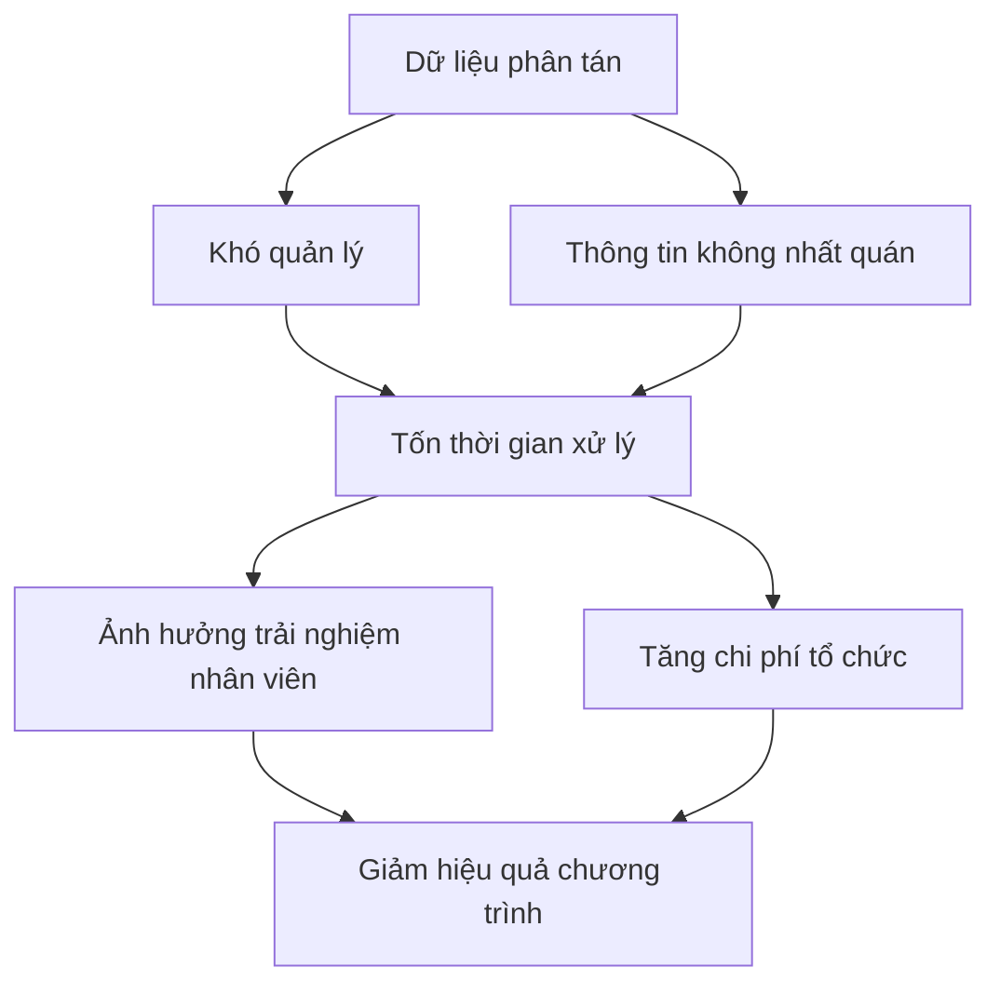

# 1. LÝ DO CHỌN ĐỀ TÀI

## 1.1. Bối cảnh thực tế

Trong môi trường doanh nghiệp hiện đại, các hoạt động du lịch và team building đóng vai trò quan trọng trong việc:
- Tăng cường gắn kết giữa các thành viên trong tổ chức
- Tạo môi trường làm việc tích cực và năng động
- Hỗ trợ giao lưu giữa các phòng ban, đơn vị
- Giảm căng thẳng và nâng cao hiệu suất làm việc

Tuy nhiên, việc tổ chức các chuyến đi tập thể cho hàng trăm đến hàng nghìn nhân viên đặt ra nhiều thách thức về mặt quản lý và điều phối.

## 1.2. Vấn đề cần giải quyết

### Hiện trạng

Hiện nay, nhiều tổ chức vẫn sử dụng các phương pháp thủ công để quản lý:

| Công cụ hiện tại | Vấn đề gặp phải |
|---|---|
| **Bảng tính Excel** | - Dữ liệu phân tán trên nhiều file - Khó đồng bộ khi có thay đổi - Dễ xảy ra lỗi nhập liệu |
| **Email và tin nhắn** | - Thông tin rải rác nhiều kênh - Khó theo dõi và truy vết - Mất thời gian trao đổi qua lại |
| **Danh sách giấy** | - Không cập nhật theo thời gian thực - Khó kiểm soát phiên bản mới nhất - Dễ thất lạc và nhầm lẫn |

### Hậu quả

*Hình 1.1: Chuỗi vấn đề từ quản lý thủ công*

## 1.3. Lý do chọn đề tài

### 1.3.1. Tính cấp thiết

- **Nhu cầu thực tế**: Các tổ chức thường xuyên tổ chức 2-4 chuyến du lịch/năm với quy mô lớn
- **Tiết kiệm nguồn lực**: Giảm thời gian và nhân lực cho công tác tổ chức
- **Nâng cao chất lượng**: Đảm bảo thông tin chính xác và kịp thời cho người tham gia

### 1.3.2. Tính khả thi

- **Phạm vi rõ ràng**: Tập trung vào quy trình nội bộ, không phức tạp như hệ thống thương mại
- **Công nghệ phù hợp**: Sử dụng công nghệ web phổ biến, dễ triển khai
- **Quy mô vừa phải**: Phù hợp với năng lực và thời gian thực hiện đồ án

### 1.3.3. Giá trị học tập

Đề tài giúp áp dụng kiến thức môn Nhập môn Công nghệ phần mềm:

- ✅ Phân tích nghiệp vụ thực tế
- ✅ Thu thập và phân tích yêu cầu
- ✅ Xác định người dùng và vai trò
- ✅ Mô hình hóa ca sử dụng
- ✅ Thiết kế giải pháp phù hợp

## 1.4. Phạm vi tập trung

Để phù hợp với báo cáo ngắn gọn, đề tài tập trung vào:

**✓ Trong phạm vi:**
- Quản lý thông tin kỳ du lịch
- Đăng ký tham gia của nhân viên
- Phân bổ chuyến bay, xe và phòng
- Tra cứu thông tin hành trình
- Xử lý yêu cầu hủy tham gia

**✗ Ngoài phạm vi:**
- Đặt vé trực tiếp với hãng hàng không
- Thanh toán trực tuyến
- Quản lý kế toán chi phí
- Chatbot AI và các tính năng mở rộng

---

**Kết luận chương 1:**

Đề tài được chọn xuất phát từ nhu cầu thực tế của các tổ chức, có tính khả thi cao và mang lại giá trị học tập tốt cho môn Nhập môn Công nghệ phần mềm. Hệ thống sẽ giúp chuẩn hóa quy trình tổ chức, giảm thiểu sai sót và nâng cao trải nghiệm cho người tham gia.