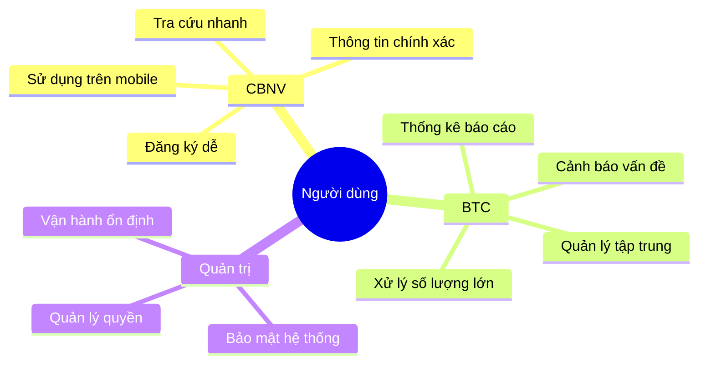

# 2. NGƯỜI DÙNG HỆ THỐNG

## 2.1. Phân loại người dùng

Hệ thống phục vụ ba nhóm người dùng chính trong tổ chức:

### 2.1.1. Cán bộ nhân viên (CBNV)

**Đặc điểm:**
- Là đối tượng tham gia chuyến đi
- Số lượng: có thể lên đến hàng trăm đến một nghìn người mỗi kỳ
- Thiết bị sử dụng: chủ yếu là điện thoại di động

**Nhu cầu:**
- Đăng ký tham gia nhanh chóng và dễ dàng
- Khai báo nhu cầu cá nhân (ca bay, xe đưa đón, điểm đón)
- Tra cứu thông tin chuyến đi của mình
- Xem hành trình chi tiết sau khi được phê duyệt
- Yêu cầu hủy khi có việc đột xuất

**Mong muốn:**
- Giao diện thân thiện, dễ sử dụng trên di động
- Thông tin rõ ràng, chính xác
- Nhận thông báo kịp thời về các thay đổi

### 2.1.2. Ban tổ chức (BTC)

**Đặc điểm:**
- Là người điều phối và quản lý toàn bộ chuyến đi
- Số lượng: khoảng 5-10 người
- Thiết bị sử dụng: máy tính để xử lý công việc phức tạp

**Nhu cầu:**
- Tạo và cấu hình kỳ du lịch mới
- Quản lý danh sách đăng ký
- Phân bổ tài nguyên (chuyến bay, xe, phòng khách sạn)
- Xử lý các yêu cầu đặc biệt và hủy tham gia
- Theo dõi tiến độ và thống kê
- Công bố thông tin chính thức

**Mong muốn:**
- Công cụ mạnh mẽ để xử lý số lượng lớn
- Khả năng xem tổng quan và chi tiết
- Cảnh báo khi có vấn đề cần xử lý
- Lưu vết mọi thay đổi quan trọng

### 2.1.3. Quản trị hệ thống

**Đặc điểm:**
- Quản lý vận hành kỹ thuật của hệ thống
- Số lượng: 1-2 người

**Nhu cầu:**
- Quản lý tài khoản và phân quyền
- Theo dõi hoạt động hệ thống
- Xử lý sự cố kỹ thuật
- Sao lưu và phục hồi dữ liệu

## 2.2. Ma trận vai trò và quyền

| Chức năng | CBNV | BTC | Quản trị |
|---|:---:|:---:|:---:|
| Xem thông tin kỳ | ✓ | ✓ | ✓ |
| Đăng ký tham gia | ✓ | ✓ | - |
| Sửa đăng ký của mình | ✓ | ✓ | - |
| Yêu cầu hủy | ✓ | ✓ | - |
| Xem hành trình của mình | ✓ | ✓ | - |
| Tạo/cấu hình kỳ | - | ✓ | ✓ |
| Xem tất cả đăng ký | - | ✓ | ✓ |
| Phân bổ chuyến bay/xe/phòng | - | ✓ | ✓ |
| Duyệt yêu cầu hủy | - | ✓ | ✓ |
| Công bố thông tin | - | ✓ | ✓ |
| Quản lý tài khoản | - | - | ✓ |

## 2.3. Kịch bản sử dụng điển hình

### Kịch bản 1: Nhân viên đăng ký tham gia

**Bối cảnh:** Anh Minh nhận được thông báo về chuyến du lịch Phú Quốc tháng 12

**Các bước:**
1. Anh Minh truy cập hệ thống trên điện thoại
2. Xem thông tin chi tiết về chuyến đi
3. Chọn "Đăng ký tham gia"
4. Khai báo: muốn bay ca sáng, cần xe đón tại điểm A
5. Đọc và đồng ý với quy định
6. Gửi đăng ký
7. Nhận xác nhận đã gửi thành công

### Kịch bản 2: BTC xử lý phân bổ

**Bối cảnh:** Chị Lan (BTC) cần phân chuyến bay cho 200 người đã đăng ký

**Các bước:**
1. Chị Lan đăng nhập hệ thống trên máy tính
2. Mở chức năng "Phân chuyến bay"
3. Xem tổng nhu cầu: 120 người muốn bay sáng, 80 người bay chiều
4. Nhập thông tin các chuyến bay có sẵn
5. Chạy phân bổ tự động
6. Xem kết quả và các cảnh báo (nếu có)
7. Điều chỉnh thủ công một số trường hợp đặc biệt
8. Xác nhận và lưu kết quả

### Kịch bản 3: Nhân viên xem hành trình

**Bối cảnh:** Trước 3 ngày khởi hành, anh Minh muốn xem chi tiết hành trình

**Các bước:**
1. Anh Minh mở hệ thống
2. Chọn "Hành trình của tôi"
3. Xem thông tin:
   - Chuyến bay: VN123, 07:00 sáng ngày 15/12
   - Xe đón: Xe số 3, tập trung 5:30 tại điểm A
   - Khách sạn: Phòng 302, khách sạn Sunrise
   - Chuyến bay về: VN456, 18:00 ngày 18/12
4. Lưu ảnh chụp màn hình để tiện tra cứu

## 2.4. Phân tích nhu cầu người dùng

*Hình 2.1: Sơ đồ tư duy về nhu cầu người dùng*