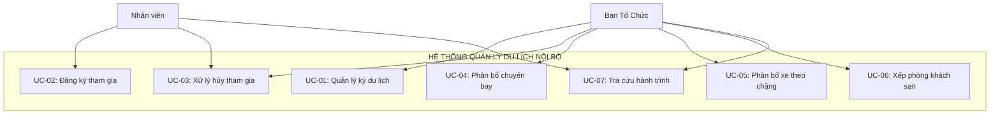

# 3. CÁC CA SỬ DỤNG (USE CASE)

## 3.1. Sơ đồ Use Case tổng quan

## 3.2. Mô tả chi tiết các Use Case chính

### UC-01: Quản lý kỳ du lịch

**Mô tả:** Ban tổ chức tạo và quản lý thông tin các kỳ du lịch

**Actor:** Ban Tổ Chức

**Luồng chính:**
1. BTC tạo kỳ mới với thông tin: tên kỳ, điểm đến, ngày đi/về, thời hạn đăng ký
2. Hệ thống kiểm tra tính hợp lệ (ngày kết thúc phải sau ngày bắt đầu)
3. BTC cấu hình ca bay, chặng xe, quy định
4. BTC mở đăng ký khi sẵn sàng
5. Sau khi đủ đăng ký, BTC đóng đăng ký và chuyển sang phân bổ
6. BTC công bố thông tin sau khi kiểm tra

**Kết quả:** Kỳ du lịch được quản lý theo từng giai đoạn rõ ràng

---

### UC-02: Đăng ký tham gia

**Mô tả:** Nhân viên đăng ký tham gia kỳ du lịch và khai báo nhu cầu

**Actor:** Nhân viên

**Tiền điều kiện:** Kỳ đang mở đăng ký

**Luồng chính:**
1. Nhân viên xem thông tin kỳ và quy định
2. Nhân viên chọn tham gia hoặc không tham gia
3. Nếu tham gia, nhân viên khai báo:
   - Ca bay mong muốn
   - Nhu cầu xe từng chặng (thành phố → sân bay, sân bay → khách sạn,...)
   - Điểm đón mong muốn
4. Nhân viên xác nhận đồng ý quy định
5. Hệ thống kiểm tra và lưu đăng ký

**Luồng thay thế:**
- Nếu nhân viên đã đăng ký, hệ thống cho phép sửa trong thời hạn
- Nếu không tham gia, ghi lý do (nếu cần)

**Kết quả:** Đăng ký được lưu với đầy đủ thông tin nhu cầu

---

### UC-03: Xử lý hủy tham gia

**Mô tả:** Nhân viên xin hủy và BTC xét duyệt

**Actor:** Nhân viên, Ban Tổ Chức

**Tiền điều kiện:** Nhân viên đã đăng ký tham gia

**Luồng chính:**
1. Nhân viên gửi yêu cầu hủy kèm lý do
2. Hệ thống tạo yêu cầu chờ duyệt, giữ nguyên chỗ đã phân
3. BTC xem danh sách yêu cầu hủy
4. BTC xem thông tin: lý do, thời điểm gửi, tài nguyên đang giữ
5. BTC quyết định:
   - **Chấp thuận:** Hủy đăng ký, giải phóng chuyến bay/xe/phòng
   - **Từ chối:** Giữ nguyên đăng ký và chỗ
6. Hệ thống lưu quyết định và lịch sử

**Kết quả:** Yêu cầu hủy được xử lý có kiểm soát, tài nguyên được giải phóng đúng

---

### UC-04: Phân bổ chuyến bay

**Mô tả:** BTC phân chuyến bay cho nhân viên theo chiều đi/về

**Actor:** Ban Tổ Chức

**Tiền điều kiện:** Đã đóng đăng ký, có thông tin chuyến bay và sức chứa

**Luồng chính:**
1. BTC nhập thông tin chuyến bay: mã chuyến, ca, giờ bay, sức chứa
2. BTC chọn chiều (đi hoặc về)
3. Hệ thống tính nhu cầu và hiển thị số người chưa xếp
4. BTC chọn "Xem trước phân bổ"
5. Hệ thống chạy thuật toán:
   - Ưu tiên giữ team cùng chuyến
   - Cố gắng đáp ứng ca mong muốn
   - Không vượt sức chứa
6. Hệ thống hiển thị preview và cảnh báo (nếu có)
7. BTC điều chỉnh thủ công nếu cần
8. BTC xác nhận, hệ thống lưu kết quả

**Luồng thay thế:**
- Nếu thiếu chỗ, BTC bổ sung chuyến bay
- Preview không làm thay đổi dữ liệu thực tế

**Kết quả:** Mỗi người có tối đa một chuyến mỗi chiều, không vượt sức chứa

---

### UC-05: Phân bổ xe theo chặng

**Mô tả:** BTC phân xe đưa đón cho từng chặng di chuyển

**Actor:** Ban Tổ Chức

**Tiền điều kiện:** Có nhu cầu xe và thông tin xe

**Luồng chính:**
1. BTC chọn chặng (VD: thành phố → sân bay)
2. BTC nhập thông tin xe: mã xe, sức chứa, giờ khởi hành, điểm đón
3. Hệ thống lọc người cần xe ở chặng này
4. BTC preview phân xe
5. Hệ thống gom người theo:
   - Điểm đón
   - Chuyến bay liên quan (nếu là chặng sân bay)
   - Giữ team nếu có thể
6. BTC xác nhận lưu

**Lưu ý:**
- Chỉ xếp người có nhu cầu xe
- Giờ xe phải phù hợp với giờ bay
- Không vượt sức chứa

**Kết quả:** Mỗi người có xe phù hợp cho từng chặng cần di chuyển

---

### UC-06: Xếp phòng khách sạn

**Mô tả:** BTC phân phòng lưu trú cho nhân viên

**Actor:** Ban Tổ Chức

**Tiền điều kiện:** Có thông tin khách sạn và phòng

**Luồng chính:**
1. BTC nhập khách sạn: tên, địa chỉ, thời gian check-in/out
2. BTC nhập phòng: số phòng, sức chứa, chính sách giới tính
3. Hệ thống hiển thị nhu cầu và số giường còn trống
4. BTC preview xếp phòng tự động hoặc xếp thủ công
5. Hệ thống kiểm tra:
   - Không vượt sức chứa
   - Tuân thủ chính sách giới tính
6. BTC xác nhận lưu

**Chính sách giới tính:**
- **male:** chỉ nam
- **female:** chỉ nữ  
- **any:** linh hoạt (nhưng không trộn giới)

**Kết quả:** Mỗi người có một phòng phù hợp, không vi phạm chính sách

---

### UC-07: Tra cứu hành trình

**Mô tả:** Nhân viên xem hành trình cá nhân sau khi BTC công bố

**Actor:** Nhân viên, Ban Tổ Chức

**Tiền điều kiện:** Hệ thống đã được công bố

**Luồng chính:**
1. Nhân viên đăng nhập và chọn "Hành trình của tôi"
2. Hệ thống kiểm tra trạng thái kỳ:
   - **Chưa công bố:** Hiển thị "Đang chờ BTC"
   - **Đã công bố:** Hiển thị đầy đủ thông tin
3. Hệ thống tổng hợp:
   - Chuyến bay đi/về (mã, giờ, sân bay)
   - Xe theo chặng (điểm đón, giờ tập trung)
   - Phòng khách sạn (số phòng, khách sạn)
   - Lịch trình chương trình
4. Nhân viên xem và chuẩn bị

**Bảo mật:**
- Chỉ xem được hành trình của chính mình
- BTC có thể tra cứu hành trình của mọi người

**Kết quả:** Nhân viên nắm rõ thông tin chuyến đi trên một màn hình duy nhất

---

## 3.3. Ma trận Use Case và Actor

| Use Case | Nhân viên | BTC | Mô tả ngắn |
|----------|-----------|-----|------------|
| UC-01 | | ● | Tạo và quản lý kỳ |
| UC-02 | ● | | Đăng ký và khai nhu cầu |
| UC-03 | ● | ● | Xin hủy và duyệt hủy |
| UC-04 | | ● | Phân chuyến bay |
| UC-05 | | ● | Phân xe theo chặng |
| UC-06 | | ● | Xếp phòng |
| UC-07 | ● | ● | Xem hành trình |

## 3.4. Độ ưu tiên Use Case

| Mức độ | Use Case | Lý do |
|--------|----------|-------|
| **Cao** | UC-01, UC-02, UC-04 | Không có thì không thể tổ chức chuyến đi |
| **Trung bình** | UC-05, UC-06, UC-07 | Quan trọng nhưng có thể xử lý thủ công tạm thời |
| **Thấp** | UC-03 | Hỗ trợ thêm, không phải mọi kỳ đều có người hủy |