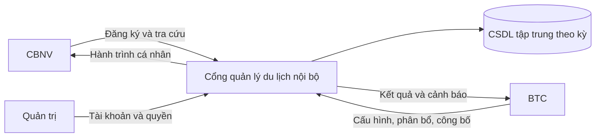

# CHƯƠNG 1. ĐẶT VẤN ĐỀ

## 1.1. Giới thiệu đề tài và ngữ cảnh

Du lịch và Team Building là hoạt động tập thể nhằm tăng cường gắn kết giữa nhân viên, hỗ trợ giao lưu giữa các đơn vị và tạo môi trường làm việc tích cực. Bên cạnh nội dung chương trình, công tác tổ chức phải xử lý nhiều thông tin hậu cần: ai tham gia, thời gian di chuyển, nguyện vọng ca bay, nhu cầu xe đưa đón, khách sạn và phòng ở. Các thông tin này có mối liên hệ chặt chẽ. Khi chuyến bay thay đổi, xe đưa đón và hành trình của nhân viên có thể phải thay đổi theo.

Đề tài “Hệ thống quản lý du lịch và Team Building nội bộ” tập trung xây dựng một cổng thông tin dùng chung cho nhân viên và BTC. Mỗi chương trình được quản lý như một kỳ độc lập, có thời gian, điểm đến, quy định và trạng thái xử lý riêng. Nhân viên khai báo nhu cầu một lần và tra cứu kết quả trên cùng hệ thống. BTC có công cụ tập trung để theo dõi đăng ký, bố trí phương tiện, xếp phòng, điều chỉnh ngoại lệ và công bố hành trình.

Project tham khảo đang sử dụng mô hình Team Building Portal. Trong báo cáo, từ “du lịch” được dùng để chỉ chuyến đi nội bộ của tổ chức; không bao hàm mua bán tour, thanh toán trực tuyến hay giao dịch đặt vé với hãng hàng không.

## 1.2. Hiện trạng và vấn đề cần giải quyết

Theo tài liệu nhu cầu của project, việc tổ chức bằng bảng tính, email và nhóm trao đổi làm dữ liệu phân tán giữa các đầu mối. Một danh sách đăng ký có thể được dùng để tạo danh sách chuyến bay, xe và phòng; sau đó từng bản được chỉnh sửa riêng. Nếu không có cơ chế đồng bộ, cùng một người có thể xuất hiện với các thông tin khác nhau trên các danh sách.

Các khó khăn điển hình gồm:

| Vấn đề | Nguyên nhân | Hậu quả nghiệp vụ |
|---|---|---|
| Khó xác định dữ liệu mới nhất | Nhiều bản file và nhiều kênh trao đổi | BTC có thể dùng nhầm danh sách cũ khi xuất báo cáo. |
| Phân bổ thủ công phức tạp | Phải cân đối sức chứa, ca, nhóm và nhu cầu | Dễ vượt chỗ, bỏ sót người hoặc tách nhóm không cần thiết. |
| Thay đổi không đồng bộ | Không có nguồn dữ liệu tập trung | Xe không còn phù hợp với giờ bay; nhân viên nhận thông tin khác nhau. |
| Khó kiểm soát sửa/hủy | Thời hạn được kiểm tra thủ công | Có yêu cầu muộn chưa được xử lý hoặc không có bằng chứng quyết định. |
| Tra cứu hành trình bất tiện | Thông tin nằm ở nhiều file/tin nhắn | Người tham gia phải hỏi BTC nhiều lần. |
| Thiếu lịch sử điều chỉnh | Chỉ lưu kết quả cuối cùng | Khó giải thích ai thay đổi, khi nào và vì sao. |

Đây là mô hình hiện trạng được tổng hợp từ tài liệu sản phẩm, chưa phải kết quả khảo sát phỏng vấn có mẫu thống kê. Vì vậy báo cáo không sử dụng các con số về số ngày xử lý, tỷ lệ sai sót hay chi phí nhân lực như kết quả đã đo.

## 1.3. Phát biểu bài toán

Cho danh sách nhân viên, cấu trúc nhóm, thông tin một kỳ du lịch và tập tài nguyên gồm chuyến bay, xe theo chặng, khách sạn/phòng. Hệ thống cần ghi nhận đăng ký và nhu cầu của từng người; hỗ trợ BTC tìm phương án phân bổ thỏa mãn các giới hạn bắt buộc; xử lý việc điều chỉnh/hủy; công bố kết quả cho đúng đối tượng.

Khó khăn trọng tâm không chỉ là lưu dữ liệu mà còn là duy trì nhất quán trong suốt vòng đời kỳ. Một người không tham gia hoặc đã được duyệt hủy không được tiếp tục chiếm chỗ như một người đang tham gia. Một hành trình chưa công bố không được hiển thị như kết quả chính thức. Một nhân viên không được dùng mã người khác để xem hồ sơ hoặc chỗ ở riêng tư.

## 1.4. Mục đích và mục tiêu

Mục đích của hệ thống là chuẩn hóa quy trình tổ chức và giảm phụ thuộc vào các danh sách rời rạc. Các mục tiêu cấp cao gồm:

1. Tạo nguồn thông tin thống nhất theo từng kỳ.
2. Chuẩn hóa đăng ký, thời hạn, quy định và xử lý hủy.
3. Hỗ trợ phân bổ thay vì yêu cầu BTC nhập toàn bộ kết quả thủ công.
4. Bảo đảm không vượt sức chứa và không gán sai chiều/chặng.
5. Cung cấp hành trình cá nhân sau công bố.
6. Phân quyền theo vai trò và phạm vi dữ liệu.
7. Lưu bằng chứng điều chỉnh để truy vết.

Mục tiêu thiết kế về quy mô tham khảo là tối đa khoảng 1.000 CBNV mỗi kỳ theo tài liệu yêu cầu. Đây là **mục tiêu thiết kế**, không phải kết quả chịu tải đã chứng minh. Hiệu quả của giải pháp được đánh giá bằng các kịch bản và phương pháp đo ở Chương 6.

## 1.5. Phạm vi và giới hạn

### 1.5.1. Trong phạm vi

Quản lý kỳ và trạng thái; đăng ký/sửa nhu cầu; hủy và duyệt hủy; quản lý chuyến bay và phân bổ; xe theo chặng và điều phối; khách sạn/phòng và xếp người; công bố/tra cứu hành trình; xác thực, danh mục cơ bản và nhật ký hỗ trợ các nghiệp vụ đó.

### 1.5.2. Ngoài phạm vi chi tiết

Chatbot AI, sơ đồ ghế Gala, đặt vé trực tiếp với nhà cung cấp, thanh toán trực tuyến, kế toán chi phí, ứng dụng di động native và tích hợp SSO thực tế. Phần mềm tham khảo có thể có các chức năng này, nhưng phạm vi báo cáo được thu hẹp có chủ đích để bảo đảm chiều sâu phân tích các nghiệp vụ cốt lõi.

### 1.5.3. Giả định

- Tài khoản nhân viên được tổ chức cung cấp; không có đăng ký tài khoản công khai.
- BTC đã có nguồn tài nguyên và sức chứa được xác nhận ngoài hệ thống.
- Sức chứa chuyến bay là số slot BTC có quyền sử dụng, không phải luôn là tổng ghế của máy bay.
- Một dòng đăng ký đại diện cho một nhân viên trong một kỳ; bài không phân tích mô hình người đi kèm độc lập.
- Ca mong muốn và giữ người cùng nhóm là ưu tiên mềm, trừ trường hợp được khóa theo quyết định BTC.
- Phí phạt hủy chỉ được ghi nhận như quyết định nghiệp vụ; báo cáo không mô hình hóa giao dịch thu tiền.

## 1.6. Người sử dụng và bên liên quan

| Đối tượng | Mối quan tâm |
|---|---|
| CBNV | Đăng ký thuận tiện, thông tin chính xác, tra cứu nhanh, bảo vệ hồ sơ. |
| BTC | Danh sách đầy đủ, sức chứa rõ, điều chỉnh được ngoại lệ, biết việc chưa hoàn thành. |
| Trưởng nhóm | Theo dõi thành viên trong phạm vi cần thiết, phối hợp nhóm. |
| Trưởng xe | Danh sách hành khách xe phụ trách và thông tin điều phối phù hợp. |
| Quản trị hệ thống | Quản lý tài khoản/vai trò, hỗ trợ vận hành và phục hồi. |
| Đơn vị tổ chức | Chương trình được vận hành nhất quán, giảm rủi ro dữ liệu. |
| Nhà cung cấp | Nhận danh sách chính xác qua BTC; không giả định truy cập trực tiếp cổng. |

Môi trường sử dụng gồm trình duyệt trên điện thoại của CBNV và máy tính của BTC. Các thao tác tra cứu cần thuận tiện ở sân bay/điểm tập trung, trong khi bảng điều phối phải có lọc, thống kê và cảnh báo rõ trên màn hình lớn. Đây là hệ thống nội bộ, không có phân tích thị trường khách hàng bán lẻ; “market demographics” trong mẫu được chuyển thành đặc điểm nhóm người dùng nội bộ.

## 1.7. Cơ hội nghiệp vụ và định vị sản phẩm

Đối với tổ chức có các chuyến đi tập thể cần quản lý nhiều danh sách hậu cần, hệ thống là cổng điều phối nội bộ tích hợp đăng ký và hành trình. Khác với cách chia sẻ nhiều bảng tính, giải pháp sử dụng một dữ liệu chung theo kỳ, kiểm tra ràng buộc tại thời điểm ghi và giới hạn người được xem thông tin. Giá trị chính nằm ở sự nhất quán và khả năng kiểm soát quy trình, không phải ở việc thay thế toàn bộ quyết định của BTC.

## 1.8. Giải pháp sơ bộ

Giải pháp được tổ chức theo mô hình web client–server. Giao diện nhận yêu cầu và hiển thị kết quả; backend kiểm tra danh tính, quyền, trạng thái kỳ và dữ liệu; dịch vụ nghiệp vụ xử lý đăng ký/phân bổ/hủy; CSDL quan hệ lưu thông tin và ràng buộc. Thuật toán phân bổ sinh phương án xem trước để BTC đánh giá, sau đó mới xác nhận lưu.

*Hình 1.1. Phác thảo giải pháp tổng thể.* Backend là điểm quyết định quyền và toàn vẹn; việc giao diện ẩn nút không thay thế kiểm tra ở server.

## 1.9. Kết cấu báo cáo

Chương 2 phân tích tổ chức, quy trình và lớp lĩnh vực. Chương 3 đặc tả yêu cầu, ca sử dụng, hợp đồng thao tác và SSD. Chương 4 thiết kế kiến trúc, dữ liệu, cấu trúc/hành vi và giao diện. Chương 5 mô tả hiện thực/triển khai. Chương 6 xây dựng kịch bản đánh giá và nêu giới hạn kết quả. Chương 7 tổng kết và đề xuất hướng phát triển.