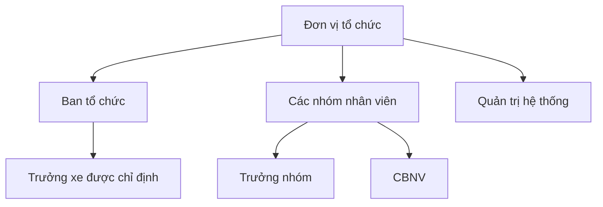
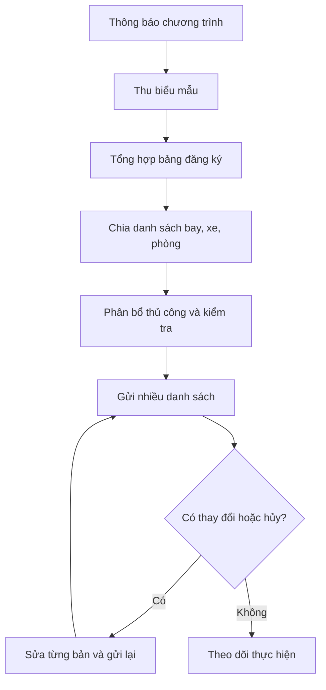
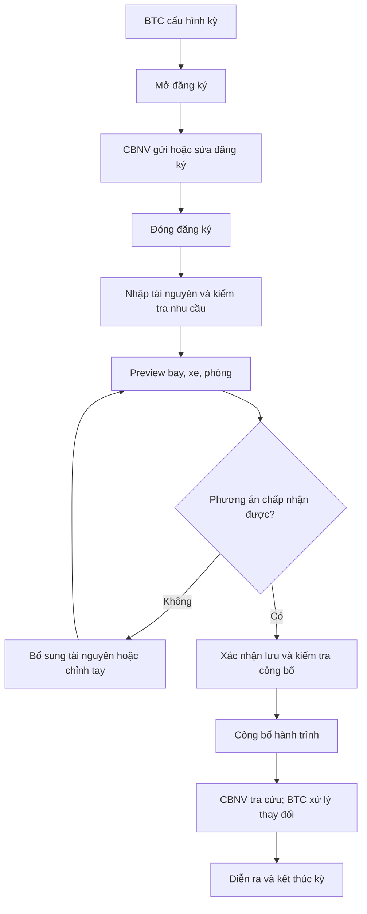
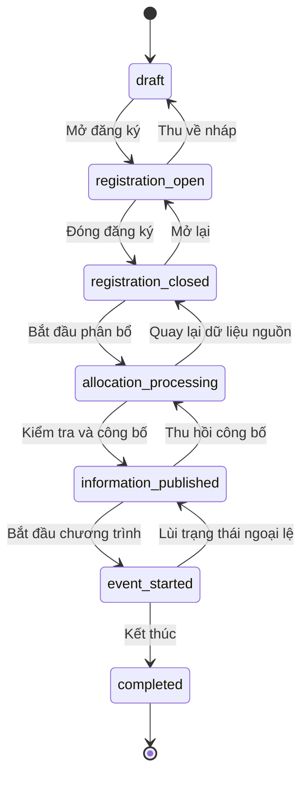
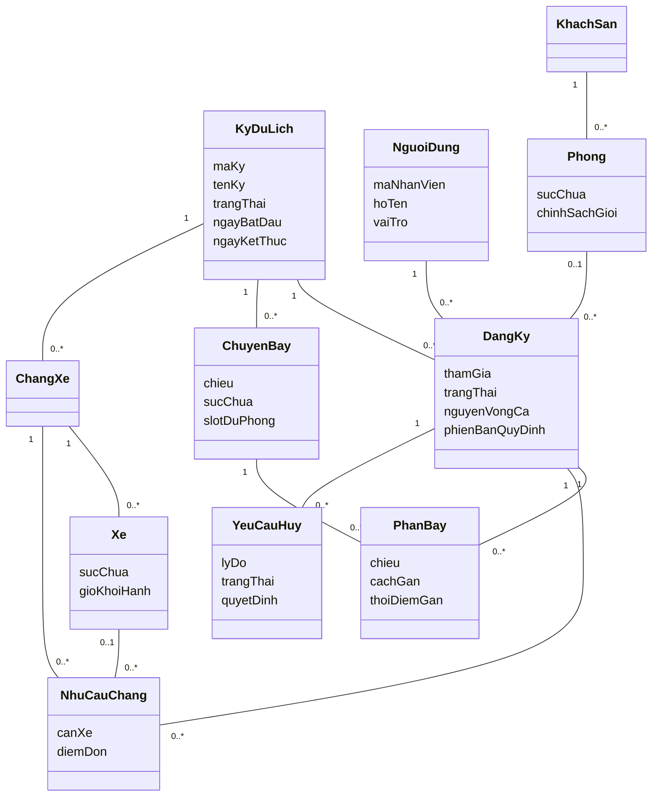

# CHƯƠNG 2. PHÂN TÍCH NGHIỆP VỤ

## 2.1. Cơ cấu tổ chức và trách nhiệm

Hoạt động du lịch nội bộ được điều phối bởi BTC. Nhân viên thuộc các đơn vị/nhóm và khai báo nhu cầu của mình. Trưởng nhóm hỗ trợ phối hợp, nhưng không thay BTC quyết định toàn bộ phân bổ. Trưởng xe được chỉ định cho từng xe nhằm hỗ trợ liên lạc khi di chuyển. Quản trị hệ thống phụ trách quyền và vận hành kỹ thuật, không được đồng nhất với nhà cung cấp dịch vụ du lịch.

*Hình 2.1. Cơ cấu vai trò nghiệp vụ.* Đây là mô hình trách nhiệm phục vụ phân tích, không khẳng định sơ đồ phòng ban thực tế của một doanh nghiệp cụ thể.

## 2.2. Thuật ngữ và quy tắc nền tảng

| Thuật ngữ | Ý nghĩa |
|---|---|
| Kỳ du lịch | Một chương trình độc lập có ngày, điểm đến, quy định, thời hạn và trạng thái. |
| Đăng ký | Bản khai của một CBNV cho một kỳ; có thể nháp, đã gửi hoặc đã hủy. |
| Ca | Khung/nguyện vọng di chuyển do BTC cấu hình trong kỳ. |
| Chiều bay | Đi hoặc về; không đồng nhất với số thứ tự chặng xe. |
| Chặng xe | Một đoạn vận chuyển như thành phố → sân bay; số chặng cấu hình bằng dữ liệu. |
| Phân bổ | Ghép người có đăng ký với tài nguyên theo quy tắc. |
| Preview | Phương án được tính để xem, chưa làm thay đổi dữ liệu phân bổ chính thức. |
| Công bố | Cho phép CBNV tra cứu kết quả được BTC xác nhận. |
| Nhật ký | Bằng chứng ai thay đổi đối tượng nào, vào lúc nào và dữ liệu trước/sau. |

Số lượng chặng và ca không cố định trong mô hình. Một người có tối đa một đăng ký trong một kỳ; một đăng ký có tối đa một chuyến mỗi chiều và một xe mỗi chặng. Phòng được gán theo đăng ký, không gắn trực tiếp vào người dùng dùng chung cho mọi kỳ.

## 2.3. Quy trình hiện trạng (As-Is)

BTC thông báo chương trình, thu đăng ký qua biểu mẫu và tổng hợp bảng tính. Danh sách được lọc theo ca/nhóm, chuyển cho các đầu mối vận tải và lưu trú. BTC cân đối chỗ, sửa ngoại lệ rồi chia sẻ danh sách. Khi nhân viên hủy hoặc thông tin thay đổi, BTC phải cập nhật nhiều bảng và gửi lại thông tin. Việc phân quyền thường dựa vào người nhận file thay vì kiểm soát từng đối tượng dữ liệu.

*Hình 2.2. Quy trình hiện trạng suy ra từ mô tả nhu cầu.* Các bước là mô hình phân tích, không phải ghi chép quan sát tại doanh nghiệp.

## 2.4. Quy trình mục tiêu (To-Be)

### 2.4.1. Chuẩn bị và đăng ký

BTC tạo kỳ nháp, khai báo ngày, thời hạn, quy định và các danh mục. Sau kiểm tra, kỳ được mở đăng ký. CBNV chọn tham gia, khai ca và nhu cầu xe theo chặng, xác nhận quy định rồi gửi. Backend kiểm tra trạng thái kỳ, dữ liệu bắt buộc và trùng đăng ký. Khi thời hạn kết thúc, BTC đóng đăng ký để ổn định nguồn dữ liệu phân bổ.

### 2.4.2. Bố trí và xác nhận

BTC bổ sung tài nguyên, xem tổng nhu cầu so với sức chứa, chạy preview phân bổ. Các trường hợp không xếp được hoặc chưa thỏa nguyện vọng được trả về để xử lý. BTC quyết định điều chỉnh thủ công hoặc bổ sung tài nguyên. Khi xác nhận, hệ thống kiểm tra lại dữ liệu và sức chứa trong giao dịch ghi; không dùng số chỗ còn lại trên màn hình cũ làm căn cứ duy nhất.

### 2.4.3. Công bố và theo dõi

Sau khi kiểm tra dữ liệu, BTC công bố thông tin. CBNV xem hành trình của mình trong một màn hình thay vì tìm nhiều file. Nếu chưa công bố, hệ thống chỉ trả trạng thái đang chờ BTC, không tiết lộ phân bổ thử. Các thay đổi sau công bố phải được lưu lịch sử; BTC phối hợp thông báo khi cần.

### 2.4.4. Hủy tham gia

Trong giai đoạn cho phép, người dùng có thể tự hủy theo chính sách. Khi cần xét duyệt, hệ thống tạo yêu cầu chờ BTC, không lập tức giải phóng mọi chỗ. BTC xem lý do, quyết định chấp thuận hoặc từ chối. Khi chấp thuận, đăng ký chuyển trạng thái hủy và tài nguyên liên quan được giải phóng thống nhất; khi từ chối, kết quả hiện tại giữ nguyên.

*Hình 2.3. Quy trình mục tiêu.* Nhánh “chấp nhận được” không có nghĩa mọi ưu tiên mềm đều được thỏa mãn; BTC phải thấy rõ các cảnh báo còn lại.

## 2.5. Vòng đời kỳ

*Hình 2.4. Vòng đời theo `event_service.ALLOWED_TRANSITIONS`.* Không nhảy trực tiếp từ nháp tới công bố; `completed` không có bước chuyển tiếp trong code hiện hành. Lý do chuyển trạng thái hiện được code cho phép tùy chọn và audit được ghi; yêu cầu bắt buộc lý do cho bước lùi là khuyến nghị quản trị, không được mô tả như constraint đã triển khai.

## 2.6. Mô hình lớp lĩnh vực

Lớp lĩnh vực biểu diễn khái niệm nghiệp vụ, chưa chứa HTTP, ORM session hay chi tiết màn hình. Đăng ký là trung tâm vì nhu cầu và phân bổ thay đổi theo từng kỳ. Người dùng tồn tại độc lập và có nhiều đăng ký ở nhiều kỳ. “Hành trình” là kết quả tổng hợp, không bắt buộc có bảng lưu riêng.

*Hình 2.5. Lớp lĩnh vực cốt lõi.* Bội số của `PhanBay` không diễn tả đầy đủ điều kiện một bản mỗi chiều; điều kiện đó được bổ sung bằng bất biến. Tương tự, `Phong` có nhiều đăng ký nhưng phải giới hạn bằng sức chứa.

## 2.7. Thẻ CRC

| Lớp | Trách nhiệm nghiệp vụ | Cộng tác |
|---|---|---|
| Kỳ du lịch | Giữ phạm vi và trạng thái, thời gian và quy định chung | Đăng ký, chuyến bay, chặng, khách sạn |
| Người dùng | Định danh nhân viên và thông tin hồ sơ phù hợp | Đăng ký, nhóm |
| Đăng ký | Ghi nhu cầu và tình trạng tham gia của người trong kỳ | Người dùng, kỳ, phân bay, nhu cầu chặng, phòng |
| Chuyến bay | Cung cấp giờ/chiều/khả năng tiếp nhận | Phân bay, ca |
| Phân bay | Ghi kết quả gán theo chiều và nguồn quyết định | Đăng ký, chuyến bay, người gán |
| Chặng xe | Phân biệt đoạn vận chuyển và điều kiện sân bay | Xe, nhu cầu chặng |
| Xe | Cung cấp sức chứa, thời gian và phụ trách điều phối | Chặng, người dùng, chuyến bay liên quan |
| Nhu cầu chặng | Ghi cần xe hay không, điểm đón và kết quả xếp xe | Đăng ký, chặng, xe |
| Phòng | Cung cấp số phòng, sức chứa và chính sách | Khách sạn, đăng ký |
| Yêu cầu hủy | Lưu lý do, quá trình xét và quyết định | Đăng ký, người gửi, BTC |

CRC hỗ trợ phân chia trách nhiệm trước khi thiết kế. Không gán toàn bộ nghiệp vụ cho `NguoiDung` chỉ vì người dùng kích hoạt thao tác; kiểm tra sức chứa thuộc dịch vụ điều phối phối hợp với dữ liệu tài nguyên.

## 2.8. Đầu vào, đầu ra và điểm kiểm soát

Đầu vào gồm hồ sơ nhân viên, đăng ký, quy định kỳ và tài nguyên. Đầu ra gồm danh sách đã phân bổ, cảnh báo chưa xếp, hành trình cá nhân và nhật ký thay đổi. Điểm kiểm soát quan trọng là lúc đóng đăng ký, lúc xác nhận phân bổ, lúc duyệt hủy và lúc công bố. Tại những điểm này phải xác nhận trạng thái kỳ và toàn vẹn dữ liệu; không chỉ kiểm tra ngay khi mở màn hình.