# CHƯƠNG 3. PHÂN TÍCH YÊU CẦU

Chương này phân tích hệ thống qua ba góc nhìn bổ sung cho nhau: **chức năng** (actor cần làm gì), **cấu trúc** (những khái niệm nào tham gia và quan hệ giữa chúng), **hành vi** (quy trình, tương tác và biến đổi trạng thái). Cách tổ chức này kế thừa các mục mô hình hóa chức năng, cấu trúc và hành vi trong `Báocáo.pdf`, nhưng vẫn giữ Operation Contracts và SSD theo hướng dẫn BTL.

Chương 2 trình bày lĩnh vực tổng thể; Chương 3 phân tích riêng từng UC; Chương 4 mới chọn API, service, lưu trữ và giao diện cụ thể. Các lớp phân tích dưới đây không phải bảng SQL hay chữ ký class Python. Bội số thể hiện quan hệ nghiệp vụ; các bất biến như sức chứa và giới hạn một chuyến mỗi chiều được ghi bổ sung, không suy diễn chỉ từ đường nối.

## 3.1. Mô hình hóa chức năng — tổng quan yêu cầu

Hệ thống được phân thành bốn miền chính: quản lý kỳ, quản lý đăng ký, điều phối chuyến đi và công bố/tra cứu. Xác thực, danh mục nhân sự và audit là chức năng hỗ trợ xuyên suốt. Cách phân rã này làm rõ trách nhiệm mà không biến mỗi nút hoặc endpoint thành một ca sử dụng độc lập.

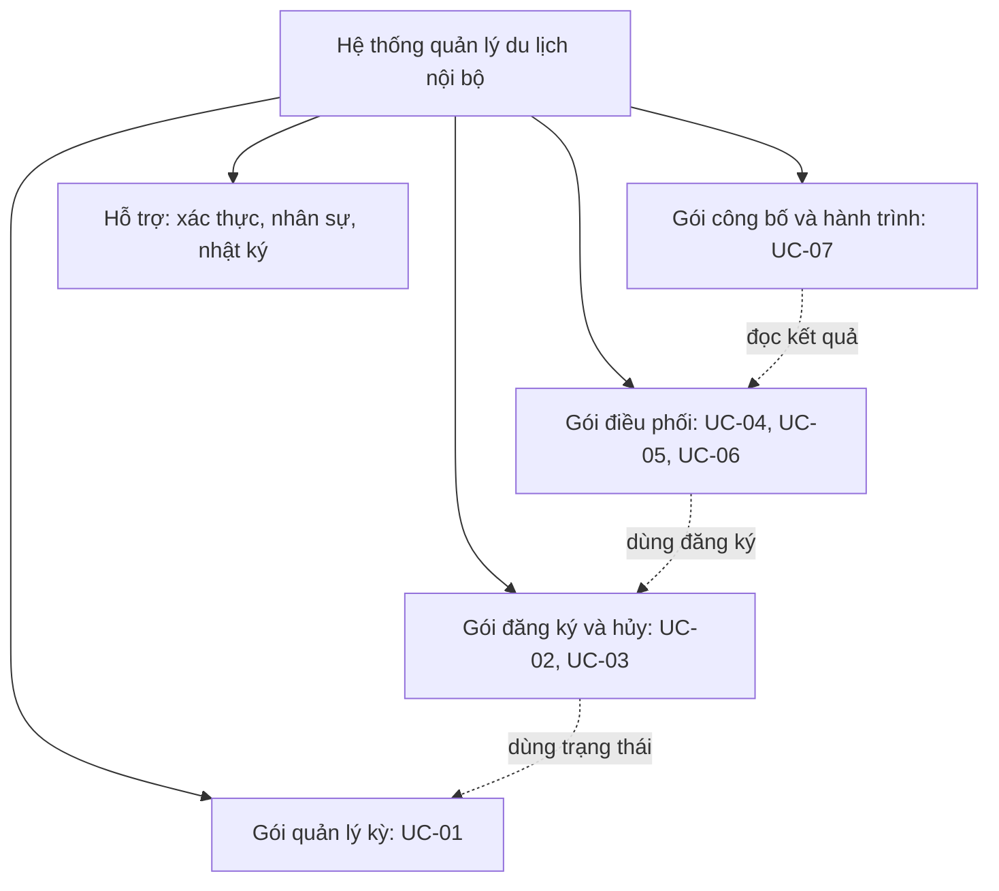

*Hình 3.1. Phác phân rã gói chức năng.* Khi vẽ lại UML Package Diagram, thay hộp bằng package và đường phụ thuộc nét đứt; đây không phải sơ đồ class.

### 3.1.1. Tác nhân và quyền

| Tác nhân | Quyền trong phạm vi báo cáo |
|---|---|
| CBNV | Đăng ký/sửa/hủy của mình; xem hành trình của mình sau công bố. |
| BTC | Cấu hình kỳ, đọc đăng ký toàn kỳ, quyết định hủy, bố trí tài nguyên và công bố. |
| Quản trị hệ thống | Quản lý tài khoản/role; được dùng chức năng BTC nếu được cấp quyền kế thừa. |
| Trưởng xe | Quyền CBNV và xem danh sách xe được chỉ định; là quyền theo phân công. |

Trưởng nhóm không có UC riêng trong phạm vi thu gọn, nhưng vẫn là người dùng có nhu cầu cá nhân và dữ liệu nhóm hỗ trợ điều phối. Không xem CSDL là actor. Dịch vụ email chỉ là cộng tác ngoài nếu mô tả gửi thông báo, không là người ra quyết định.

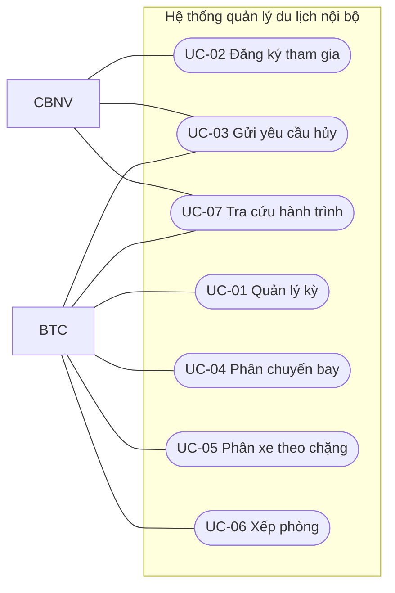

*Hình 3.2. Phác Use Case tổng quan.* Đăng nhập là tiền điều kiện chung, không vẽ `include` từ mọi UC đến Đăng nhập. UC-03/UC-07 là nhóm mục tiêu có các kịch bản tương ứng actor; khi vẽ UML chi tiết có thể tách “yêu cầu hủy/duyệt hủy” và “công bố/xem hành trình”, nhưng giữ mã nhóm để truy vết.

### 3.1.2. Yêu cầu được đánh mã

| Mã | Yêu cầu | Tiêu chí chấp nhận |
|---|---|---|
| FR-01 | Quản lý thông tin và trạng thái kỳ | Ngày hợp lệ; chỉ chuyển theo đồ thị được phép. |
| FR-02 | Ghi đăng ký duy nhất theo kỳ/người | Yêu cầu trùng không sinh bản ghi thứ hai. |
| FR-03 | Khai nhu cầu theo chặng và chấp thuận quy định | Lưu version/thời điểm; số chặng không cố định. |
| FR-04 | Xử lý hủy theo giai đoạn | Chờ duyệt không tự giải phóng; duyệt thành công giải phóng nhất quán. |
| FR-05 | Bố trí chuyến bay theo chiều | Tối đa một bản mỗi chiều; không vượt slot khả dụng. |
| FR-06 | Bố trí xe đúng chặng | Xe tương ứng chặng, không vượt sức chứa, kiểm tra thời gian. |
| FR-07 | Xếp phòng hợp lệ | Không vượt giường; phù hợp chính sách giới; một phòng hiện tại mỗi đăng ký. |
| FR-08 | Preview không ghi phân bổ | Sau preview, phân bổ chính thức không đổi. |
| FR-09 | Công bố và tra cứu có kiểm soát | Trước công bố không trả kết quả thử; sau công bố chỉ dữ liệu đúng quyền. |
| FR-10 | Truy vết thay đổi quan trọng | Lưu actor, thời gian, đối tượng, trước/sau phù hợp. |
| FR-11 | Danh mục tài nguyên theo kỳ | Không chọn tài nguyên thuộc kỳ khác. |
| FR-12 | Hiển thị cảnh báo/thiếu dữ liệu | BTC biết người chưa được xếp và nguyên nhân có thể xử lý. |

## 3.2. Mô hình hóa chức năng — đặc tả chi tiết ca sử dụng

### UC-01. Quản lý kỳ du lịch

**Tác nhân chính:** BTC. **Mục tiêu:** thiết lập một kỳ độc lập và kiểm soát các giai đoạn xử lý. **Mức quan trọng:** cao. **Bên liên quan:** BTC cần ổn định nguồn dữ liệu; CBNV cần biết thời hạn; quản trị cần audit.

**Tiền điều kiện:** tài khoản BTC hoạt động và có quyền; với thao tác sửa/chuyển, kỳ tồn tại. **Kích hoạt:** BTC chọn tạo/sửa kỳ hoặc chuyển giai đoạn. **Hậu điều kiện thành công:** thông tin/trạng thái hợp lệ được lưu, audit phù hợp được ghi. **Bảo đảm khi thất bại:** không thay đổi một phần cấu hình hoặc trạng thái.

**Luồng chính:**

1. BTC mở chức năng quản lý kỳ.
2. Hệ thống hiển thị danh sách và trạng thái hiện tại.
3. BTC tạo kỳ, nhập mã, tên, điểm đến, ngày, cửa sổ đăng ký và quy định.
4. Hệ thống kiểm tra mã, ngày kết thúc không trước ngày bắt đầu, cửa sổ đăng ký hợp lệ.
5. Hệ thống lưu kỳ nháp, BTC cấu hình ca/chặng/tài nguyên.
6. BTC yêu cầu mở đăng ký; hệ thống kiểm tra transition và cập nhật.
7. BTC đóng đăng ký rồi chuyển sang phân bổ khi phù hợp.
8. Sau kiểm tra, BTC công bố, bắt đầu và kết thúc kỳ theo tuần tự.

**Luồng thay thế:** sửa kỳ chưa bị khóa cấu hình; mở lại giai đoạn theo transition; chọn một kỳ khác để xử lý. **Ngoại lệ:** mã trùng; ngày sai; chuyển nhảy cóc; cấu hình đã khóa; không đủ quyền. **Quy tắc:** code hiện hành cho phép ghi chú lý do tùy chọn; báo cáo đề nghị quy trình BTC bổ sung lý do cho thao tác lùi nhưng không coi đã bắt buộc ở server.

### UC-02. Đăng ký tham gia và sửa nhu cầu

**Tác nhân chính:** CBNV. **Mục tiêu:** khai báo tham gia và nhu cầu cho một kỳ. **Mức quan trọng:** cao. **Tiền điều kiện:** đã đăng nhập; kỳ mở; danh mục hợp lệ. **Kích hoạt:** chọn “Đăng ký” hoặc “Sửa đăng ký”.

**Luồng chính:**

1. Hệ thống hiển thị thông tin kỳ, hạn đăng ký và hồ sơ cá nhân liên quan.
2. CBNV chọn tham gia, cập nhật thông tin được phép.
3. Hệ thống hiển thị quy định hiện hành; CBNV xác nhận đồng ý.
4. CBNV chọn ca mong muốn, điểm xuất phát và nhu cầu xe từng chặng.
5. Hệ thống kiểm tra lựa chọn cùng kỳ, dữ liệu bắt buộc, nhu cầu/điểm đón phù hợp.
6. CBNV kiểm tra bản tổng hợp và gửi.
7. Server kiểm tra lại quyền, trạng thái kỳ và unique theo kỳ/người.
8. Hệ thống lưu đăng ký, nhu cầu chặng và bằng chứng đồng ý; trả xác nhận.

**Luồng thay thế:** không tham gia thì ghi lựa chọn/lý do theo chính sách; đăng ký đã tồn tại thì cập nhật bản hiện tại; lưu nháp khi chức năng hỗ trợ. **Ngoại lệ:** thiếu hồ sơ; ca/chặng thuộc kỳ khác; version quy định đã thay đổi; kỳ đóng giữa lúc nhập; gửi trùng. **Hậu điều kiện:** đúng một đăng ký theo người/kỳ, với các nhu cầu hợp lệ; lỗi không để lại một nửa dữ liệu đăng ký và chặng.

**Bất biến:** việc chọn ca không phải cam kết phân bay; `is_shift_locked` mới biểu diễn ngoại lệ bắt buộc. Nhu cầu không đi xe không được biến thành phân xe mà không có quyết định nghiệp vụ.

### UC-03. Yêu cầu và xử lý hủy tham gia

**Tác nhân:** CBNV gửi; BTC quyết định. **Mục tiêu:** chuyển một đăng ký khỏi danh sách tham gia có kiểm soát. **Tiền điều kiện:** đăng ký tồn tại; chủ thể có quyền; chưa có yêu cầu pending trùng. **Kích hoạt:** chọn Hủy hoặc BTC mở danh sách chờ.

**Luồng chính (sau công bố/cần duyệt):**

1. CBNV xem đăng ký và chọn xin hủy.
2. Hệ thống hiển thị ảnh hưởng/chính sách và yêu cầu lý do.
3. CBNV gửi; server kiểm tra giai đoạn và tạo yêu cầu `pending`.
4. BTC mở yêu cầu, xem lý do, giai đoạn gửi và chỗ đang được cấp.
5. BTC chấp thuận, ghi chú và quyết định phí phạt nếu áp dụng.
6. Hệ thống kiểm tra yêu cầu còn pending trong giao dịch.
7. Hệ thống chuyển đăng ký sang `cancelled`, gỡ phân bay, phân xe và phòng liên quan theo quy tắc.
8. Hệ thống lưu quyết định, dữ liệu đã giải phóng, audit và trả kết quả.

**Luồng thay thế:** tự hủy khi chính sách/giai đoạn cho phép; BTC từ chối và ghi lý do, đăng ký/chỗ giữ nguyên; BTC hủy thay trong ngoại lệ được phép. **Ngoại lệ:** yêu cầu đã xử lý; gửi pending thứ hai; kỳ kết thúc; người dùng khác truy cập. **Hậu điều kiện:** chấp thuận thì không còn chiếm các tài nguyên trong phạm vi; từ chối thì kết quả hiện tại không mất. Tài nguyên Gala ngoài báo cáo không được phân tích chi tiết, dù phần mềm đầy đủ có thể giải phóng thêm.

### UC-04. Quản lý và phân bổ chuyến bay

**Tác nhân:** BTC. **Mục tiêu:** bố trí người tham gia theo từng chiều mà không vượt slot. **Tiền điều kiện:** giai đoạn cho phép; có dữ liệu đăng ký và chuyến cùng kỳ. **Kích hoạt:** BTC chọn chiều và Phân bổ.

**Luồng chính:**

1. BTC khai báo mã chuyến, chiều, ca, sân bay, giờ và sức chứa/slot dự phòng.
2. Hệ thống tính nhu cầu, chỗ khả dụng và người chưa xếp.
3. BTC chọn xem trước phân bổ.
4. Hệ thống gom người/nhóm, giữ quyết định thủ công theo chính sách, chạy heuristic.
5. Hệ thống trả kết quả preview, thiếu slot, nhóm bị tách và lệch ca.
6. BTC xem và điều chỉnh khi cần; quyết định có lưu phương án hay không.
7. Khi xác nhận, hệ thống đọc lại nguồn, kiểm tra preview còn phù hợp và giới hạn.
8. Hệ thống lưu phân bổ theo đăng ký/chiều, ghi người/thời gian/cách gán và audit.

**Luồng thay thế:** gán/chuyển thủ công một người; thêm tài nguyên rồi chạy lại; giữ các bản `manual` trừ khi BTC chủ động chọn chế độ ghi đè được phép. **Ngoại lệ:** thiếu chỗ; sai chiều; tài nguyên khác kỳ; dữ liệu đổi sau preview; yêu cầu vượt slot. **Hậu điều kiện:** preview không đổi kết quả chính thức; khi lưu không có hai chuyến cùng chiều cho một đăng ký và không vượt slot.

### UC-05. Quản lý xe và phân bổ theo chặng

**Tác nhân:** BTC. **Mục tiêu:** xếp người cần xe lên phương tiện đúng chặng và khớp điều kiện thời gian. **Tiền điều kiện:** có chặng, nhu cầu và xe; với chặng sân bay cần biết chuyến liên quan. **Kích hoạt:** chọn chặng và chức năng phân xe.

**Luồng chính:**

1. BTC cấu hình chặng, điểm đón, xe và sức chứa.
2. BTC khai báo giờ tập trung/khởi hành; liên kết chuyến bay nếu chặng sân bay.
3. Hệ thống lọc người đang tham gia, có nhu cầu đúng chặng.
4. BTC chạy preview; hệ thống gom theo chuyến/điểm đón/nhóm theo quy tắc.
5. Hệ thống trả danh sách đề xuất và cảnh báo chưa xếp/lệch giờ.
6. BTC điều chỉnh, chọn trưởng xe nếu cần.
7. BTC xác nhận; hệ thống kiểm tra lại sức chứa và chặng trong giao dịch.
8. Kết quả được ghi vào nhu cầu chặng; audit ghi nhận thay đổi.

**Luồng thay thế:** gán/chuyển thủ công, bỏ xe khi không còn nhu cầu, chỉnh thời gian/xe phù hợp sau đổi chuyến. **Ngoại lệ:** xe khác chặng; vượt chỗ; người không cần xe; giờ không phù hợp; nguồn thay đổi. **Hậu điều kiện:** một xe hiện tại mỗi đăng ký/chặng, hoặc trạng thái chưa xếp được thể hiện rõ; không ngầm coi chưa xếp là không cần xe.

### UC-06. Quản lý khách sạn và xếp phòng

**Tác nhân:** BTC. **Mục tiêu:** bố trí nơi ở không vượt sức chứa, phù hợp chính sách. **Tiền điều kiện:** người tham gia hợp lệ, khách sạn/phòng cùng kỳ. **Kích hoạt:** BTC mở chức năng phòng.

**Luồng chính:**

1. BTC nhập khách sạn, số phòng, loại phòng, sức chứa và chính sách giới.
2. Hệ thống hiển thị nhu cầu và giường còn khả dụng theo chính sách.
3. BTC chọn xếp tự động/xem trước hoặc xếp thủ công.
4. Hệ thống kiểm tra giới tính khai báo, chính sách và sức chứa; trả phương án/cảnh báo.
5. BTC xem và xử lý trường hợp thiếu thông tin hoặc có ghi chú đặc biệt.
6. BTC xác nhận, hệ thống kiểm tra lại dữ liệu và số người trong phòng.
7. Hệ thống cập nhật phòng trên đăng ký và ghi metadata/audit.

**Luồng thay thế:** nhập danh sách phân phòng theo file nếu dùng; chuyển người sang phòng khác; giữ phân phòng manual. **Ngoại lệ:** quá giường, giới không phù hợp, phòng khác kỳ, người đã hủy; preview lỗi thì không ghi. **Hậu điều kiện:** một phòng hiện tại mỗi đăng ký hoặc chưa xếp có cảnh báo; không trộn giới khi quy tắc hiện hành cấm, kể cả phòng policy `any` trong thuật toán project.

### UC-07. Công bố và tra cứu hành trình

**Tác nhân:** BTC công bố; CBNV tra cứu. **Mục tiêu:** cung cấp kết quả chính thức theo quyền. **Tiền điều kiện công bố:** kỳ ở giai đoạn phân bổ, đủ các điều kiện kiểm tra của phạm vi kỳ; **tiền điều kiện tra cứu:** đăng nhập và có quyền đối với dữ liệu của mình.

**Luồng chính:**

1. BTC xem checklist bay/xe/phòng và các lỗi chưa xử lý.
2. BTC yêu cầu công bố; server kiểm tra transition và điều kiện công bố.
3. Hệ thống cập nhật trạng thái, audit; có thể gửi thông báo theo cấu hình.
4. CBNV mở Hành trình của tôi.
5. Server lấy user từ phiên và kiểm tra kỳ được phép.
6. Hệ thống tổng hợp đăng ký, bay đi/về, xe theo chặng, phòng và lịch trình.
7. Hệ thống trả dữ liệu được phép hiển thị và các trạng thái chưa có thông tin.

**Luồng thay thế:** trước công bố chỉ trả “chờ BTC”; khi không tham gia/đã hủy, hiển thị tình trạng phù hợp, không hiện chỗ như còn hiệu lực. **Ngoại lệ:** cố truyền ID người khác; kỳ không được phép xem; dữ liệu không đủ để công bố. **Hậu điều kiện:** tra cứu chỉ đọc, không tạo bản hành trình SQL riêng; dữ liệu cập nhật từ cùng nguồn.

## 3.3. Mô hình hóa cấu trúc theo ca sử dụng

Mỗi UC được phân tích bằng một kịch bản minh họa, các lớp/thuộc tính cần thiết, sơ đồ quan hệ và bảng CRC rút gọn. Dữ liệu K1, N1, F1, B1, R1 dưới đây là **giả lập để giải thích mô hình**, không phải kết quả khảo sát hay demo đã chạy. Các lớp xuất hiện ở nhiều UC là cùng khái niệm, không được tạo bản sao riêng khi thiết kế CSDL.

### 3.3.1. UC-01 — Quản lý kỳ du lịch

**Kịch bản:** BTC tạo K1, cấu hình ca C1 và chặng L1, mở đăng ký rồi đóng khi kết thúc thời hạn. K1 là phạm vi cho những cấu hình đó; không lấy ca/chặng của K2 để dùng cho K1.

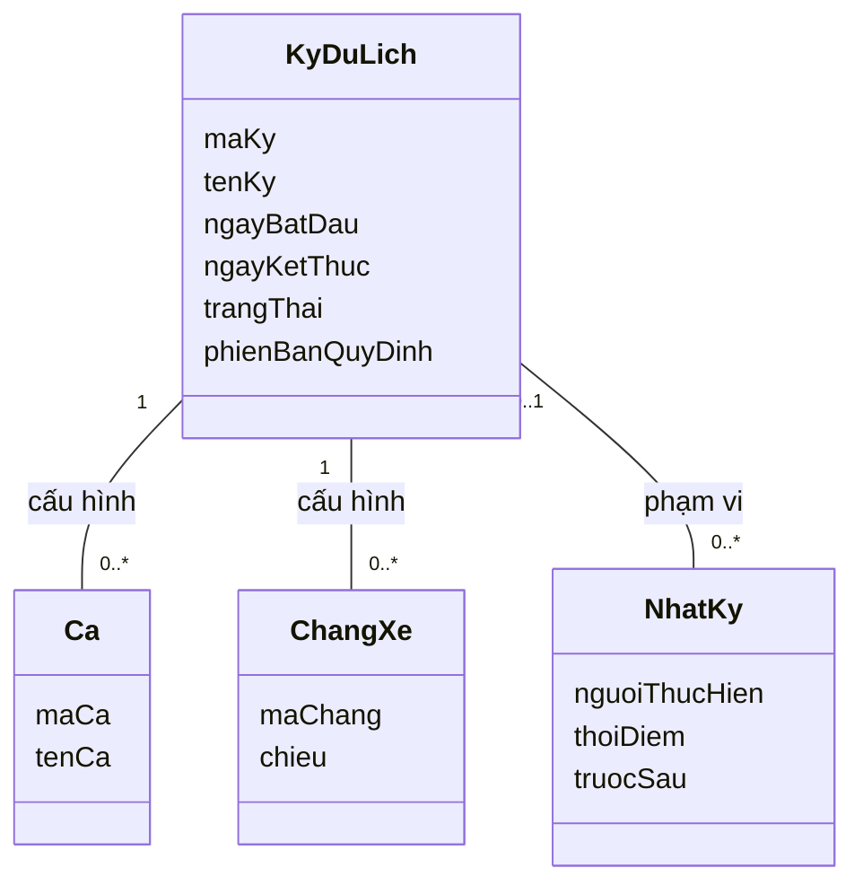

*Hình 3.3. Cấu trúc phân tích UC-01.* Nhật ký có thể không gắn kỳ cho hành động hệ thống khác; hình không biểu diễn mọi FK vật lý.

| Lớp | Trách nhiệm trong UC | Cộng tác |
|---|---|---|
| Kỳ du lịch | Giữ thông tin, cửa sổ đăng ký và trạng thái | Ca, chặng, nhật ký |
| Ca / Chặng xe | Định nghĩa lựa chọn và vận chuyển trong một kỳ | Kỳ du lịch |
| Nhật ký | Ghi bằng chứng chuyển trạng thái/cấu hình | Kỳ, người thực hiện |

**Bất biến:** ngày kết thúc không trước ngày bắt đầu; trạng thái chuyển đúng đồ thị; cấu hình thuộc kỳ xác định. Lý do chuyển trạng thái hiện là tùy chọn trong code, không gán thành thuộc tính bắt buộc của mọi transition.

### 3.3.2. UC-02 — Đăng ký tham gia

**Kịch bản:** N1 gửi đăng ký cho K1, chọn ca C1 và cần xe chặng L1. Hệ thống ghi một Đăng ký liên kết N1–K1 và một Nhu cầu chặng cho L1; version/thời điểm đồng ý được giữ cùng đăng ký.

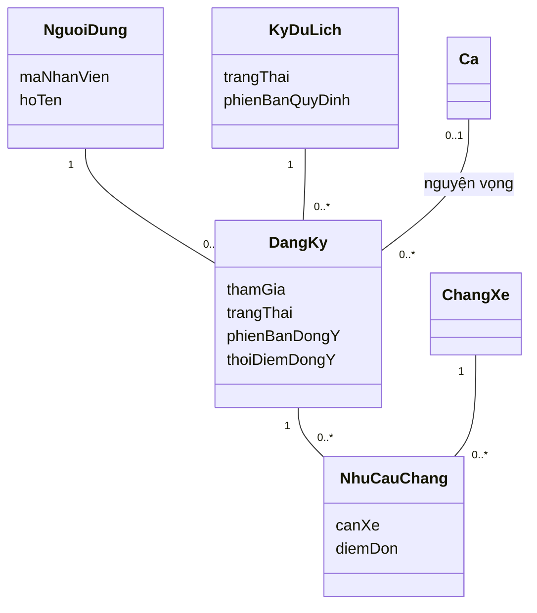

*Hình 3.4. Cấu trúc phân tích UC-02.* Consent là nhóm thuộc tính/bằng chứng, không tự tạo entity có bảng riêng nếu schema đã gộp.

| Lớp | Trách nhiệm trong UC | Cộng tác |
|---|---|---|
| Người dùng | Cung cấp định danh và hồ sơ được phép | Đăng ký |
| Đăng ký | Giữ tình trạng tham gia, ca và bằng chứng đồng ý | Người dùng, kỳ, ca, nhu cầu chặng |
| Nhu cầu chặng | Giữ lựa chọn cần xe/điểm đón cho từng chặng | Đăng ký, chặng |
| Kỳ du lịch | Cung cấp giai đoạn và quy định được áp dụng | Đăng ký |

**Bất biến:** duy nhất theo người/kỳ và đăng ký/chặng; ca/chặng cùng kỳ; lựa chọn ca không mặc định là kết quả phân bay. Các lớp không tự chứng minh phân quyền, cần điều kiện chính chủ ở thao tác.

### 3.3.3. UC-03 — Xử lý hủy

**Kịch bản:** N1 đã có bay F1, xe B1, phòng R1 và xin hủy. Yêu cầu chờ duyệt tồn tại độc lập với trạng thái đăng ký; BTC từ chối thì chỗ giữ nguyên, chấp thuận mới cập nhật đăng ký và giải phóng tài nguyên.

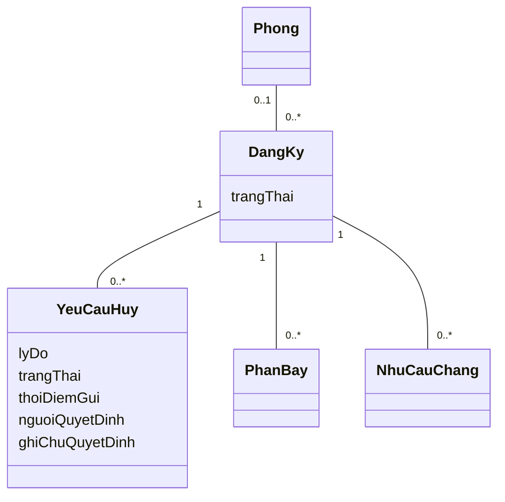

*Hình 3.5. Cấu trúc phân tích UC-03.* Không đặt “pending hủy” thành trạng thái mới của Registration vì yêu cầu hủy có vòng đời riêng.

| Lớp | Trách nhiệm trong UC | Cộng tác |
|---|---|---|
| Yêu cầu hủy | Giữ lý do, lịch sử xét, quyết định và tài nguyên đã giải phóng | Đăng ký, người gửi, BTC |
| Đăng ký | Giữ hiệu lực tham gia và liên kết hiện tại | Yêu cầu hủy, phân bay, nhu cầu chặng, phòng |
| Phân bay / Nhu cầu chặng | Cho biết các chỗ cần giải phóng khi hủy hợp lệ | Đăng ký, tài nguyên |

**Bất biến:** tối đa một yêu cầu pending cho đăng ký; quyết định duyệt/từ chối chỉ áp dụng yêu cầu chưa xử lý; không chuyển toàn bộ lịch sử yêu cầu sang canceled khi đăng ký hủy. Không có entity Thanh toán trong phạm vi quyết định phí phạt.

### 3.3.4. UC-04 — Phân bổ chuyến bay

**Kịch bản:** K1 có ba người cần bay đi nhưng F1 chỉ có hai slot khả dụng. Preview trả tối đa hai người trên F1 và cảnh báo người còn thiếu; BTC có thể bổ sung chuyến rồi xác nhận phương án mới.

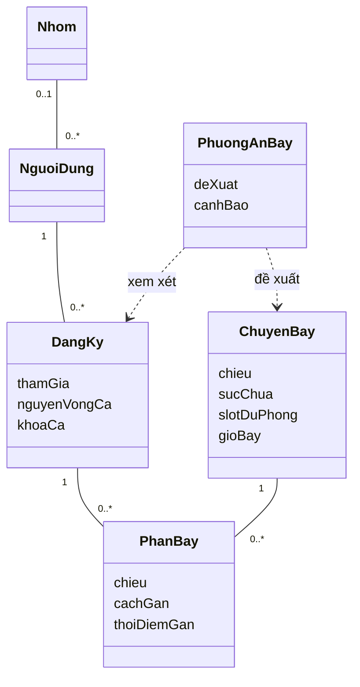

*Hình 3.6. Cấu trúc phân tích UC-04.* Phương án là kết quả tạm, không phải phân bổ đã lưu hay bảng SQL mới. Đường nét đứt biểu diễn phụ thuộc thông tin, không FK.

| Lớp | Trách nhiệm trong UC | Cộng tác |
|---|---|---|
| Chuyến bay | Cung cấp chiều, ca, giờ và slot khả dụng | Phân bay |
| Đăng ký / Nhóm | Cung cấp điều kiện tham gia và ưu tiên nhóm/ca | Phương án, phân bay |
| Phân bay | Giữ quyết định chính thức theo chiều | Đăng ký, chuyến |
| Phương án bay | Tập hợp đề xuất, thiếu chỗ và lệch ưu tiên | Đăng ký, chuyến |

**Bất biến:** số người ≤ capacity − reserved; tối đa một phân bay/đăng ký/chiều; đúng chiều và cùng kỳ; preview không thay PhânBay. Phương án không cần thỏa mọi ưu tiên mềm mới hợp lệ, nhưng phải hiển thị cảnh báo.

### 3.3.5. UC-05 — Phân xe theo chặng

**Kịch bản:** N1 cần xe L1, B1 phục vụ L1 còn một chỗ, B2 thuộc L2. N1 có thể được gán B1 nếu thời gian phù hợp; không được dùng B2 chỉ vì còn chỗ.

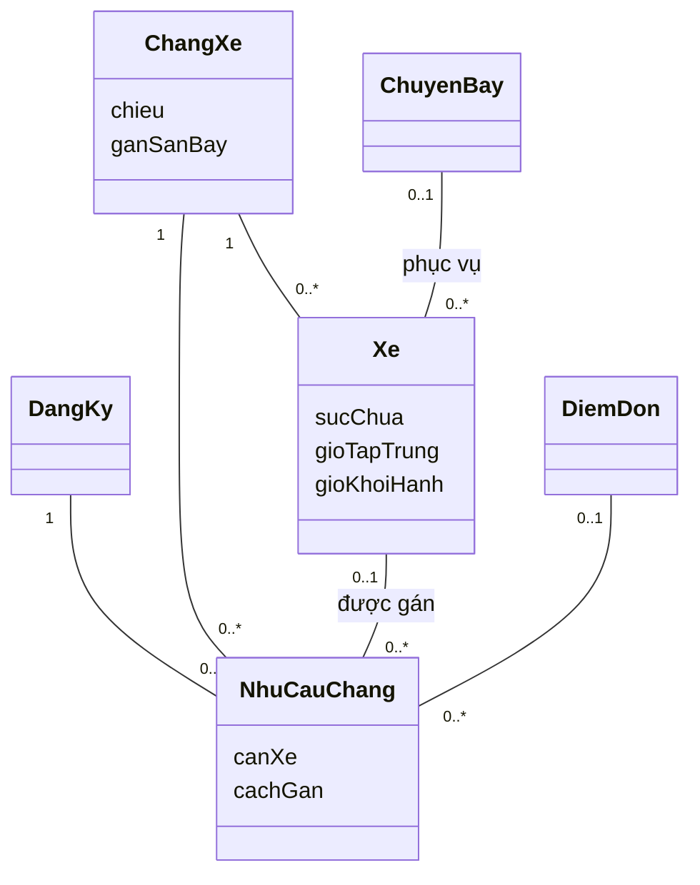

*Hình 3.7. Cấu trúc phân tích UC-05.* Nhu cầu chặng đồng thời giữ xe được gán; không tạo lớp PhânXe độc lập như thể schema có bảng đó.

| Lớp | Trách nhiệm trong UC | Cộng tác |
|---|---|---|
| Chặng xe | Xác định đoạn vận chuyển và điều kiện sân bay | Xe, nhu cầu |
| Xe | Cung cấp chỗ, giờ và chuyến phục vụ | Chặng, nhu cầu, chuyến bay |
| Nhu cầu chặng | Phân biệt tự đi, cần xe chưa xếp và đã xếp | Đăng ký, chặng, xe, điểm đón |
| Điểm đón | Cung cấp nơi tập trung phù hợp | Nhu cầu, xe |

**Bất biến:** bus được gán đúng chặng/kỳ và còn chỗ; người không cần xe không bị xếp; chưa có bus không đồng nghĩa tự đi; liên kết chuyến phải phù hợp giờ/người trên xe.

### 3.3.6. UC-06 — Xếp phòng

**Kịch bản:** N1 đang tham gia K1 được chuyển từ R1 sang R2. R2 phải thuộc khách sạn của K1, còn giường và phù hợp chính sách; nếu không, N1 vẫn giữ phòng cũ.

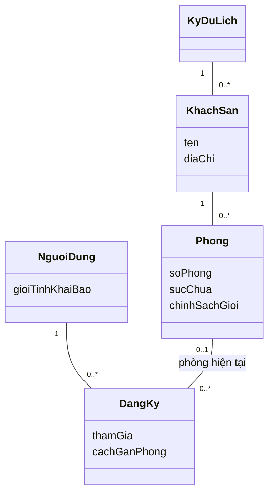

*Hình 3.8. Cấu trúc phân tích UC-06.* Bội số nhiều đăng ký/phòng phải kèm giới hạn sức chứa, không có lớp/table PhanPhong riêng trong mô hình hiện hành.

| Lớp | Trách nhiệm trong UC | Cộng tác |
|---|---|---|
| Khách sạn | Giữ phạm vi kỳ và cơ sở lưu trú | Kỳ, phòng |
| Phòng | Giữ sức chứa và chính sách | Khách sạn, đăng ký |
| Đăng ký | Giữ phòng hiện tại và nguồn quyết định gán | Người dùng, phòng |
| Người dùng | Cung cấp thông tin phục vụ policy theo quyền | Đăng ký |

**Bất biến:** một phòng hiện tại/đăng ký; không vượt giường; phòng cùng kỳ; không trộn giới theo quy tắc đã chọn. Policy `any` không tự động có nghĩa thuật toán cho phép trộn giới.

### 3.3.7. UC-07 — Công bố và tra cứu hành trình

**Kịch bản:** khi K1 chưa công bố, N1 chỉ thấy trạng thái chờ. Khi BTC công bố hợp lệ, hành trình N1 tổng hợp phân bay, xe theo chặng, phòng và lịch trình có liên quan; không đọc dữ liệu N2.

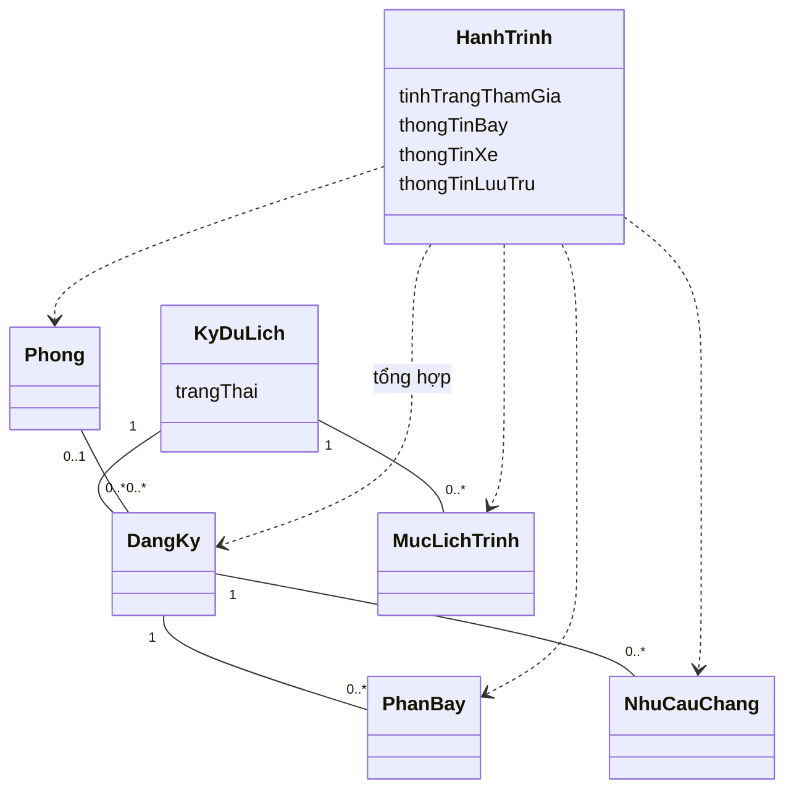

*Hình 3.9. Cấu trúc phân tích UC-07.* Hành trình là thông tin dẫn xuất/projection, không phải entity lưu độc lập nhân bản mọi kết quả.

| Lớp | Trách nhiệm trong UC | Cộng tác |
|---|---|---|
| Kỳ du lịch | Quyết định giai đoạn được hiển thị | Đăng ký, lịch trình |
| Đăng ký và phân bổ | Cung cấp tình trạng/kết quả chính thức của người | Hành trình |
| Mục lịch trình | Cung cấp hoạt động phù hợp đối tượng | Kỳ, hành trình |
| Hành trình | Tổng hợp thông tin được phép để đọc | Đăng ký, bay, xe, phòng, lịch trình |

**Bất biến:** dữ liệu theo chính chủ hoặc quyền BTC; chưa công bố không lộ kết quả thử; người đã hủy không thấy chỗ cũ như đang hiệu lực; đọc hành trình không tạo phân bổ.

## 3.4. Mô hình hóa hành vi theo ca sử dụng

Activity mô tả luồng công việc và điều kiện rẽ nhánh; SSD tại mục 3.6 mô tả thông điệp actor–hệ thống; state machine mô tả vòng đời của một đối tượng. Không dùng ba loại hình như các bản sao của cùng sơ đồ. Flowchart Mermaid dưới đây là bản nháp activity với nhãn trách nhiệm; khi vẽ lại UML cần dùng swimlane, action, decision và initial/final node đúng ký pháp.

### 3.4.1. UC-01 — Hành vi quản lý kỳ

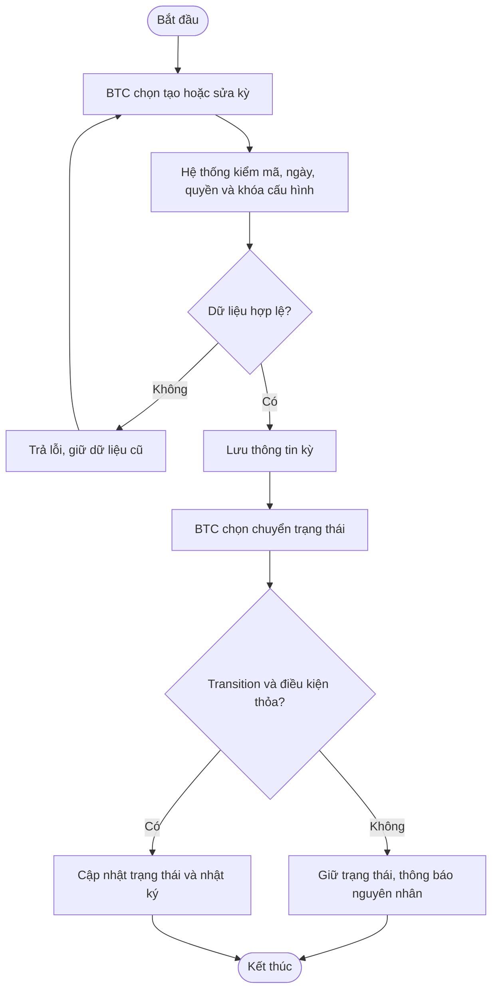

*Hình 3.10. Activity UC-01.* Vòng đời kỳ tổng thể đã có ở Hình 2.4; không lập lại một state machine với đường chuyển khác.

### 3.4.2. UC-02 — Hành vi đăng ký

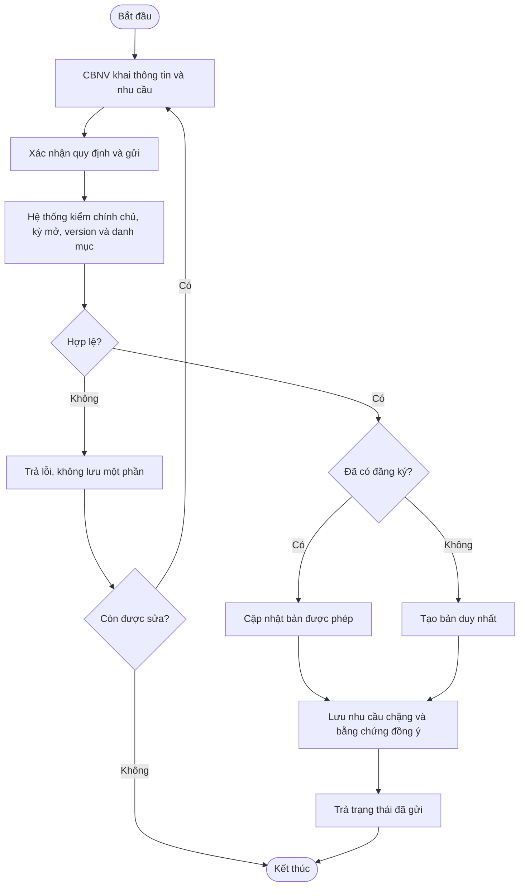

*Hình 3.11. Activity UC-02.* Nhánh “đã có” không cho sửa bất kể trạng thái; vẫn chịu điều kiện thao tác đã đặc tả. Xung đột gửi trùng cần quay về phản hồi lỗi hợp lý, không tạo bản thứ hai.

### 3.4.3. UC-03 — Hành vi xử lý hủy

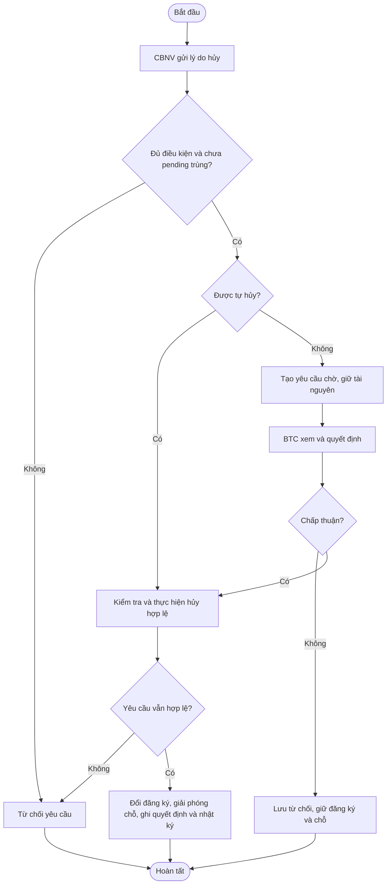

*Hình 3.12. Activity UC-03.* Quyết định BTC không áp dụng nhánh tự hủy; bước kiểm lại ngăn xử lý lặp. Bước giải phóng phải thống nhất, không để một phần bay/xe/phòng vẫn giữ như đang tham gia.

### 3.4.4. UC-04 — Hành vi phân chuyến bay

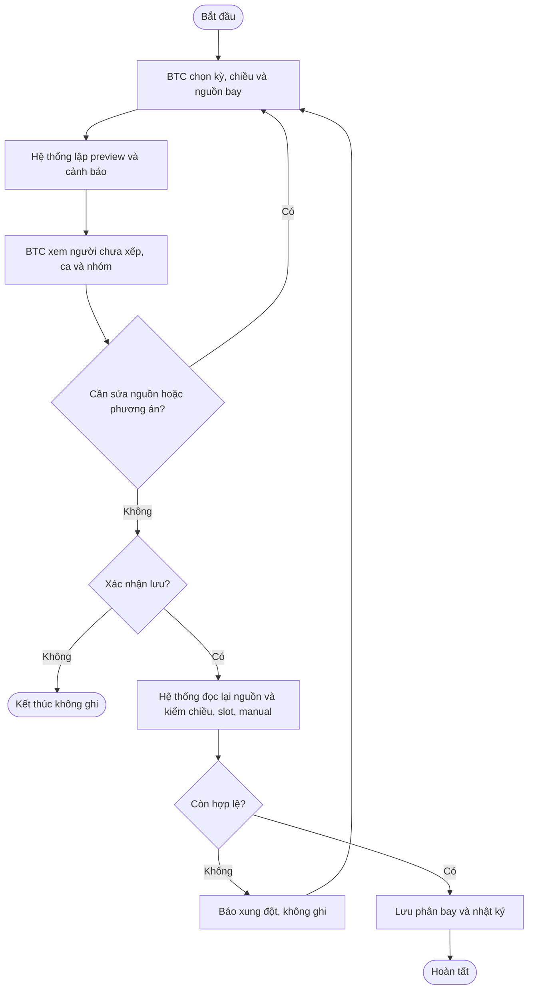

*Hình 3.13. Activity UC-04.* Thiếu slot được hiển thị như kết quả phân tích, không được âm thầm vượt sức chứa để làm đủ người. Độ tốt của heuristic thuộc đánh giá, không là trạng thái “đã tối ưu tuyệt đối”.

### 3.4.5. UC-05 — Hành vi phân xe

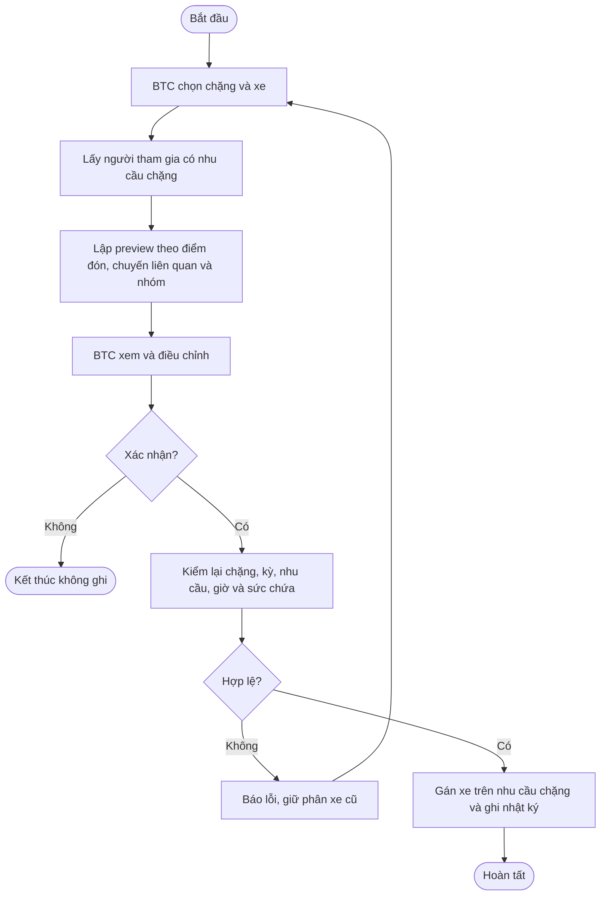

*Hình 3.14. Activity UC-05.* Không dùng cùng sơ đồ bay mà chỉ đổi tên: xe có điều kiện chặng, điểm đón và giờ liên quan riêng.

### 3.4.6. UC-06 — Hành vi xếp/chuyển phòng

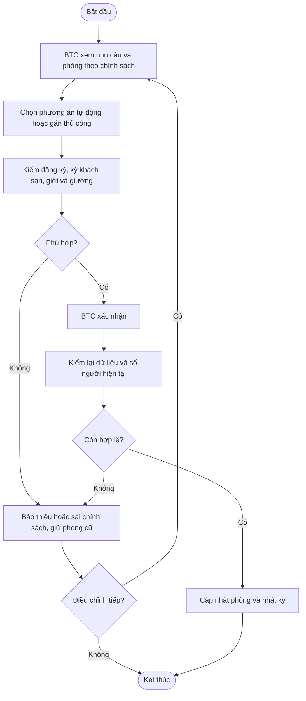

*Hình 3.15. Activity UC-06.* Giữ phòng cũ khi chuyển thất bại là bảo đảm của thao tác; preview tự động không cập nhật phòng chính thức.

### 3.4.7. UC-07 — Hành vi công bố/tra cứu

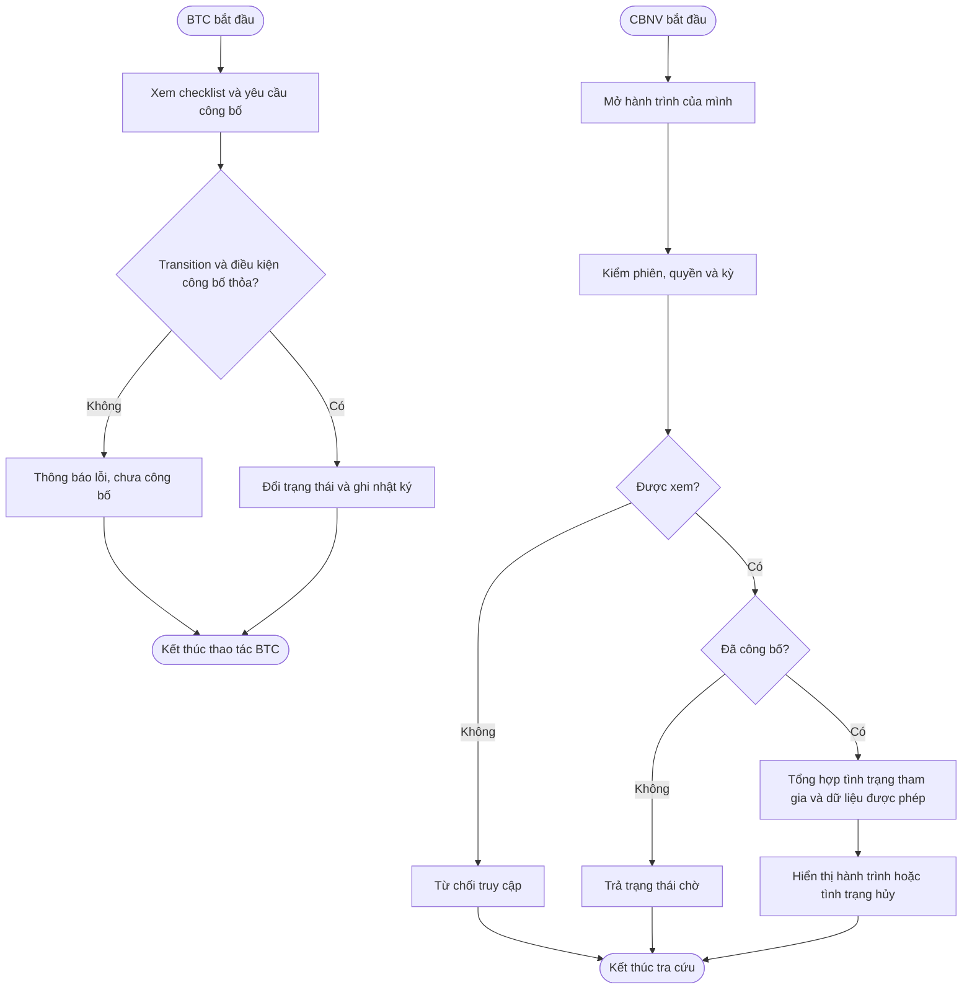

*Hình 3.16. Hai kịch bản UC-07.* Không nối luồng BTC sang CBNV như thể mỗi lần tra cứu phải yêu cầu công bố lại; trạng thái kỳ liên kết hai hành vi.

### 3.4.8. Máy trạng thái yêu cầu hủy

Đối tượng được chọn là **Yêu cầu hủy**, vì nó có vòng đời khác Đăng ký. Các nhãn là trạng thái phân tích, cần ánh xạ enum hiện thực ở Chương 4B; hình tập trung nhánh xin hủy có xét duyệt, không mô tả mọi hình thức hủy thay/tự hủy.

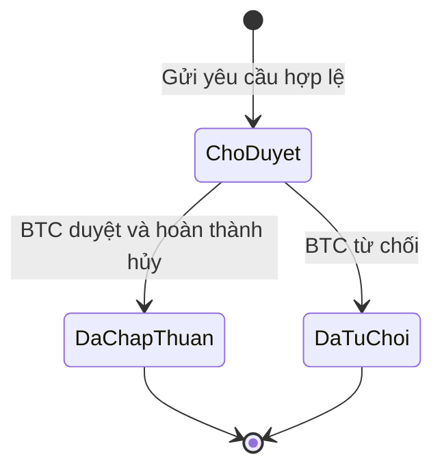

*Hình 3.17. State machine yêu cầu hủy có duyệt.* Người dùng gửi lại sau từ chối tạo **một yêu cầu mới**, không mở lại bản cũ bằng transition tự suy diễn. Preview của phân bổ là một kết quả tạm, không thêm các trạng thái pending/approved vào FlightAssignment nếu mô hình lưu không có chúng.

### 3.4.9. Tổng hợp ba góc nhìn và liên kết mô hình

| UC | Chức năng | Cấu trúc | Hành vi | Tương tác/hợp đồng |
|---|---|---|---|---|
| UC-01 | Mục 3.2, quản lý kỳ | Hình 3.3 và CRC | Hình 3.10, vòng đời Hình 2.4 | SSD-06; OC-01,02 |
| UC-02 | Mục 3.2, đăng ký | Hình 3.4 và CRC | Hình 3.11 | SSD-01; OC-03 |
| UC-03 | Mục 3.2, hủy | Hình 3.5 và CRC | Hình 3.12,3.17 | SSD-03; OC-04,05 |
| UC-04 | Mục 3.2, phân bay | Hình 3.6 và CRC | Hình 3.13 | SSD-02; OC-06,07 |
| UC-05 | Mục 3.2, phân xe | Hình 3.7 và CRC | Hình 3.14 | SSD-04; OC-08 |
| UC-06 | Mục 3.2, phòng | Hình 3.8 và CRC | Hình 3.15 | SSD-07; OC-09 |
| UC-07 | Mục 3.2, công bố/tra cứu | Hình 3.9 và CRC | Hình 3.16 | SSD-05; OC-10,11 |

Mô hình cấu trúc cho thấy đối tượng cần đọc/đổi; activity giải thích khi nào việc đó hợp lệ; hợp đồng xác định hậu điều kiện; SSD thể hiện actor yêu cầu gì. Chương 4 hiện thực hóa chúng bằng service, giao dịch và API, không thay các sơ đồ phân tích bằng chi tiết framework.

## 3.5. Hợp đồng thao tác (Operation Contracts)

Các tên thao tác dưới đây thuộc mô hình phân tích, không phải chữ ký endpoint code. Hậu điều kiện mô tả thay đổi đối tượng/quan hệ/trạng thái, không lặp lại các bước bấm nút.

| Mã | Thao tác | Tiền điều kiện | Hậu điều kiện thành công |
|---|---|---|---|
| OC-01 | `createEvent(data)` | BTC có quyền; mã chưa dùng; ngày hợp lệ | Tạo Event ở `draft`, gán dữ liệu cấu hình, ghi thời điểm/actor phù hợp. |
| OC-02 | `changeEventStatus(eventId,target)` | Kỳ tồn tại; transition hợp lệ; guard thỏa | Đổi đúng một trạng thái; tạo audit; không thay dữ liệu phân bổ như hệ quả ngầm. |
| OC-03 | `submitRegistration(eventId,data,consent)` | Người dùng của phiên; kỳ mở; danh mục cùng kỳ | Tạo/cập nhật Registration duy nhất; tạo/cập nhật RegistrationLeg; gán version và thời điểm đồng ý. |
| OC-04 | `requestCancellation(regId,reason)` | Chính chủ; đăng ký đủ điều kiện; không pending trùng | Tạo Cancellation pending; phân bổ hiện tại giữ nguyên khi cần duyệt. |
| OC-05 | `decideCancellation(id,decision,note)` | BTC; yêu cầu pending; giai đoạn hợp lệ | Nếu duyệt: cập nhật hủy, giải phóng các liên kết phân bổ, ghi quyết định/audit. Nếu từ chối: đổi trạng thái yêu cầu, giữ đăng ký/chỗ. |
| OC-06 | `previewFlights(eventId,direction)` | BTC; dữ liệu nguồn hợp lệ | Trả phương án/cảnh báo; không tạo/xóa/cập nhật phân bổ chính thức. |
| OC-07 | `commitFlights(eventId,direction,proposal)` | BTC; nguồn chưa xung đột; slot/chiều hợp lệ | Tạo/cập nhật FlightAssignment theo chính sách giữ manual; ghi metadata/audit trong giao dịch. |
| OC-08 | `assignBus(regId,legId,busId)` | Nhu cầu hợp lệ; đúng chặng/kỳ; còn chỗ | Gán bus vào RegistrationLeg; không có bản thứ hai cho cùng đăng ký/chặng; audit thay đổi. |
| OC-09 | `assignRoom(regId,roomId)` | Người tham gia; phòng cùng kỳ; còn chỗ; policy thỏa | Cập nhật `Registration.room_id` và metadata, giải phóng liên kết phòng cũ theo giao dịch. |
| OC-10 | `publishJourney(eventId)` | BTC; đang phân bổ; checklist thỏa | Event chuyển `information_published`; phân bổ trở thành hiển thị cho người dùng theo quyền. |
| OC-11 | `getMyJourney(eventId)` | Phiên hợp lệ; kỳ được phép | Không đổi đối tượng; trả projection của chính user hoặc trạng thái chờ công bố. |

Nếu một điều kiện không thỏa, giao dịch ghi phải rollback và trả lỗi có ý nghĩa. Email không nên khiến giao dịch phân bổ/hủy đã hợp lệ bị ghi một phần; trạng thái gửi cần được theo dõi riêng khi chức năng thông báo được dùng.

## 3.6. Mô hình hóa tương tác — System Sequence Diagrams (SSD)

SSD xem toàn bộ phần mềm là một đối tượng hộp đen. Không đưa Controller, Repository hoặc SQL vào SSD; các chi tiết này thuộc biểu đồ trình tự thiết kế ở Chương 4.

### SSD-01 — Đăng ký

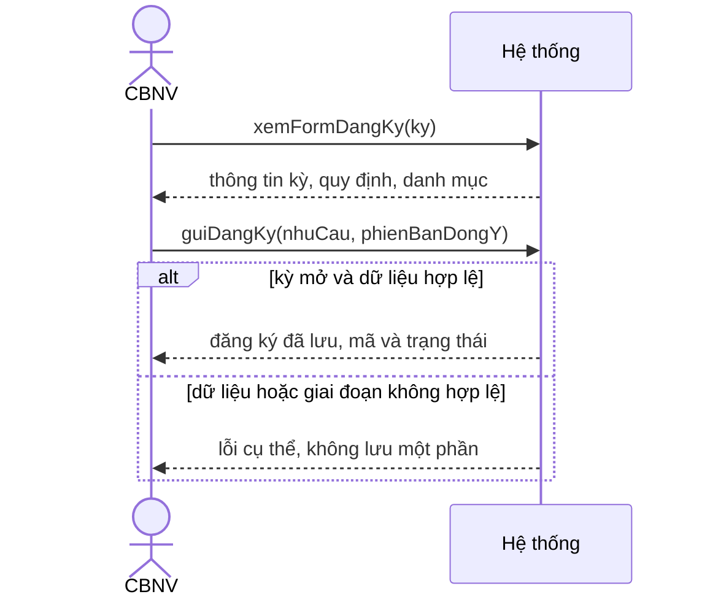

### SSD-02 — Phân chuyến bay

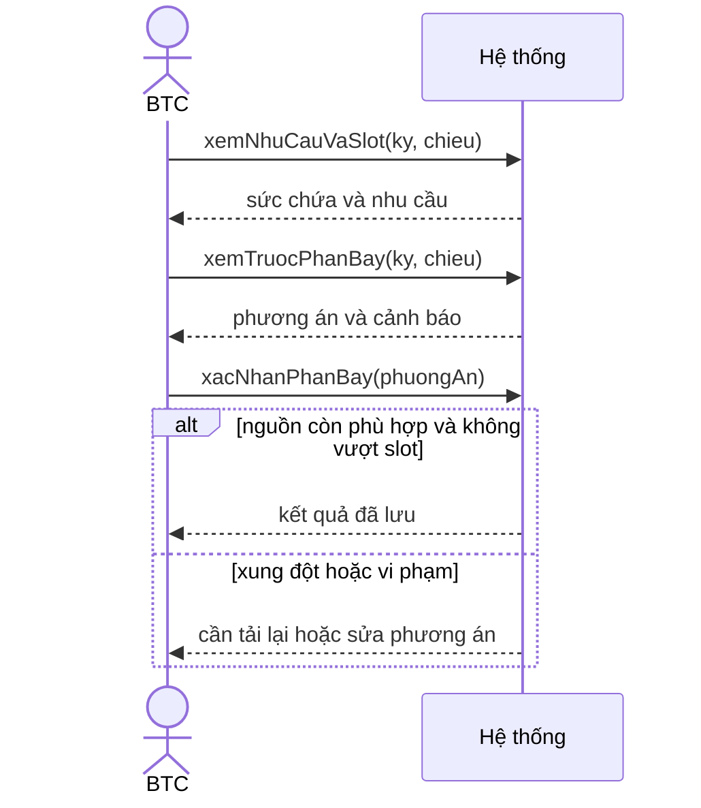

### SSD-03 — Hủy có duyệt

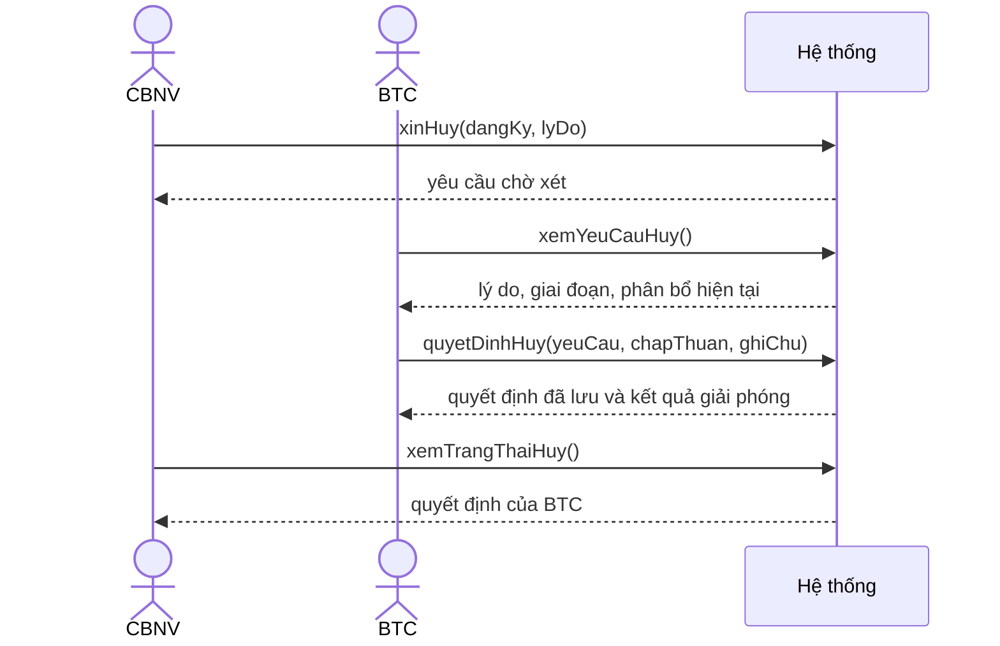

### SSD-04 — Phân xe theo chặng (UC-05)

```mermaid
sequenceDiagram
    actor B as BTC
    participant S as Hệ thống
    B->>S: xemNhuCauXe(ky, chang)
    S-->>B: người cần xe, xe, giờ liên quan
    B->>S: previewXe(chang)
    S-->>B: phương án và cảnh báo
    B->>S: xacNhanXe(phuongAn)
    S-->>B: kết quả hoặc xung đột
```

### SSD-05 — Công bố và xem hành trình

```mermaid
sequenceDiagram
    actor B as BTC
    actor NV as CBNV
    participant S as Hệ thống
    B->>S: xemChecklist(ky)
    S-->>B: điều kiện đạt/chưa đạt
    B->>S: congBo(ky)
    S-->>B: trạng thái công bố hoặc lỗi
    NV->>S: xemHanhTrinhCuaToi(ky)
    S-->>NV: hành trình theo quyền của phiên
```

### SSD-06 — Quản lý kỳ (UC-01)

```mermaid
sequenceDiagram
    actor B as BTC
    participant S as Hệ thống
    B->>S: taoKy(thongTin, quyDinh)
    S-->>B: kỳ nháp hoặc lỗi dữ liệu
    B->>S: chuyenTrangThai(ky, trangThaiDich, ghiChu)
    alt transition và điều kiện hợp lệ
        S-->>B: trạng thái mới
    else không hợp lệ
        S-->>B: nguyên nhân, trạng thái giữ nguyên
    end
```

### SSD-07 — Xếp phòng (UC-06)

```mermaid
sequenceDiagram
    actor B as BTC
    participant S as Hệ thống
    B->>S: xemNhuCauPhong(ky)
    S-->>B: nhu cầu theo chính sách và giường
    B->>S: previewPhong(ky)
    S-->>B: phương án và người chưa xếp
    B->>S: xacNhanPhong(phuongAn)
    alt chính sách, sức chứa và nguồn hợp lệ
        S-->>B: kết quả đã lưu
    else vi phạm hoặc xung đột
        S-->>B: lỗi cụ thể, giữ phòng hiện tại
    end
```

SSD-06/07 được bổ sung để mỗi nhóm UC có SSD riêng, giữ mã SSD cũ phục vụ đối chiếu. Không yêu cầu thứ tự SSD trùng số UC; bảng mục 3.4.9 xác định ánh xạ rõ ràng.

## 3.7. Ma trận CRUD đối tượng lĩnh vực

| Đối tượng | UC-01 | UC-02 | UC-03 | UC-04 | UC-05 | UC-06 | UC-07 |
|---|---|---|---|---|---|---|---|
| Kỳ | CRU | R | R | R | R | R | RU |
| Người dùng/nhóm | R | RU hồ sơ được phép | R | R | R | R | R |
| Đăng ký | R | CRU | RU | R | R | RU phòng | R |
| Nhu cầu chặng | R | CRU | RU gỡ xe | R | RU | R | R |
| Yêu cầu hủy | – | – | CRU | – | – | – | R trạng thái |
| Chuyến/phân bay | – | – | RD phân bổ | CRUD | R | R | R |
| Xe | – | R | R | R | CRU | – | R |
| Khách sạn/phòng | – | – | R | – | – | CRU | R |
| Nhật ký | C | C theo hành động | C | C | C | C | CR theo quyền |

CRUD ở đây bao phủ các kịch bản trong nhóm UC, không đồng nghĩa mọi actor trong UC đều có toàn bộ quyền. Hủy đăng ký thường là cập nhật trạng thái, còn gỡ FlightAssignment có thể là xóa bản phân bổ; cần phân biệt hai loại hành vi.

## 3.8. Yêu cầu phi chức năng

| Mã | Nhóm | Nội dung và cách xác nhận |
|---|---|---|
| NFR-01 | Bảo mật | Mọi API ghi kiểm tra role, ownership, kỳ; thử truy cập chéo phải bị chặn. |
| NFR-02 | Toàn vẹn | Unique/FK/check và service validation; thử vượt chỗ/gửi trùng không tạo dữ liệu sai. |
| NFR-03 | Hiệu năng | Mục tiêu ≤1.000 người/kỳ; mục tiêu phân bổ ≤5 giây theo tài liệu yêu cầu, cần đo trong môi trường xác định. |
| NFR-04 | Khả dụng | Dữ liệu giữ khi restart; backup/restore được kiểm chứng bằng bản sao. |
| NFR-05 | Dễ dùng | Form chỉ lỗi đúng trường; dùng được trên điện thoại, trạng thái chưa công bố rõ. |
| NFR-06 | Bảo trì | Tách API/nghiệp vụ/lưu trữ; ca/chặng bằng dữ liệu; có migration. |
| NFR-07 | Riêng tư | Không trả mật khẩu/hash; hạn chế CCCD/hồ sơ/roommate theo quyền; không đưa dữ liệu thật vào báo cáo. |

## 3.9. Truy vết yêu cầu

| Yêu cầu | UC | Hợp đồng | Thiết kế/kiểm thử |
|---|---|---|---|
| FR-01 | UC-01 | OC-01,02 | State kỳ; TC-01,02 |
| FR-02,03 | UC-02 | OC-03 | Sequence đăng ký; TC-03…07 |
| FR-04 | UC-03 | OC-04,05 | Transaction hủy; TC-08…11 |
| FR-05,08 | UC-04 | OC-06,07 | Allocator/slot; TC-12…16 |
| FR-06 | UC-05 | OC-08 | FK ghép chặng, thời gian; TC-17…20 |
| FR-07 | UC-06 | OC-09 | Room policy; TC-21…24 |
| FR-09 | UC-07 | OC-10,11 | Journey projection; TC-25…28 |
| FR-10,11,12 | Các UC | Hợp đồng ghi tương ứng | Audit, cùng kỳ, cảnh báo; TC-29…32 |