# CHƯƠNG 4. THIẾT KẾ HỆ THỐNG
## Phần A — Kiến trúc, trách nhiệm và hành vi ca sử dụng

## 4.1. Kiến trúc logic

Hệ thống chọn kiến trúc phân tầng để tách tương tác người dùng khỏi quyết định nghiệp vụ và chi tiết lưu trữ. Tầng trình bày không trực tiếp sửa CSDL. API xác nhận danh tính và dữ liệu đầu vào; dịch vụ nghiệp vụ kiểm tra trạng thái/điều kiện; SQLAlchemy và Session cung cấp truy cập dữ liệu. Tầng dịch vụ không phụ thuộc ngược vào giao diện/API.

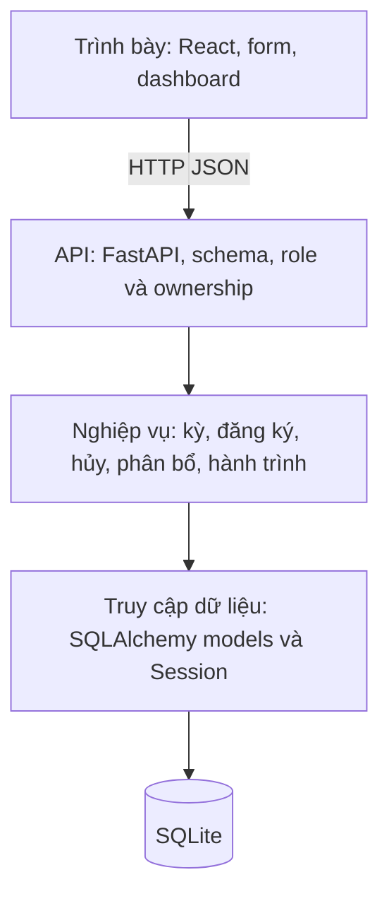

*Hình 4.1. Kiến trúc logic.* Cơ chế role/ownership có thể được triển khai bằng dependency và kiểm tra nghiệp vụ; không được coi API kiểm role là đủ nếu đối tượng nằm ngoài phạm vi user.

### 4.1.1. Quyết định kiến trúc

| Quyết định | Lý do | Đánh đổi |
|---|---|---|
| SPA + API | Tách UI khỏi nghiệp vụ, hỗ trợ tra cứu trên nhiều kích thước | Cần quản lý phiên, loading/error và cache. |
| CSDL quan hệ | Dữ liệu nhiều quan hệ và ràng buộc | Cần migration, kiểm tra truy vấn và giao dịch. |
| SQLite cho demo/nội bộ | Dễ đóng gói, lưu volume, không cần DB server riêng | Một writer; phải kiểm soát transaction và giới hạn tải. |
| Phân bổ heuristic + quyết định BTC | Giải thích được và xử lý nhanh ở quy mô mục tiêu | Không cam kết tối ưu toàn cục. |
| Preview trước khi ghi | BTC hiểu cảnh báo trước quyết định | Cần phát hiện dữ liệu thay đổi giữa preview/commit. |
| Hành trình là projection | Không nhân bản dữ liệu bay/xe/phòng vào một bảng khác | Cần tổng hợp và phân quyền nhiều nguồn. |

### 4.1.2. Kiến trúc triển khai

Trình duyệt gọi web server nginx; nginx phục vụ React build và proxy API đến backend. Backend truy cập SQLite trên volume và SMTP nội bộ nếu dùng thông báo. Không mở backend trực tiếp trong cấu hình compose chính giúp giảm bề mặt truy cập và bảo đảm header từ proxy có căn cứ tin cậy.

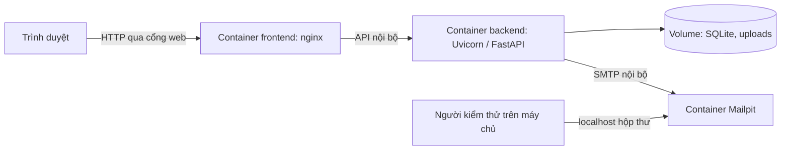

*Hình 4.2. Phác triển khai demo.* Khi triển khai mạng thực cần HTTPS, secret phù hợp, backup và quy trình vận hành; hình này không khẳng định bản demo đã sẵn sàng production.

## 4.2. Các kỹ thuật thiết kế

### 4.2.1. Boundary–Control–Entity

Boundary biểu diễn màn hình/API nhận yêu cầu. Control tổ chức một mục tiêu sử dụng và kiểm tra quy tắc. Entity biểu diễn dữ liệu nghiệp vụ. Ví dụ `RegistrationForm` không tự lưu SQL; `RegistrationService` kiểm kỳ và nhu cầu; `Registration`/`RegistrationLeg` giữ kết quả. Tách như vậy giúp kiểm thử nghiệp vụ mà không cần trình duyệt.

### 4.2.2. Gắn kết cao và phụ thuộc thấp

Dịch vụ đăng ký không nên chịu trách nhiệm tính phương án chuyến bay. Allocator nhận dữ liệu đã chuẩn bị và trả đề xuất/cảnh báo, không trực tiếp gọi API hoặc gửi email. JourneyService chỉ tổng hợp dữ liệu được phép. AuditService ghi nhật ký dùng chung nhưng không thay quyết định nghiệp vụ.

### 4.2.3. Data Access Management

Theo cách trình bày của báo cáo mẫu, DAM/Repository là điểm truy cập dữ liệu cho nhóm lớp. Trong code hiện tại, service dùng SQLAlchemy Session/models trực tiếp; báo cáo không giả định đã có các Repository class sau. Bảng này là thiết kế có thể dùng khi tiếp tục tách lớp:

| DAM/Repository đề xuất | Trách nhiệm |
|---|---|
| EventRepository | Đọc/lưu kỳ, trạng thái và cấu hình. |
| RegistrationRepository | Lấy đăng ký theo kỳ/user; lưu đăng ký và nhu cầu. |
| FlightRepository | Đọc nguồn bay, sức chứa, phân bổ theo chiều. |
| TransportRepository | Đọc xe/chặng và nhu cầu, kiểm tra kết quả gán. |
| AccommodationRepository | Lấy phòng và occupancy, cập nhật liên kết phòng. |
| CancellationRepository | Lưu lịch sử yêu cầu, kiểm tra pending. |
| AuditRepository | Append log, truy vấn theo phạm vi quyền. |

### 4.2.4. Giao dịch và cạnh tranh

Một thao tác có thể cập nhật nhiều bảng: duyệt hủy ảnh hưởng đăng ký, bay, xe, phòng và lịch sử. Các phần thay đổi đó cần nằm trong cùng transaction; lỗi phải rollback. SQLite được bật foreign keys, WAL, busy timeout. Với tranh chấp ghi, code có tiện ích `immediate_transaction` dùng `BEGIN IMMEDIATE`; transaction phải ngắn, không gọi mạng/AI/SMTP trong lúc giữ khóa.

Unique giải quyết trùng đăng ký hoặc trùng phân bổ theo chiều/chặng; không tự giải quyết giới hạn tổng số người trong xe/phòng. Giới hạn tổng phải kiểm tra service trong giao dịch bảo đảm không có hai request cùng đọc một chỗ cuối rồi cùng ghi.

## 4.3. Làm giàu lớp lĩnh vực và thiết kế cấu trúc

Lớp phân tích được bổ sung thao tác, kiểu dữ liệu và lớp điều phối. Vai trò CBNV/BTC/Quản trị là role trên tài khoản trong schema hiện hành, không dùng kế thừa ORM thành ba bảng tài khoản. Biểu đồ sau thể hiện cấu trúc thiết kế đại diện cho toàn bộ UC; các lớp service được liên kết theo phạm vi thay vì lặp lại toàn bộ class ở mỗi hình.

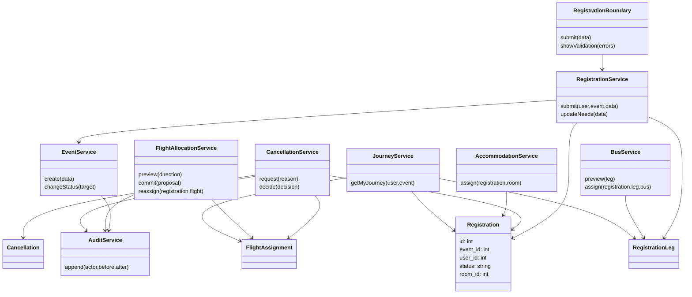

*Hình 4.3. Cấu trúc lớp thiết kế đại diện.* Tên thao tác là thiết kế khái quát, không cam kết chính xác signature trong Python. Bảng `room_assignments`/`bus_assignments` không xuất hiện vì schema v2 lưu trên Registration/RegistrationLeg.

### 4.3.1. Ánh xạ UC sang lớp

| UC | Boundary | Control/Dịch vụ | Entity trọng tâm |
|---|---|---|---|
| UC-01 | EventAdminPage/Event API | EventService | Event, Shift, TripLeg |
| UC-02 | RegistrationForm/Registration API | RegistrationService | Registration, RegistrationLeg, User |
| UC-03 | CancellationForm/Admin list | CancellationService | Cancellation, Registration, phân bổ |
| UC-04 | FlightAllocationPage | FlightAllocationService, Allocator | Flight, FlightAssignment, Registration |
| UC-05 | BusAllocationPage | BusService, TimingService | Bus, TripLeg, RegistrationLeg |
| UC-06 | RoomAllocationPage | AccommodationService, RoomAllocationService | Hotel, Room, Registration |
| UC-07 | JourneyPage/Publish action | EventService, JourneyService | Event và projection hành trình |

## 4.4. Thiết kế hành vi — biểu đồ trình tự

### 4.4.1. UC-01 — Chuyển giai đoạn

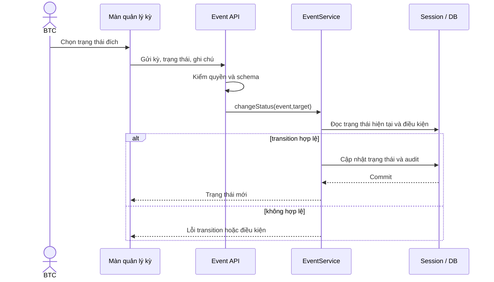

### 4.4.2. UC-02 — Lưu đăng ký

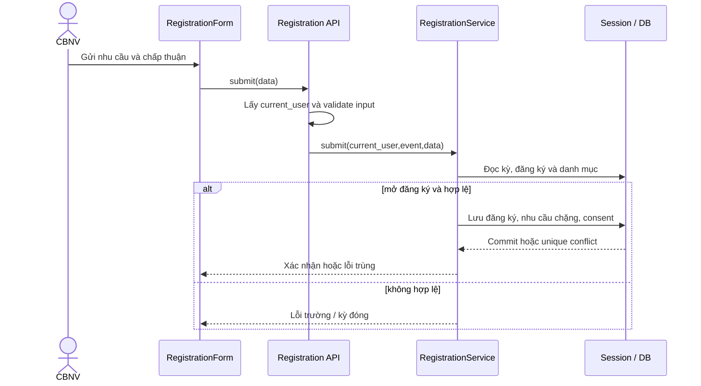

### 4.4.3. UC-03 — Duyệt hủy

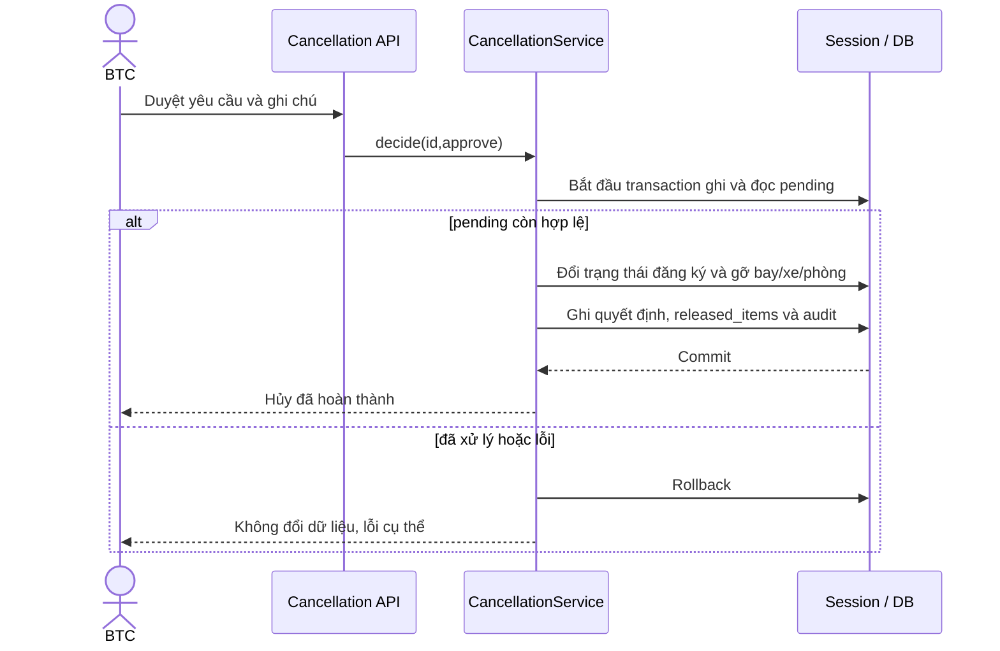

### 4.4.4. UC-04 — Preview và xác nhận bay

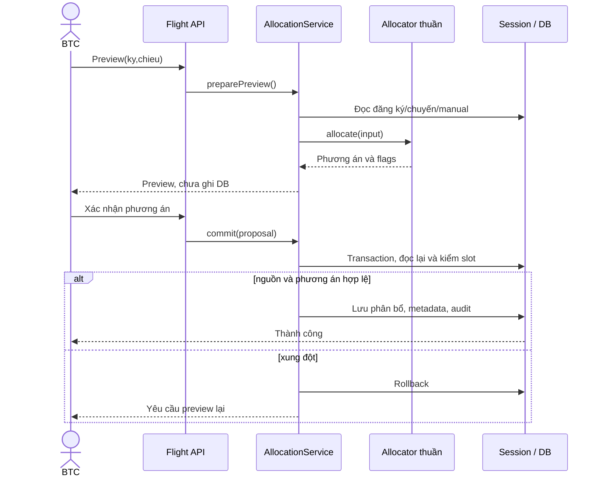

### 4.4.5. UC-05 — Gán xe

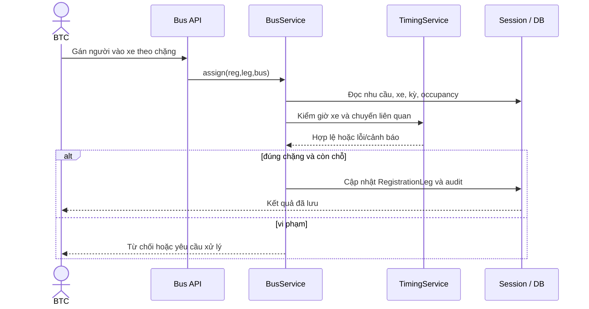

### 4.4.6. UC-06 — Chuyển phòng

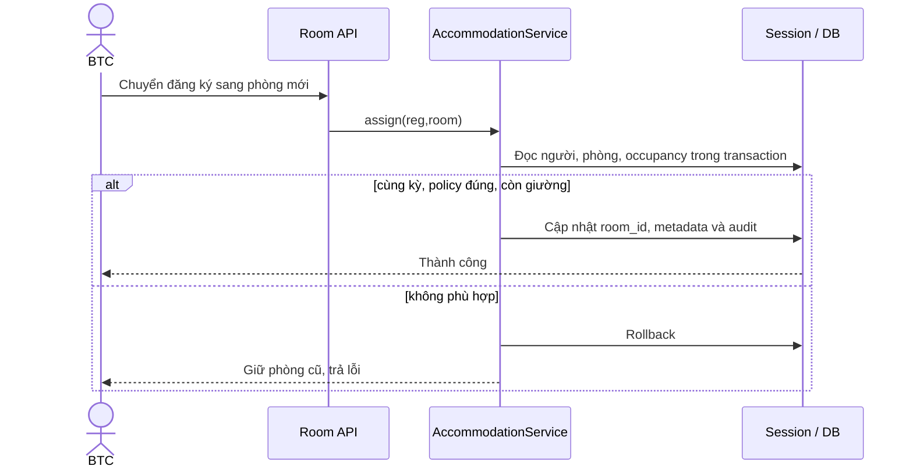

### 4.4.7. UC-07 — Tổng hợp hành trình

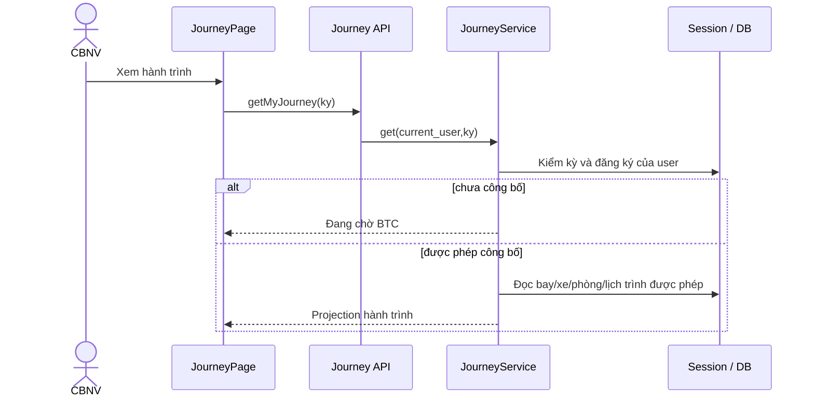

## 4.5. Activity Diagram tiêu biểu

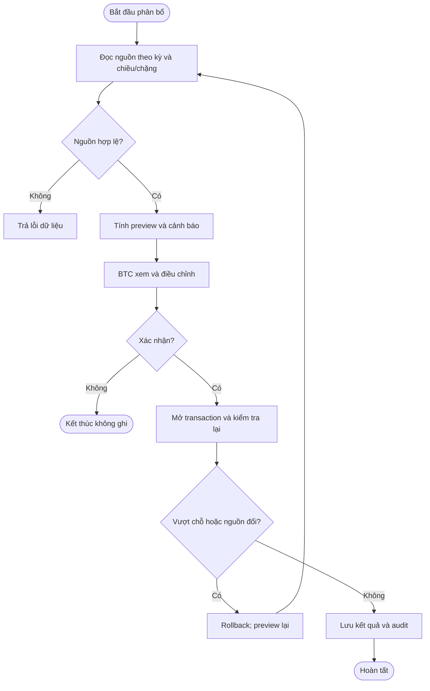

*Hình 4.4. Activity phân bổ.* Các hình flowchart này cần thêm swimlane BTC/Hệ thống khi vẽ UML để phân biệt trách nhiệm; quyết định ghi và quyết định thuật toán không phải một.

## 4.6. Thuật toán phân bổ

### 4.6.1. Chuyến bay

Đầu vào là tập đăng ký còn tham gia, team, ca mong muốn/khóa ca, tập chuyến theo chiều và các bản manual. Với chuyến `f`, sức chứa dùng được bằng `capacity(f) − reserved_slots(f)`; sau khi giữ manual, phần còn lại được dùng cho auto. Điều kiện cứng: số người không vượt khả dụng, đúng chiều/kỳ và tôn trọng khóa ca. Tiêu chí mềm: giữ team cùng chuyến, phù hợp ca, giảm phân mảnh.

Heuristic tham khảo gom nhóm, xử lý nhóm lớn trước, chọn chuyến vừa khít/phù hợp ưu tiên, tách nhóm khi cần, sau đó cải thiện cục bộ trong giới hạn. Người không xếp được được trả về cùng flag; không tạo chuyến giả hoặc âm số chỗ. Preview không ghi DB; commit cần kiểm tra nguồn lại. Không dùng con số “90–95% tối ưu” trong kết quả báo cáo khi chưa có benchmark chứng minh.

### 4.6.2. Xe

Input phải phân biệt người có nhu cầu xe và người tự di chuyển. Chặng sân bay cần xét chuyến liên quan và thời gian đón. Chỉ gom lên xe tương thích chặng/điểm/giờ; ưu tiên giữ team nếu không vi phạm điều kiện cứng. Gán xe có FK ghép đảm bảo đúng chặng ở tầng dữ liệu, nhưng kiểm “cùng kỳ” và thời gian vẫn phải ở service.

### 4.6.3. Phòng

Input gồm đăng ký còn tham gia, giới tính khai báo, phòng/policy/sức chứa và manual. Quy tắc hiện hành trong thuật toán project không trộn giới trong một phòng, kể cả policy `any`; người chưa khai nam/nữ chỉ vào phòng `any` thích hợp. Ưu tiên mềm giữ cùng team/chuyến. Tổng giường đủ chưa chứng minh xếp được mọi người vì cấu trúc phòng/policy có thể không phù hợp. Cảnh báo phải nêu nhóm thiếu giường thay vì chỉ tổng số.