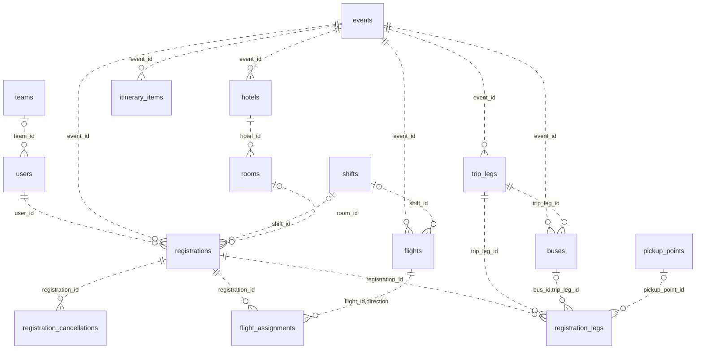

# CHƯƠNG 4 — PHẦN B. THIẾT KẾ CƠ SỞ DỮ LIỆU

## 4.7. Phạm vi lược đồ

Schema project có 27 bảng theo `ERD.MD`; báo cáo chỉ đặc tả sâu **12 bảng nghiệp vụ**: `events`, `users`, `registrations`, `registration_cancellations`, `flights`, `flight_assignments`, `trip_legs`, `buses`, `registration_legs`, `hotels`, `rooms`, `itinerary_items`. `teams`, `shifts`, `pickup_points` được nêu ngắn vì là danh mục/FK trực tiếp; `audit_logs` được nêu ngắn vì cần truy vết. Các bảng xác thực/email/chat/Gala không chép toàn bộ vào chương.

Đây là lược đồ **trích chọn**, không phải lời khẳng định ứng dụng chỉ có 12 bảng. Không xóa FK đang tham chiếu danh mục chỉ để giảm số hộp trên hình. `registration_legs` gộp nhu cầu/phân xe; `registrations.room_id` gán phòng. Không dùng `bus_assignments`, `room_assignments`, `consents` từ thiết kế cũ như bảng hiện hành.

## 4.8. Lựa chọn mô hình lưu trữ và chuẩn hóa

CSDL quan hệ phù hợp vì mỗi đăng ký gắn với người/kỳ và tài nguyên có định danh rõ. Khóa ngoại bảo vệ quan hệ; unique thể hiện quy tắc duy nhất; giao dịch bảo đảm xử lý hủy hoặc chuyển tài nguyên không dở dang. SQLite là lựa chọn hiện thực cho môi trường demo, không phải kết luận tốt nhất cho mọi quy mô.

### 4.8.1. Dạng chuẩn

- **1NF:** nhu cầu nhiều chặng được biểu diễn bằng các dòng `registration_legs`, không lưu danh sách bus trong một ô. Cột `_1…_4` là dấu hiệu nhóm lặp/thiết kế khó mở rộng, nhưng không nên kết luận tự động vi phạm 1NF nếu các giá trị vẫn nguyên tử mà chưa xét định nghĩa/phụ thuộc.
- **2NF:** xét bảng nhu cầu theo khóa ứng viên `(registration_id,trip_leg_id)`, lựa chọn/xe được gán thuộc cả cặp; tên chặng thuộc TripLeg nên không sao chép vào nhu cầu. Với khóa thay thế `id`, vẫn phải xét khóa ứng viên, không mặc định chứng minh 2NF chỉ vì có một cột PK.
- **3NF:** địa chỉ khách sạn phụ thuộc khách sạn, không lưu lặp trên từng đăng ký; họ tên/email thuộc người dùng, không nhân bản trong mỗi phân bổ. Cần tránh phụ thuộc bắc cầu trong nhóm dữ liệu nghiệp vụ.

Thiết kế hướng tới chuẩn hóa các quan hệ cốt lõi. Không tuyên bố toàn schema 27 bảng đạt 3NF vì còn JSON cấu hình, các trường snapshot và tham chiếu mềm phục vụ hiện thực; chưa có phân tích phụ thuộc hàm đầy đủ cho toàn bộ schema.

### 4.8.2. Kế thừa và ánh xạ lớp

Actor CBNV/BTC/Quản trị được biểu diễn bằng `users.role`; không tạo bảng con chỉ vì UML actor có tổng quát hóa. Lớp `HanhTrinh` là DTO/projection đọc, không có bảng riêng. Lớp control/boundary/DAM không trở thành bảng dữ liệu.

| Lớp lĩnh vực | Bảng hiện hành | Cách ánh xạ |
|---|---|---|
| Kỳ du lịch | `events` | Một dòng/kỳ; settings theo kỳ. |
| Người dùng | `users` | Tài khoản và hồ sơ gộp; role là thuộc tính. |
| Đăng ký | `registrations` | Cặp kỳ/người duy nhất; phòng hiện tại tại đây. |
| Yêu cầu hủy | `registration_cancellations` | Nhiều lần lịch sử cho một đăng ký; chỉ một pending. |
| Chuyến / phân bay | `flights`, `flight_assignments` | Tách tài nguyên và kết quả gán theo chiều. |
| Chặng / xe / nhu cầu | `trip_legs`, `buses`, `registration_legs` | Nhu cầu và bus hiện tại gộp theo chặng. |
| Khách sạn / phòng | `hotels`, `rooms` | Hotel 1–N Room; Registration tham chiếu Room. |
| Mục lịch trình | `itinerary_items` | Dòng hoạt động theo kỳ/ngày và audience. |

## 4.9. ERD nghiệp vụ trích chọn

*Hình 4.5. Quan hệ chính và danh mục tham chiếu.* Bội số xuất phát nullable/FK, không thể hiện mọi rule cùng kỳ/sức chứa. Một dòng FlightAssignment gắn đúng một chuyến; unique theo đăng ký/chiều được ghi riêng. Quan hệ leader của team là tham chiếu mềm nên không vẽ như FK cứng.

## 4.10. Đặc tả bảng cốt lõi

Các bảng dưới đây chọn trường quan trọng từ models, không chép mọi cột. `VARCHAR`/timestamp dạng chuỗi phản ánh khai báo SQLAlchemy hiện có; không tự đổi sang DATETIME mà mô tả là hiện thực. Thời gian timestamp dùng UTC ISO; ngày/giờ hiển thị theo quy ước giao diện.

### 4.10.1. `events`

| Trường | Kiểu/khóa | Ý nghĩa |
|---|---|---|
| id | INTEGER PK | Định danh kỳ. |
| code | VARCHAR(32) NN UQ | Mã kỳ không trùng. |
| name | VARCHAR(255) NN | Tên kỳ. |
| destination | VARCHAR(255), nullable | Điểm đến. |
| start_date, end_date | VARCHAR(10) NN | Ngày theo YYYY-MM-DD. |
| status | VARCHAR(32) NN | Trạng thái vòng đời được CHECK enum. |
| registration_opens_at, registration_closes_at | VARCHAR(32), nullable | Cửa sổ đăng ký. |
| terms_version, terms_content | VARCHAR(16) NN; TEXT nullable | Phiên bản và nội dung quy định. |
| is_active | BOOLEAN NN | Kỳ đang chọn mặc định; giới hạn active được kiểm service. |
| settings | JSON NN | Cấu hình phân bổ/thời gian theo kỳ. |

Các constraint thứ tự ngày và cửa sổ thời hạn được xử lý theo validation nghiệp vụ; không giả định tất cả là CHECK DB.

### 4.10.2. `users`

| Trường | Kiểu/khóa | Ý nghĩa |
|---|---|---|
| id | INTEGER PK | Định danh tài khoản/hồ sơ. |
| employee_code | VARCHAR(32) nullable UQ | Mã nhân viên. |
| email | VARCHAR(255) NN UQ | Tên đăng nhập. |
| password_hash | VARCHAR(255), nullable | Hash, không trả qua API và không dùng mật khẩu rõ. |
| full_name | VARCHAR(255) NN | Tên phục vụ tổ chức chuyến đi. |
| role | VARCHAR(32) NN | employee/team_leader/admin/super_admin. |
| team_id | INTEGER nullable FK | Danh mục nhóm. |
| gender, date_of_birth | VARCHAR(16), VARCHAR(10), nullable | Phục vụ hồ sơ và chính sách phòng/vé. |
| is_active | BOOLEAN NN | Có thể thao tác hay không. |

Các cột CCCD, địa chỉ, sức khỏe và liên hệ khẩn cấp có trong hồ sơ hiện thực nhưng không đưa dữ liệu thật vào báo cáo. Số CCCD cần giữ kiểu chuỗi vì có thể có số 0 đầu.

### 4.10.3. `registrations`

| Trường | Kiểu/khóa | Ý nghĩa |
|---|---|---|
| id | INTEGER PK | Đăng ký một người trong kỳ. |
| event_id, user_id | INTEGER NN FK | Kỳ và người; UQ ghép `(event_id,user_id)`. |
| is_participating | BOOLEAN NN | Tham gia hay không. |
| not_participating_reason | VARCHAR(512), nullable | Lý do không tham gia. |
| shift_id | INTEGER nullable FK | Ca mong muốn. |
| is_shift_locked | BOOLEAN NN | Ngoại lệ bắt buộc theo ca. |
| status | VARCHAR(16) NN | draft/submitted/cancelled. |
| submitted_at | VARCHAR(32), nullable | Thời điểm gửi. |
| consent_version, consented_at | VARCHAR(16), VARCHAR(32), nullable | Bằng chứng đồng ý quy định. |
| room_id | INTEGER nullable FK | Phòng hiện tại. |
| room_mode, room_assigned_by, room_assigned_at | VARCHAR(16), INTEGER FK, VARCHAR(32), nullable | Cách/người/thời điểm gán phòng. |
| is_room_captain | BOOLEAN NN | Người phụ trách phòng, phải có room nếu true. |

CHECK đảm bảo cặp consent version/time cùng null hoặc cùng có giá trị; không dùng bảng `consents` riêng. CHECK phòng có captain cần có room; giới hạn tổng người/phòng kiểm ở service.

### 4.10.4. `registration_cancellations`

| Trường | Kiểu/khóa | Ý nghĩa |
|---|---|---|
| id | INTEGER PK | Một lần yêu cầu/quyết định hủy. |
| event_id, registration_id, user_id | INTEGER NN FK | Phạm vi và chủ thể. |
| mode, status | VARCHAR(16) NN | Hình thức hủy và trạng thái xử lý. |
| reason | VARCHAR(512) NN | Lý do gửi. |
| event_status, requested_at | VARCHAR(32) NN | Snapshot giai đoạn và thời điểm gửi. |
| after_deadline | BOOLEAN NN | Ghi nhận sau hạn. |
| decided_by, decided_at | INTEGER FK, VARCHAR(32), nullable | Người/thời điểm xét. |
| decision_note | VARCHAR(1000), nullable | Ghi chú quyết định. |
| penalty_applied, penalty_note | BOOLEAN NN; VARCHAR(512) nullable | Quyết định chính sách, không phải giao dịch tiền. |
| released_items | TEXT nullable | Snapshot JSON tài nguyên đã giải phóng. |

Unique có điều kiện `registration_id WHERE status='pending'` chặn nhiều yêu cầu đang chờ, nhưng vẫn giữ nhiều lần lịch sử đã xử lý.

### 4.10.5. `flights`

| Trường | Kiểu/khóa | Ý nghĩa |
|---|---|---|
| id | INTEGER PK | Chuyến trong danh mục kỳ. |
| event_id | INTEGER NN FK | Kỳ sở hữu. |
| flight_code | VARCHAR(16) NN | Mã chuyến. |
| direction | VARCHAR(16) NN | outbound/return. |
| shift_id | INTEGER nullable FK | Ca. |
| departure_airport, arrival_airport | VARCHAR(8) NN | Mã sân bay. |
| departure_time, arrival_time | VARCHAR(32) NN | Thời điểm. |
| capacity, reserved_slots | INTEGER NN | Slot tổng và dự phòng. |

CHECK capacity/reserved không âm, reserved ≤ capacity. UQ `(event_id,flight_code,direction)` phân biệt chuyến theo kỳ/chiều; UQ `(id,direction)` hỗ trợ FK ghép trong phân bay.

### 4.10.6. `flight_assignments`

| Trường | Kiểu/khóa | Ý nghĩa |
|---|---|---|
| id | INTEGER PK | Định danh kết quả gán. |
| registration_id | INTEGER NN FK | Người trong kỳ. |
| flight_id, direction | INTEGER NN; VARCHAR(16) NN | FK ghép đến chuyến/chiều. |
| assignment_mode | VARCHAR(16) NN | auto/manual. |
| assigned_by | INTEGER nullable FK | Người gán; có thể null theo hiện thực. |
| assigned_at | VARCHAR(32) NN | Thời điểm gán. |
| seat_number, ticket_code | VARCHAR(8), VARCHAR(32), nullable | Thông tin được ghi khi có. |

UQ `(registration_id,direction)` bảo đảm tối đa một chuyến mỗi chiều. “Có đúng hai chuyến khi công bố” là rule hoàn thiện nghiệp vụ tùy nhu cầu, không suy ra từ unique.

### 4.10.7. `trip_legs`

| Trường | Kiểu/khóa | Ý nghĩa |
|---|---|---|
| id | INTEGER PK | Chặng. |
| event_id | INTEGER NN FK | Kỳ. |
| code, name | VARCHAR(32), VARCHAR(255) NN | Mã/tên chặng. |
| direction | VARCHAR(16) NN | Đi/về. |
| leg_date | VARCHAR(10), nullable | Ngày chặng. |
| is_airport_linked | BOOLEAN NN | Cần xét chuyến bay và thời gian. |

UQ `(event_id,code)`, CHECK direction. Không hard-code bốn chặng trong lược đồ.

### 4.10.8. `buses`

| Trường | Kiểu/khóa | Ý nghĩa |
|---|---|---|
| id | INTEGER PK | Xe phục vụ một chặng. |
| event_id, trip_leg_id | INTEGER NN FK | Kỳ/chặng. |
| bus_code | VARCHAR(32) NN | Mã xe trong chặng. |
| capacity | INTEGER NN | Số người tối đa, CHECK >0. |
| pickup_point_id | INTEGER nullable FK | Điểm đón. |
| departure_time, gather_time | VARCHAR(32), nullable | Giờ chạy/tập trung. |
| linked_flight_id | INTEGER nullable FK | Chuyến phục vụ nếu có. |
| leader_user_id | INTEGER nullable FK | Trưởng xe nội bộ. |

UQ `(event_id,trip_leg_id,bus_code)` và `(id,trip_leg_id)`. Một xe vật lý có thể được khai nhiều bản phục vụ các chặng khác nhau; không nhầm bản phục vụ chặng với hồ sơ phương tiện dùng toàn doanh nghiệp.

### 4.10.9. `registration_legs`

| Trường | Kiểu/khóa | Ý nghĩa |
|---|---|---|
| id | INTEGER PK | Dòng nhu cầu theo chặng. |
| registration_id | INTEGER NN FK | Đăng ký. |
| trip_leg_id | INTEGER NN FK | Chặng. |
| needs_bus | BOOLEAN NN | Cần xe hay tự đi. |
| pickup_point_id | INTEGER nullable FK | Điểm đón mong muốn. |
| bus_id | INTEGER nullable | Xe hiện tại; FK ghép với chặng. |
| assignment_mode | VARCHAR(16), nullable | auto/manual khi phân xe. |
| assigned_by, assigned_at | INTEGER FK, VARCHAR(32), nullable | Metadata gán. |

UQ `(registration_id,trip_leg_id)`. FK `(bus_id,trip_leg_id) → buses(id,trip_leg_id)` đảm bảo bus đúng chặng; bus null là chưa gán, không có nghĩa không cần xe. CHECK `bus_id IS NULL OR needs_bus = 1` chặn gán xe khi không có nhu cầu; CHECK mode cho phép null hoặc auto/manual. Models không có CHECK buộc tất cả metadata gán phải cùng có giá trị, nên không suy diễn thêm ràng buộc đó.

### 4.10.10. `hotels` và 4.10.11. `rooms`

| Bảng/trường | Kiểu/khóa | Ý nghĩa |
|---|---|---|
| hotels.id | INTEGER PK | Khách sạn theo kỳ. |
| hotels.event_id | INTEGER NN FK | Kỳ. |
| hotels.name | VARCHAR(255) NN | Tên. |
| hotels.address, phone | VARCHAR(512), VARCHAR(32), nullable | Địa chỉ/liên hệ. |
| hotels.check_in_at, check_out_at | VARCHAR(32), nullable | Thời điểm nhận/trả. |
| rooms.id | INTEGER PK | Phòng. |
| rooms.hotel_id | INTEGER NN FK | Khách sạn. |
| rooms.room_number | VARCHAR(32) NN | Số phòng, không bắt buộc thuần số. |
| rooms.capacity | INTEGER NN | Sức chứa, CHECK >0. |
| rooms.gender_policy | VARCHAR(16) NN | any/male/female. |

UQ phòng `(hotel_id,room_number)` tránh phòng trùng cùng khách sạn; không unique số phòng toàn hệ thống. Kỳ của phòng suy ra qua hotel, service phải kiểm phòng cùng kỳ đăng ký.

### 4.10.12. `itinerary_items`

| Trường | Kiểu/khóa | Ý nghĩa |
|---|---|---|
| id | INTEGER PK | Hoạt động lịch trình. |
| event_id | INTEGER NN FK | Kỳ. |
| day_date | VARCHAR(10) NN | Ngày. |
| start_time, end_time | VARCHAR(5), nullable | Giờ HH:MM. |
| title | VARCHAR(255) NN | Nội dung ngắn. |
| description | TEXT nullable | Chi tiết. |
| location | VARCHAR(255), nullable | Địa điểm. |
| audience | VARCHAR(32) NN | Đối tượng áp dụng. |
| trip_leg_id | INTEGER nullable FK | Mốc gắn chặng nếu có. |

Lịch trình chung không thay thế giờ bay/xe của từng người; hành trình phải tổng hợp dữ liệu phù hợp và tránh công bố thông tin không đúng đối tượng.

## 4.11. Danh mục tham chiếu và lịch sử

| Bảng | Khóa/quan hệ đáng chú ý |
|---|---|
| teams | `id`, code UQ, name; `users.team_id` FK; `leader_user_id` của team là tham chiếu mềm, không FK thật. |
| shifts | `id`, event_id FK, code/name; UQ theo kỳ/code. |
| pickup_points | `id`, event_id FK, trip_leg_id nullable FK, name/address; cùng kỳ và phù hợp nhu cầu kiểm service. |
| audit_logs | id, event_id/actor_id nullable FK, action, entity_type/entity_id, before_data/after_data, reason, created_at. Entity_id là tham chiếu mềm theo loại. |

Không vẽ đường FK cứng từ audit tới mọi bảng vì `entity_id` không có ràng buộc như vậy. Audit có giá trị theo thời điểm nên không cập nhật ngược nội dung lịch sử khi dữ liệu hiện tại đổi.

## 4.12. Chỉ mục, ràng buộc và chiến lược truy cập

Truy vấn thường lọc theo kỳ, đăng ký, chiều và chặng. Chỉ mục FK/unique giúp lấy dữ liệu hành trình và đếm phân bổ. Không thêm index cho mọi cột: mỗi index tăng chi phí ghi. Các thao tác ảnh hưởng sức chứa cần đọc occupancy và ghi kết quả trong transaction nhất quán.

Tầng DB bảo vệ định danh, liên kết và giá trị enum; tầng service bảo vệ quyền, trạng thái, cùng kỳ, giới hạn tổng và điều kiện giờ. Hai lớp bổ sung cho nhau. Tắt `PRAGMA foreign_keys` làm nhiều ràng buộc không được thực thi trong SQLite, vì vậy code bật nó trên mỗi connection. Migration phải chạy trước khi dùng schema mới; không chỉ dùng `create_all` để cập nhật một DB cũ.

## 4.13. Dữ liệu nhạy cảm và vòng đời lưu trữ

Chỉ bản thân người dùng và vai trò có nhiệm vụ mới đọc hồ sơ đầy đủ. Các projection danh sách/roommate/trưởng xe phải giới hạn trường theo nhu cầu. Export dữ liệu nhạy cảm cần kiểm role và ghi nhận phù hợp. Không đưa mật khẩu demo hay CCCD thật vào sơ đồ/bảng minh họa. Chính sách xóa/ẩn sau kỳ cần được tổ chức chốt; báo cáo chỉ đề xuất nguyên tắc tối thiểu và kiểm soát quyền, không khẳng định đã có tác vụ xóa tự động.