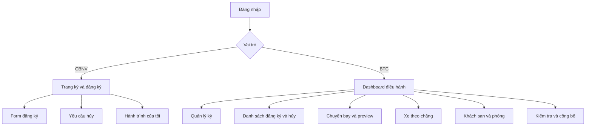

# CHƯƠNG 4 — PHẦN C. THIẾT KẾ GIAO DIỆN

## 4.14. Nguyên tắc thiết kế

Giao diện ưu tiên hai nhóm mục tiêu: CBNV nhập và tra cứu nhanh trên điện thoại; BTC xử lý danh sách và tài nguyên trên máy tính. Mỗi màn phải thể hiện kỳ đang chọn để tránh sửa nhầm kỳ. Trạng thái loading, chưa có dữ liệu, lỗi quyền và lỗi nghiệp vụ phải được phân biệt; một bảng trống không được dùng để thay thông báo không đủ quyền.

Thông tin chưa công bố phải có nhãn chờ rõ. Thao tác hủy/chuyển trạng thái/chuyển tài nguyên cần tóm tắt ảnh hưởng trước xác nhận. Khi server trả xung đột, UI tải lại dữ liệu, không tiếp tục hiển thị một phương án cũ như đã lưu.

## 4.15. Cấu trúc và điều hướng



*Hình 4.6. Phác điều hướng giao diện.* Có thể chuyển sang IFML khi cần: mỗi màn là view container, bảng/form là view component, thao tác là event/action và đường điều hướng thể hiện dữ liệu. Flowchart này không được gọi là IFML hoàn chỉnh.

## 4.16. Đặc tả màn hình theo ca sử dụng

### 4.16.1. UC-01 — Quản lý kỳ

**Dữ liệu:** mã/tên, điểm đến, ngày, thời hạn, quy định, trạng thái. **Điều khiển:** tạo, sửa, mở/đóng, chuyển giai đoạn. **Validation:** ngày bắt đầu/kết thúc, mã trùng, cửa sổ đăng ký; server quyết định transition.

```text
+--------------------------------------------------------+
| QUẢN LÝ KỲ                         Kỳ đang chọn: TB2026 |
| Tên kỳ      [                                          ]|
| Điểm đến    [                                          ]|
| Ngày đi     [dd/mm/yyyy]  Ngày về [dd/mm/yyyy]            |
| Đăng ký từ  [ngày giờ]    đến     [ngày giờ]              |
| Trạng thái: NHÁP                                        |
| Quy định / phiên bản [                                  ]|
| [Lưu cấu hình]               [Mở đăng ký]                |
+--------------------------------------------------------+
```

Lùi trạng thái có hộp xác nhận mô tả ảnh hưởng. Quy định hạn chế sửa khi diễn ra/kết thúc được thể hiện bằng trạng thái read-only và giải thích, nhưng API vẫn phải kiểm lại.

### 4.16.2. UC-02 — Đăng ký nhiều bước

Form gồm: thông tin người dùng → quy định → ca/điểm đi → nhu cầu xe theo chặng → xác nhận. Các chặng lấy từ dữ liệu kỳ, không đặt bốn checkbox cố định trong thiết kế.

```text
+------------------------------------------------------+
| ĐĂNG KÝ THAM GIA — kỳ hiện tại                        |
| Bước 1 Hồ sơ > 2 Quy định > 3 Ca > 4 Xe > 5 Xác nhận  |
| Tham gia: (●) Có  ( ) Không                           |
| Ca mong muốn [v]                                     |
| Chặng Thành phố → Sân bay:  [x] Cần xe                |
| Điểm đón [v]                                         |
| Chặng Sân bay → Khách sạn: [x] Cần xe                 |
| Ghi chú [                                           ]|
| [Quay lại]                                [Tiếp tục] |
+------------------------------------------------------+
```

**Luồng lỗi:** lỗi chỉ trường; không mất các lựa chọn hợp lệ; nếu kỳ đóng khi gửi, thông báo giai đoạn mới và chuyển về chế độ xem. Màn cuối nêu ca là nguyện vọng, không cam kết vé. Consent lưu version người dùng đã đọc, không chỉ checkbox trên UI.

### 4.16.3. UC-03 — Hủy và xét hủy

CBNV thấy trạng thái hiện tại, cảnh báo ảnh hưởng, ô lý do và nút gửi. BTC thấy tab pending/đã xử lý, tên/mã người, lý do, giai đoạn, phân bổ đang giữ và quyết định.

```text
+-----------------------------------------------------+
| XỬ LÝ YÊU CẦU HỦY                                   |
| Người gửi: NV001    Trạng thái: Chờ duyệt             |
| Lý do: ...                                          |
| Chỗ đang cấp: Bay đi/về; xe; phòng                   |
| Quyết định chính sách phí phạt: [ ] áp dụng          |
| Ghi chú [                                         ] |
| [Từ chối]                          [Chấp thuận hủy]  |
+-----------------------------------------------------+
```

Nút quyết định vô hiệu khi đã xử lý; double click vẫn phải được server chặn. Từ chối không xóa chỗ; UI phải mô tả đúng hai kết quả khác nhau.

### 4.16.4. UC-04 — Phân chuyến bay

Màn có bộ lọc kỳ/chiều, tổng nhu cầu/slot, bảng chuyến và vùng preview. Mỗi dòng chuyến có mã, ca, giờ, số chỗ khả dụng/đã xếp. Danh sách cảnh báo hiển thị người chưa xếp, team bị tách, lệch ca. Chuyển người thủ công mở chi tiết nguồn/đích và lý do tùy quy tắc.

```text
+--------------------------------------------------------+
| PHÂN BAY  Kỳ [v]  Chiều [Đi v]                          |
| Nhu cầu: ...   Slot: ...   Chưa xếp: ...                 |
| Chuyến | Ca | Giờ | Khả dụng | Đã xếp | Còn             |
| ...                                                    |
| [Xem trước]     [Điều chỉnh]          [Xác nhận lưu]     |
| PREVIEW — chưa lưu                                     |
| Cảnh báo: thiếu slot / tách team / nguyện vọng chưa đạt  |
+--------------------------------------------------------+
```

Không để nút Xác nhận khi chưa có preview hợp lệ. Nếu nguồn đổi, yêu cầu chạy lại; không đánh dấu thành công trước phản hồi commit.

### 4.16.5. UC-05 — Xe theo chặng

Hiển thị chặng, điểm đón, xe/sức chứa, giờ tập trung/chạy, chuyến bay phục vụ và trưởng xe. Lọc người cần xe nhưng chưa xếp riêng với người tự di chuyển. Điều chỉnh thủ công kiểm xe còn chỗ và cùng chặng; cảnh báo thời gian có vị trí rõ cạnh xe hoặc người bị ảnh hưởng.

### 4.16.6. UC-06 — Khách sạn/phòng

Hiển thị khách sạn, phòng, sức chứa, chính sách và người đang ở. Số giường trống tổng và theo policy cần phân biệt. Chuyển người giữ phòng cũ đến khi server xác nhận phòng mới thành công. Ghi chú sức khỏe không hiển thị rộng trên bảng tổng quan; chỉ người có nhiệm vụ được xem.

### 4.16.7. UC-07 — Hành trình cá nhân và công bố

```text
+----------------------------------------------+
| HÀNH TRÌNH CỦA TÔI — Kỳ đang chọn             |
| Trạng thái tham gia / cập nhật                |
| BAY ĐI  : Mã, giờ, sân bay                     |
| XE      : Chặng, điểm đón, giờ tập trung       |
| LƯU TRÚ : Khách sạn, số phòng                  |
| BAY VỀ  : Mã, giờ, sân bay                     |
| LỊCH TRÌNH: các hoạt động phù hợp              |
+----------------------------------------------+
```

Trước công bố thay vùng kết quả bằng “Đang chờ BTC công bố”, không trả rồi chỉ ẩn bằng CSS. Khi đã hủy, hiển thị trạng thái hủy thay vì chỗ cũ. Màn BTC công bố hiển thị checklist và lỗi chặn; phạm vi báo cáo không cấu hình Gala nên không thêm checklist Gala vào mô hình tinh giản. Bản phần mềm đầy đủ có thể có điều kiện khác nếu kỳ bật module đó.

## 4.17. Kịch bản nguyên mẫu xuyên suốt

**Dữ liệu minh họa giả lập:** kỳ K1 có hai chuyến đi F1/F2, chặng L1, hai xe B1/B2 và phòng R1/R2. Nhân viên N1 đăng ký tham gia và cần xe L1. BTC đóng đăng ký, chạy preview rồi xác nhận F1, B1, R1. Sau công bố, N1 thấy đúng các thông tin đó. N1 xin hủy; khi pending, chỗ vẫn còn giữ. BTC duyệt, N1 thấy trạng thái hủy; số người của F1/B1/R1 giảm tương ứng.

Kịch bản kiểm tra mối liên hệ giữa các màn, không phải các ảnh độc lập. Các ID này là dữ liệu minh họa, không phải kết quả vận hành thật. Khi chụp ảnh demo phải dùng bộ seed hoặc dữ liệu test và ghi rõ trạng thái trước/sau.

## 4.18. Kiểm tra chất lượng giao diện

Kiểm trên màn hình nhỏ và desktop; các nút quan trọng không bị che; lỗi có văn bản không chỉ màu; thao tác được bằng bàn phím; bảng lớn có lọc/scroll; ngày giờ thống nhất. Cache phải được invalidation sau ghi/hủy để dashboard và hành trình không hiện số cũ. Bảo mật cần kiểm server, không được chứng minh bằng ảnh một nút bị ẩn.