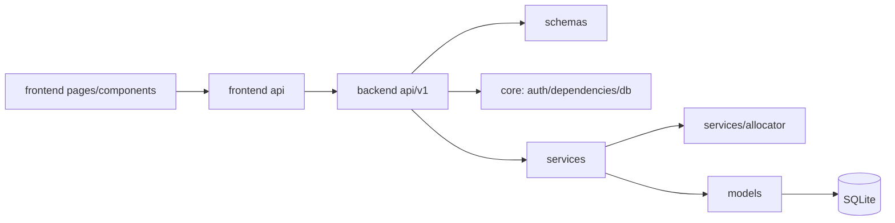
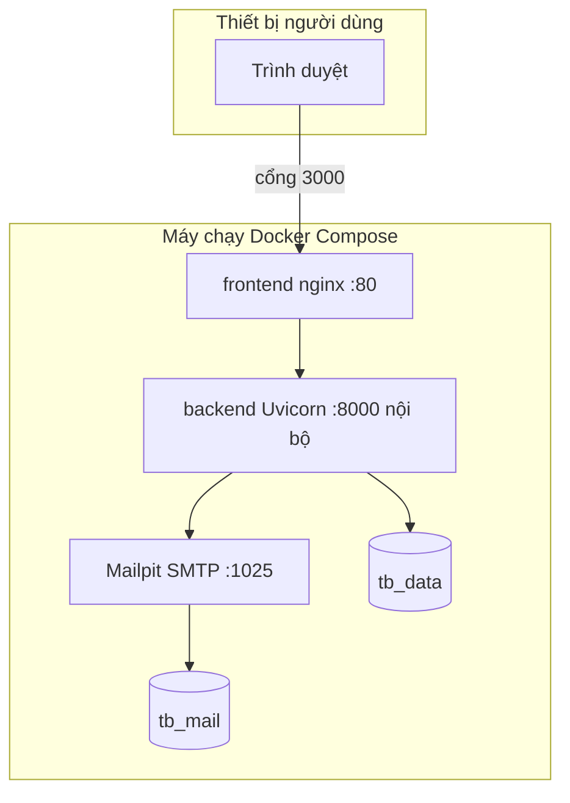

# CHƯƠNG 5. THỰC HIỆN VÀ TRIỂN KHAI

## 5.1. Công nghệ và thành phần hiện thực

Project tham khảo sử dụng React/Vite cho frontend, FastAPI cho API, SQLAlchemy cho mô hình/truy vấn và SQLite cho dữ liệu quan hệ. Alembic quản lý thay đổi schema. Docker Compose đóng gói frontend, backend và Mailpit phục vụ thử email. Phạm vi báo cáo không phân tích AI/Gala, nhưng source đầy đủ vẫn có các module đó; không yêu cầu xóa chúng để viết báo cáo thu gọn.

| Thành phần | Công nghệ xác nhận trong repo | Vai trò |
|---|---|---|
| Frontend | React 19, Vite 8, Tailwind CSS 4 | SPA, form và màn điều hành. |
| Điều hướng/dữ liệu UI | React Router, TanStack Query, Axios | Navigation, API, cache và refresh. |
| Form | React Hook Form, Zod | Kiểm tra và hiển thị lỗi đầu vào. |
| Backend | FastAPI, Python ≥3.13 | API, dependency và dịch vụ nghiệp vụ. |
| ORM | SQLAlchemy 2, Alembic | Quan hệ, constraint, migration. |
| DB | SQLite, WAL | Lưu dữ liệu và transaction. |
| Triển khai | Docker Compose, nginx, Uvicorn | Phục vụ web/proxy/API. |
| Kiểm thử | pytest; frontend lint/build/render-check | Xác nhận chức năng và chất lượng mã. |

## 5.2. Cấu trúc mã nguồn và biểu đồ gói

Backend chia `api`, `schemas`, `services`, `models`, `core`; frontend chia API client, pages, components, hooks/routes và utils. Phân tách này thể hiện trách nhiệm: API không chứa toàn bộ thuật toán; service không import ngược API; models không quyết định quyền giao diện.



*Hình 5.1. Phác Package Diagram hiện thực.* Khi vẽ UML package, dùng ký pháp package và dependency; không gọi đây là class diagram.

### 5.2.1. Ánh xạ UC sang mã nguồn

| UC | API/module | Service trọng tâm |
|---|---|---|
| UC-01 | `events.py` | `event_service.py` |
| UC-02 | `registrations.py` | `registration_service.py` |
| UC-03 | `cancellations.py` | `cancellation_service.py` |
| UC-04 | `flights.py`, `flight_assignments.py` | `flight_allocation_service.py`, `flight_service.py`, allocator |
| UC-05 | `buses.py`, `bus_assignments.py` | `bus_service.py`, `transport_timing_service.py` |
| UC-06 | `rooms.py`, `room_assignments.py`, `hotels.py` | `accommodation_service.py`, `room_allocation_service.py` |
| UC-07 | `journey.py`, `events.py` | `journey_service.py`, `event_service.py` |

Tên router `bus_assignments.py`/`room_assignments.py` là giao diện nghiệp vụ, **không chứng minh có bảng SQL cùng tên**. Schema hiện hành lưu xe trên `registration_legs` và phòng trên `registrations`.

## 5.3. Giao tiếp API đại diện

API có prefix `/api/v1`. Quyền/current user lấy từ phiên và dependency; kỳ được chọn qua cơ chế ActiveEvent. CBNV không tự truyền một user_id bất kỳ để đọc hành trình.

| API đã đối chiếu | Mục tiêu |
|---|---|
| `GET /api/v1/registrations/me` | Đăng ký của chính người dùng. |
| `POST /api/v1/registrations` | Gửi đăng ký theo payload. |
| `PATCH /api/v1/registrations/me` | Sửa đăng ký của mình theo quy tắc. |
| `GET /api/v1/flights/summary` | BTC xem nhu cầu và slot. |
| `POST /api/v1/flights/allocate` | Dry-run hoặc ghi thật theo payload. |
| `GET /api/v1/journey/me` | Hành trình của user từ JWT. |
| `GET /api/v1/journey/{user_id}` | BTC tra cứu hộ, được kiểm admin. |

Không chép tất cả endpoint vào thân báo cáo. Khi demo, kiểm OpenAPI và code để chọn payload đúng phiên bản. Chức năng xuất PDF hành trình được comment là chưa làm trong router hiện hành, nên không coi là kết quả đã hoàn thành.

## 5.4. Môi trường triển khai

Compose chính tạo ba dịch vụ: frontend nginx mở web cổng mặc định 3000, backend không publish trực tiếp ra ngoài, Mailpit UI ở localhost 8025. Volume `tb_data` giữ SQLite/uploads và dữ liệu ứng dụng; `tb_mail` giữ email demo. Việc khởi động lại không mặc định xóa dữ liệu.



*Hình 5.2. Phác Deployment Diagram.* Khối container/node cần vẽ lại đúng ký pháp nếu môn yêu cầu UML Deployment.

## 5.5. Quy trình cấu hình và chạy demo

Chạy các lệnh dưới đây từ `D:/QLDuLich` trên PowerShell sau khi Docker Desktop đã chạy. Không cần nhập khóa AI cho phạm vi báo cáo. **Compose hiện tại bắt buộc `JWT_SECRET_KEY`**, khác hướng dẫn cũ trong README có thể nói không cần `.env`.

```powershell
Set-Location 'D:/QLDuLich'
Copy-Item '.env.example' '.env'
$secret = node -e "console.log(require('node:crypto').randomBytes(48).toString('base64url'))"
$envText = Get-Content -Raw '.env'
$envText = $envText -replace '(?m)^JWT_SECRET_KEY=.*$', "JWT_SECRET_KEY=$secret"
Set-Content -Path '.env' -Value $envText -Encoding utf8
docker compose up -d --build
docker compose ps
```

Lệnh Copy-Item ở trên dành cho lần tạo mới; không chạy lại để ghi đè cấu hình `.env` đã có. Secret tạo ngẫu nhiên và `.env` không commit. Sau khi dịch vụ healthy, mở web và hộp thư demo. Kiểm log khi migration/seed thất bại, không sửa DB trực tiếp để bỏ qua ràng buộc.

```powershell
docker compose logs --tail 100 backend
docker compose logs --tail 100 frontend
```

## 5.6. Migration, dữ liệu mẫu và vòng đời dữ liệu

Startup có cơ chế migration/seed theo cấu hình compose. Dữ liệu mẫu tạo nhiều kỳ và các trường hợp chưa đăng ký để thực hiện luồng test; đây không phải dữ liệu doanh nghiệp thật. Không sử dụng lệnh reset trong quá trình đánh giá cần giữ lịch sử. `docker compose down` dừng container nhưng giữ volume; `down -v` xóa dữ liệu và không dùng như thao tác vận hành thông thường.

SQLite WAL cần cách backup phù hợp; không coi việc chép một file DB đang ghi là bản sao luôn nhất quán. Quy trình restore phải được thử trên môi trường riêng và đối chiếu FK, số bản ghi, trạng thái kỳ và liên kết phân bổ. Không đưa khóa bí mật hay file chứa hồ sơ cá nhân vào phụ lục công khai.

## 5.7. Hiện thực so với mô hình báo cáo

Các service/router/models đã được xác nhận tồn tại bằng đọc source; đây là bằng chứng cấu trúc, không thay bằng chứng chạy end-to-end. Báo cáo thu gọn giả định quy trình thông thường; code có thể xử lý thêm ngoại lệ như đăng ký lại sau hủy ở một số giai đoạn. Các lớp Repository/DAM là thiết kế đề xuất, trong khi code hiện dùng Session/models trực tiếp. Các khác biệt được ghi rõ để không biến mô hình học thuật thành mô tả sai hiện thực.